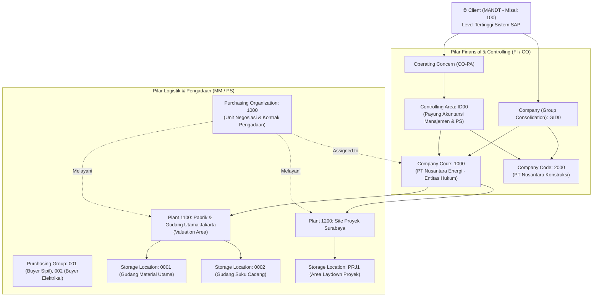
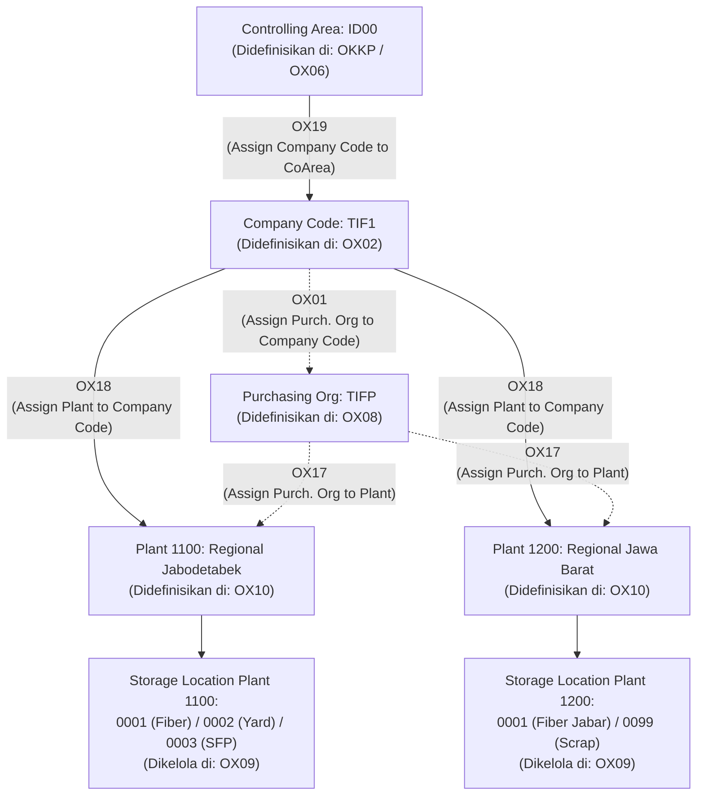

# Modul 01: Arsitektur SAP, Enterprise Structure, & Master Data Terpadu (MM • PS • FI)

> **Tujuan Pembelajaran:**
> 1. Memahami perbedaan fundamental arsitektur **SAP ECC 6.0** dan **SAP S/4HANA** pada tingkat basis data dan proses bisnis.
> 2. Menguasai desain **Enterprise Structure (Struktur Organisasi)** lintas modul FI, CO/PS, dan MM beserta jalur konfigurasi **SPRO (IMG)**.
> 3. Memahami **Master Data Inti** (G/L Account, Business Partner, Material Master, dan WBS Element) serta field-field kritis yang mengendalikan integrasi otomatis antar-modul.

---

## 1. Evolusi Arsitektur: SAP ECC 6.0 vs SAP S/4HANA

Memahami perbedaan antara SAP ECC 6.0 dan SAP S/4HANA sangat penting karena di lapangan (perusahaan korporasi/BUMN/multinasional), Anda akan menemukan perusahaan yang masih menggunakan ECC maupun yang sudah bermigrasi ke S/4HANA.
**Cakupan:** Contoh GUI/IMG terutama untuk ECC 6.0 dan S/4HANA on-premise/private edition. Public Cloud memakai aplikasi dan konfigurasi yang dirilis untuk edisinya; ketersediaan transaksi, tabel, dan akses langsung tidak diasumsikan sama. Semua kode organisasi, akun, perusahaan, dan angka di sini adalah contoh fiktif.

### 1.1 Perbandingan Arsitektur Teknis & Tabel Database

| Dimensi | SAP ERP Central Component (ECC 6.0) | SAP S/4HANA (Business Suite 4 SAP HANA) |
| :--- | :--- | :--- |
| **Database Engine** | ECC dapat berjalan pada beberapa database yang didukung, termasuk SAP HANA. | SAP HANA. |
| **Antarmuka Pengguna (UI)** | SAP GUI; antarmuka lain bergantung instalasi. | Fiori dan, pada on-premise/private edition, transaksi GUI yang tersedia; Public Cloud memiliki cakupan aplikasi tersendiri. |
| **Master Vendor & Customer** | Vendor (`LFA1`/`LFB1`/`LFM1`) dan customer (`KNA1`) dikelola terpisah. | Business Partner adalah titik pemeliharaan utama; CVI mengintegrasikan data supplier/customer yang masih relevan. |
| **Tabel Akuntansi (FI & CO)** | Dokumen dan indeks FI/CO disimpan dalam beberapa tabel. | `ACDOCA` menyatukan banyak item jurnal FI/CO/AA/ML menurut ledger; `BKPF` dan `BSEG` tetap relevan. Tabel lama tertentu disajikan lewat compatibility view, bukan semuanya dihapus. |
| **Tabel Pergerakan Barang (MM)** | `MKPF` dan `MSEG` untuk dokumen material. | `MATDOC` menjadi penyimpanan utama dokumen material; akses lama dan agregasi stok bergantung pada mekanisme kompatibilitas dan rilis. |
| **Penilaian Material (Material Valuation)** | Material Ledger opsional. | Material Ledger wajib untuk valuasi material; **actual costing opsional**, bukan otomatis aktif. |
| **Integrasi CO Cost Element** | Cost element dikelola terpisah di CO. | Cost element dikelola sebagai tipe G/L account; ketersediaan transaksi lama bergantung rilis. |

Rujukan SAP Learning untuk S/4HANA: [Material Ledger dan actual costing](https://learning.sap.com/courses/product-cost-planning-in-sap-s-4hana/describing-material-ledger); [dokumen FI, BSEG dan Universal Journal](https://learning.sap.com/courses/configuring-additional-settings-in-financial-accounting-in-sap-s-4hana/executing-data-archiving-for-specific-fi-objects). Rujukan ini tidak menetapkan ketersediaan semua transaksi untuk setiap edisi.

### 1.2 Pintasan Navigasi Penting di SAP GUI (Command Field)

Saat bekerja di layar SAP GUI, kuasai prefiks perintah berikut pada *Command Field* (kotak input kiri atas):

* **`/n<TCODE>`**: Menutup transaksi saat ini dan langsung membuka T-Code baru di jendela yang sama (contoh: `/nME21N`).
* **`/o<TCODE>`**: Membuka transaksi pada sesi baru jika batas sesi sistem belum tercapai.
* **`/n`**: Keluar dari transaksi aktif kembali ke layar utama *SAP Easy Access*.
* **`/nend`**: Log off dari sistem SAP dengan konfirmasi penyimpanan.
* **`/nex`**: Log off paksa seketika tanpa konfirmasi (*hati-hati: data yang belum di-save akan hilang*).
* **`F1`**: Bantuan dokumentasi teknis pada field tempat kursor berada (klik ikon *Technical Information* / gambar palu-kunci untuk melihat **Nama Tabel & Nama Field** asli di database).
* **`F4`**: Membuka daftar pencarian nilai yang valid (*Search Help / Matchcode*).

---

## 2. Enterprise Structure (Struktur Organisasi SAP)

Sebelum satu pun transaksi dapat diposting di SAP, konsultan harus mendefinisikan **Enterprise Structure** di menu **SPRO** (*SAP Project Reference Object* $\rightarrow$ *SAP Customizing Implementation Guide / IMG*).



### 2.1 Daftar Elemen Organisasi & T-Code Konfigurasi SPRO

| Modul | Elemen Organisasi | Deskripsi & Fungsi Bisnis | Relasi Kardinalitas | T-Code / Jalur SPRO |
| :---: | :--- | :--- | :--- | :--- |
| **BASIS** | **Client (`MANDT`)** | Unit pemisahan data dan konfigurasi dalam sistem, bukan entitas hukum. Data tingkat client dapat digunakan lintas company code sesuai desain. | 1 Client : $N$ Company Code | `SCC4` |
| **FI** | **Company Code (`BUKRS`)** | Unit organisasi terkecil untuk laporan keuangan eksternal lengkap; dapat merepresentasikan entitas hukum. | 1 Company Code : $N$ Plant; setiap plant ditetapkan ke satu company code | `OX02` / `EC01` |
| **FI** | **Chart of Accounts (`KTOPL`)** | Daftar akun G/L untuk satu atau beberapa company code. | 1 operating CoA : $N$ Company Code | `OB13` / `OB62` |
| **CO / PS** | **Controlling Area (`KOKRS`)** | Unit akuntansi biaya internal dan proyek. | 1 controlling area dapat mencakup beberapa company code dengan operating CoA dan kesesuaian fiscal year variant yang disyaratkan. | `OKKP` / `OX19` |
| **MM / PS** | **Plant (`WERKS`)** | Unit operasional; menjadi valuation area bila level valuasi plant dipilih. | Setiap plant ditetapkan ke satu company code; satu company code dapat mempunyai banyak plant. | `OX10` / `OX18` / `OMWD` |
| **MM** | **Storage Location (`LGORT`)** | Unit penyimpanan di dalam plant; kuantitas stok tergantung jenis stok. | 1 Plant : $N$ Storage Location | `OX09` |
| **MM** | **Purchasing Organization (`EKORG`)** | Unit pengadaan dan negosiasi. | Dapat ditetapkan ke satu company code atau tidak ditetapkan untuk cross-company; beberapa purchasing organization dapat melayani company code/plant yang sama. | `OX08` / `OX01` / `OX17` |
| **MM** | **Purchasing Group (`EKGRP`)** | Kode individu pembeli (*buyer*) atau tim pengadaan (misal: `B01` Tim Buyer Mekanikal). **Tidak terikat** ke Company Code di SPRO, bersifat lintas organisasi. | Independen | `OME4` |

> **⚠️ Aturan Emas Konsultan (Valuation Level):**
> Level valuasi dipilih dalam konfigurasi: ECC dapat memakai company code atau plant sesuai skenario; pada S/4HANA gunakan plant sesuai prasyarat produk. Jika plant adalah valuation area, material yang sama dapat mempunyai harga berbeda pada dua plant. Jangan menganggap setiap plant selalu valuation area di semua instalasi ECC.

### 2.2 Kamus Detail Konfigurasi Enterprise: OX02, OX10, OX09, OX08 & Rantai Assignment

Keempat kode **`OX02`**, **`OX10`**, **`OX09`**, dan **`OX08`** adalah **T-Code pintasan SPRO IMG (*Customizing*)** untuk mendefinisikan (*Definition*) fondasi organisasi perusahaan di modul FI, MM, dan PS sebelum modul dapat digunakan untuk transaksi operasional.

#### 1. Tabel Ringkasan Kamus Definisi Enterprise

| Kode SPRO | Elemen Organisasi | Modul | Key Field & Tabel Database | Fungsi Bisnis Utama | Jalur Menu Konfigurasi SPRO (IMG) |
| :---: | :--- | :---: | :--- | :--- | :--- |
| **`OX02`** | **Company Code** | FI | `BUKRS`<br>*(Tabel `T001`)* | Mendefinisikan entitas hukum perusahaan terkecil yang wajib menyusun Neraca (*Balance Sheet*) dan Laba Rugi (*P&L*). | *Enterprise Structure $\rightarrow$ Definition $\rightarrow$ Financial Accounting $\rightarrow$ Edit, Copy, Delete, Check Company Code* |
| **`OX10`** | **Plant** | MM / PS | `WERKS`<br>*(Tabel `T001W`)* | Mendefinisikan unit operasional; juga valuation area jika level plant dipilih. | *Enterprise Structure $\rightarrow$ Definition $\rightarrow$ Logistics - General $\rightarrow$ Define, copy, delete, check plant* |
| **`OX09`** | **Storage Location** | MM-IM | `LGORT`<br>*(Tabel `T001L`)* | Mendefinisikan gudang penyimpanan fisik stok di dalam suatu Plant (pencatatan kuantitas fisik di tabel `MARD`). | *Enterprise Structure $\rightarrow$ Definition $\rightarrow$ Materials Management $\rightarrow$ Maintain storage location* |
| **`OX08`** | **Purchasing Organization** | MM-PUR | `EKORG`<br>*(Tabel `T024E`)* | Mendefinisikan unit pengadaan yang berwenang menegosiasikan kontrak, harga beli, dan menerbitkan PO ke vendor. | *Enterprise Structure $\rightarrow$ Definition $\rightarrow$ Materials Management $\rightarrow$ Maintain purchasing organization* |

#### 2. Bedah Parameter Kritis & Contoh Implementasi Telco (TIF / InfraNexia)

Untuk memahami penerapan di dunia kerja nyata (misal: industri penyedia infrastruktur telekomunikasi / fiber optik):

* **`OX02` — Define Company Code (`BUKRS`):**
  - **Fungsi:** Wadah pembukuan eksternal untuk transaksi dan master data yang relevan.
  - **Contoh input:** Company Code (`TIF1`), nama fiktif, kota, negara, mata uang, dan bahasa.
  - **Praktik:** Penyalinan template melalui `EC01` perlu ditinjau ulang; tidak menjamin semua konfigurasi lokal sudah benar.

* **`OX10` — Define Plant (`WERKS`):**
  - **Fungsi:** Pusat operasional logistik; menjadi valuation area jika dipilih dalam konfigurasi.
  - **Contoh input:** Plant Key, nama, alamat dan factory calendar sesuai konfigurasi.
  - **Dampak:** Calendar dapat mempengaruhi penjadwalan; hasil PO dan network juga bergantung kalender dan pengaturan objek terkait.

* **`OX09` — Maintain Storage Location (`LGORT`):**
  - **Fungsi:** Membagi Plant menjadi gudang-gudang fisik berdasarkan jenis material atau fungsi perlakuan stok. Konfigurasi `OX09` dibuat langsung menempel di bawah Plant induk tanpa perlu assignment terpisah.
  - **Contoh Pembagian Gudang Telco:**
    - `0001` — Gudang Utama Kabel Fiber Optik & Aksesori ODF.
    - `0002` — Open Yard Drum Kabel & Pipa Subduct.
    - `0003` — Gudang Perangkat Aktif & Suku Cadang Maintenance (SFP, OLT, Patch Cord).
    - `0099` — Gudang Karantina / Scrap / Material Bekas Bongkaran.
  - **Dampak Transaksi:** Plant dan storage location relevan untuk pergerakan stok yang memerlukannya; stok khusus seperti project stock tidak selalu direpresentasikan oleh `MARD-LABST`.

* **`OX08` — Maintain Purchasing Organization (`EKORG`):**
  - **Fungsi:** Entitas komersial pengadaan. Data master info record harga (`ME11`), kontrak payung (*Outline Agreement* `ME31K`), dan master vendor level purchasing (`LFM1`) terikat pada Purchasing Org ini.
  - **Field Input Wajib:** Purchasing Org Key (`TIFP` - Divisi Pengadaan Infrastruktur Jaringan).

#### 3. Rantai Assignment Wajib: Menghubungkan Organisasi Menjadi Satu Sistem

Mendefinisikan unit saja belum cukup. Konsultan **wajib** merajut unit-unit tersebut menggunakan T-Code **Assignment**:



| T-Code Assignment | Relasi Penghubung | Aturan Kardinalitas & Dampak Sistem |
| :---: | :--- | :--- |
| **`OX18`** | **Plant (`OX10`) $\rightarrow$ Company Code (`OX02`)** | Banyak plant dapat ditetapkan ke satu company code; setiap plant ke satu company code. Tidak semua mutasi stok menghasilkan jurnal FI. |
| **`OX01`** | **Purchasing Org (`OX08`) $\rightarrow$ Company Code (`OX02`)** | Menentukan apakah pengadaan bersifat *Company-Specific* (1 POrg untuk 1 CC) atau *Cross-Company* (POrg tidak di-assign ke CC, melainkan hanya ke Plant lintas perusahaan). |
| **`OX17`** | **Purchasing Org (`OX08`) $\rightarrow$ Plant (`OX10`)** | **Wajib.** Memberikan wewenang kepada Purchasing Org untuk membelikan barang/jasa bagi Plant tersebut di PO `ME21N`. |
| **`OX19`** | **Company Code (`OX02`) $\rightarrow$ Controlling Area (`OKKP`)** | **Wajib untuk PS & CO.** Mengintegrasikan pembukuan finansial dengan akuntansi biaya. Tanpa `OX19`, WBS Element (`CJ20N`) tidak bisa dibuat. |

#### 4. Jembatan Hafalan Cepat Konsultan
1. **`OX02` (Company Code):** *"Siapa badan hukum yang menyusun neraca dan membayar pajak?"* (Pilar **FI**)
2. **`OX10` (Plant):** *"Di area operasional mana fisik proyek dikerjakan & stok dinilai harganya?"* (Pilar **MM / PS**)
3. **`OX09` (Storage Location):** *"Di rak atau gudang mana drum kabel optik disimpan?"* (Pilar **MM-IM**)
4. **`OX08` (Purchasing Org):** *"Unit mana yang berwenang menawar harga dan menerbitkan PO resmi?"* (Pilar **MM-PUR**)

---

## 3. Master Data Inti Lintas Modul

Dalam sistem ERP terintegrasi, **Master Data yang salah akan menghasilkan jurnal akuntansi yang salah**. Berikut adalah empat Master Data paling krusial yang menghubungkan MM, PS, dan FI:

---

### 3.1 Master Data 1: General Ledger (G/L) Account (`FS00`)

G/L Account adalah muara dari seluruh transaksi keuangan di SAP. Di S/4HANA, `FS00` menggabungkan akun FI dan Cost Element CO dalam satu layar.

#### Struktur 2 Segmen di `FS00`:
1. **Chart of Accounts Segment (Level Client - Tabel `SKA1`):**
   - **G/L Account Number & Short/Long Text:** Nomor dan nama akun.
   - **G/L Account Type (Khusus S/4HANA):**
     - `X` — *Balance Sheet Account* (Akun Neraca: Kas, Bank, Persediaan, Hutang, Aset).
     - `N` — *Non-Operating Expense or Income* (Biaya/Pendapatan di luar operasi, tidak masuk CO).
     - `P` — *Primary Costs or Revenue* (Biaya/Pendapatan operasional yang **wajib** memiliki objek biaya CO seperti Cost Center atau **WBS Element PS**!).
     - `S` — *Secondary Costs* (Akun alokasi internal CO/PS seperti *Assessment* atau *Settlement*).
   - **Account Group (`OBD4`):** Mengelompokkan rentang nomor akun (misal: `100000-199999` Aset, `200000-299999` Kewajiban).

2. **Company Code Segment (Level Company Code - Tabel `SKB1`):**
   - **Account Currency:** Mata uang akun. Jika diisi mata uang lokal (`IDR`), akun dapat menerima posting dalam mata uang asing apa saja (`USD`, `EUR`). Jika diisi mata uang spesifik (`USD`), akun hanya bisa menerima posting dalam `USD`.
   - **Reconciliation Account for Account Type:**
     - Diisi `K` (*Vendors*) untuk akun Hutang Dagang, `D` (*Customers*) untuk Piutang Dagang, atau `A` (*Assets*) untuk Akun Aset Tetap.
     - **Prinsip Penting:** Akun Rekonsiliasi **TIDAK BISA dijurnal langsung secara manual** di `FB50`/`F-02`. Akun ini hanya bergerak otomatis ketika sub-ledger (Vendor/Customer/Asset) diposting!
   - **Open Item Management (OIM):** Dipakai untuk akun clearing yang perlu dicocokkan, sesuai desain akun dan konfigurasi.
   - **Field Status Group (`OBC4`):** Mengatur field wajib, opsional, atau tersembunyi; isi grup bergantung konfigurasi.
   - **Post Automatically Only:** Dapat digunakan untuk membatasi posting manual pada akun integrasi sesuai desain kontrol perusahaan.

---

### 3.2 Master Data 2: Business Partner — Vendor / Supplier (`BP` / `XK01`)

Di S/4HANA, transaksi lama `XK01`/`FK01`/`MK01` telah digantikan oleh satu transaksi tunggal: **`BP` (Maintain Business Partner)**.

#### 3 Peran Utama (BP Roles) untuk Vendor/Pemasok:
```text
┌────────────────────────────────────────────────────────────────────────────┐
│                        BUSINESS PARTNER (Nomor: 100024)                    │
│                        Nama: PT Baja Konstruksi Utama                      │
├───────────────────────┬──────────────────────────┬─────────────────────────┤
│ 1. Role: 000000       │ 2. Role: FLVN00          │ 3. Role: FLVN01         │
│ (General Data)        │ (FI Vendor - CoCode)     │ (MM Purchasing - POrg)  │
├───────────────────────┼──────────────────────────┼─────────────────────────┤
│ • Nama & Alamat Resmi │ • Reconciliation Account │ • Order Currency (IDR)  │
│ • NPWP / Tax Number   │   (misal: 210010 Hutang) │ • Payment Terms (ZB01)  │
│ • Rekening Bank Vendor│ • Payment Terms FI       │ • Incoterms (CIF/FOB)   │
│   (IBAN / Swift)      │ • Withholding Tax (PPh)  │ • Schema Group Vendor   │
│                       │ • Check Double Invoice   │ • **GR-Based IV** (Cek) │
├───────────────────────┼──────────────────────────┼─────────────────────────┤
│ Tabel: BUT000 / LFA1  │ Tabel: LFB1              │ Tabel: LFM1             │
└───────────────────────┴──────────────────────────┴─────────────────────────┘
```

* **Field Kritis Integrasi MM-FI pada BP:**
  1. **Reconciliation Account (`LFB1-AKONT`):** Menghubungkan nomor kode vendor (`100024`) dengan akun Buku Besar Hutang Usaha (`210010`) di Neraca FI.
  2. **Check Double Invoice (`LFB1-REPRF`):** Mengaktifkan pemeriksaan faktur ganda menurut kriteria dan konfigurasi transaksi; hasil dapat berupa pesan/blokir, bukan jaminan semua duplikasi tercegah.
  3. **GR-Based Invoice Verification:** Indikator supplier/PO item dan konfigurasi menghubungkan verifikasi ke penerimaan relevan; periksa item PO, toleransi dan kasus khusus sebelum menyimpulkan faktur pasti ditolak.
Untuk customer, role FI `FLCU00` dan sales `FLCU01` melengkapi data umum BP sesuai kebutuhan; CVI menyelaraskan objek supplier/customer. Role, otorisasi dan aplikasi tersedia bergantung edisi.

---

### 3.3 Master Data 3: Material Master (`MM01` / `MM02` / `MM03`)

Material Master adalah jantung dari modul logistik dan pabrik. Data material dibagi menjadi beberapa tampilan (*Views*) sesuai departemen yang bertanggung jawab.

#### A. Jenis Material Standar (Material Types - T-Code `OMS2`)

Tabel berikut contoh konfigurasi lazim, bukan aturan universal: quantity/value updating dapat berbeda menurut material type dan valuation area.

| Kode | Nama Standar | Karakteristik Stok (Quantity Updating) | Karakteristik Nilai (Value Updating) | Contoh Penggunaan |
| :---: | :--- | :---: | :---: | :--- |
| **`ROH`** | Raw Materials (Bahan Baku) | ✅ Ya | ✅ Ya | Bijih besi, plat baja, bahan kimia produksi. |
| **`ERSA`** | Spare Parts (Suku Cadang) | ✅ Ya | ✅ Ya | Bearing mesin, filter oli, trafo cadangan. |
| **`HALB`** | Semi-Finished Goods | ✅ Ya | ✅ Ya | Rangka baja setengah jadi. |
| **`FERT`** | Finished Products (Barang Jadi) | ✅ Ya | ✅ Ya | Produk akhir siap jual ke pelanggan. |
| **`HAWA`** | Trading Goods (Barang Dagangan) | ✅ Ya | ✅ Ya | Barang yang dibeli untuk langsung dijual kembali. |
| **`NLAG`** | Non-Stock Materials | ❌ Tidak | ❌ Tidak | Alat tulis kantor (ATK), konsumsi langsung saat beli. |
| **`UNBW`** | Non-Valuated Materials | ✅ Ya (Kuantitas dicatat di gudang) | ❌ Tidak (Langsung dibiayakan saat beli) | Barang promosi, seragam kerja, material nilai rendah. |
| **`DIEN`** | Services (Jasa) | ❌ Tidak | ❌ Tidak | Jasa instalasi, jasa konsultansi proyek. |

#### B. Struktur Views pada Material Master & Field Kritisnya

1. **Basic Data 1 & 2 (Level Client - Tabel `MARA`):**
   - *Base Unit of Measure* (`MEINS`: PC, KG, TON, M), *Material Group* (`MATKL` — pengelompokan komoditas barang), dimensi & berat.
2. **Purchasing View (Level Plant - Tabel `MARC`):**
   - *Purchasing Group* (`EKGRP`), *Order Unit*, *Purchasing Value Key* (mengatur toleransi pengiriman kurang/lebih dan pengingat vendor), *Automatic PO* (izinkan pembuatan PO otomatis via `ME59N`).
3. **MRP 1, 2, 3, 4 Views (Level Plant - Tabel `MARC`):**
   - *MRP Type* (`PD` MRP reguler, `VB` Reorder Point manual, `ND` No Planning), *Lot Size*, *Procurement Type* (`F` External Procurement / beli dari luar, `E` In-house Production, `X` Keduanya), *Planned Delivery Time* (hari pengiriman).
4. **Plant Data / Storage 1 & 2 (Level Storage Location - Tabel `MARD`):**
   - Kondisi penyimpanan, umur simpan (*Shelf Life Expiration Date*), satuan pengeluaran.
5. **Accounting 1 & 2 Views (Level Valuation Area/Plant - Tabel `MBEW`) — ⚠️ TITIK INTEGRASI UTAMA MM-FI:**
   - **Valuation Class (`BKLAS`):** Jembatan penghubung antara Material Master dengan akun G/L di FI!
     - Contoh: Material Baja menggunakan Valuation Class `3000` (Bahan Baku) $\rightarrow$ otomatis masuk ke G/L Persediaan Bahan Baku `114010`.
     - Suku cadang menggunakan Valuation Class `3040` (Spare Parts) $\rightarrow$ otomatis masuk ke G/L Persediaan Suku Cadang `114040`.
   - **Price Control Indicator (`VPRSV`):**
     - **`V` (Moving Average Price / MAP):** Harga rata-rata dapat berubah mengikuti penerimaan dan perbedaan faktur, bergantung stok dan aturan valuasi.
     - **`S` (Standard Price):** Posting persediaan menggunakan harga standar; selisih dapat masuk price difference dan diproses lebih lanjut oleh actual costing jika diaktifkan. Pilihan harga tergantung desain perusahaan.


#### C. Perbedaan Transaksi Master Data: MM01 vs MM02 vs MM03

Transaksi berikut menggambarkan create/extend, change dan display material; sufiks bukan aturan universal semua T-Code SAP.

<details>
<summary><b>🔍 Matriks Perbandingan Cepat: MM01 vs MM02 vs MM03</b></summary>

| Parameter | `MM01` (Create & Extend) | `MM02` (Change) | `MM03` (Display) |
| :--- | :--- | :--- | :--- |
| **Fungsi Utama** | Membuat nomor material baru atau memperluas (*extend*) view / organisasi baru. | Memperbarui atribut data master yang telah terdaftar. | Melihat master data material (*read-only*). |
| **Hak Otorisasi** | Kewenangan create sesuai objek dan organisasi. | Kewenangan change sesuai objek dan organisasi. | Kewenangan display sesuai objek dan organisasi. |
| **Kunci (*Lock*)** | Enqueue mengikuti objek dan tahap pemrosesan, bukan lock tabel penuh. | Enqueue mencegah perubahan bersamaan yang konflik, sesuai implementasi. | Akses display umumnya tidak mengambil lock perubahan. |
| **Audit Log (`CDHDR`/`CDPOS`)** | Pencatatan bergantung pada objek dan konfigurasi. | Perubahan field yang relevan dapat dicatat sebagai change document. | Display bukan perubahan master. |
| **Fiori** | Aplikasi product master yang tersedia pada edisi/rilis terkait. | Sama, sesuai hak akses. | Sama, sesuai hak akses. |

</details>

<details>
<summary><b>🔹 MM01 — Create & Extend Material: Pembuatan Baru vs Pelebaran Organisasi</b></summary>

* **Pembuatan Material Baru (*Initial Creation*):**
  - Pengguna memasukkan *Industry Sector* (misal: `M` Mechanical Engineering, `T` Telecommunications) dan *Material Type* (misal: `ROH`, `ERSA`, `DIEN`).
  - Menentukan *Views* awal yang dibutuhkan (Basic Data, Purchasing, Accounting).
  - Menyimpan data level Client ke tabel **`MARA`** (General Data) dan **`MAKT`** (Deskripsi/Teks).
* **Pelebaran Organisasi (*Extend Material* — Fitur Kritis MM01):**
  - Perluasan dapat dilakukan dengan `MM01`: masukkan material lama, pilih view yang diperlukan dan organisasi tujuan.
  - Contoh: memperluas kabel dari Plant `1100` ke `1200`.
  - Rekaman organisasi yang dibuat bergantung pada view dan data yang benar-benar disimpan; tidak otomatis membuat semua `MARC`, `MARD`, dan `MBEW`.

</details>

<details>
<summary><b>🔹 MM02 — Change Material: Aturan Integritas Data & Field Terkunci</b></summary>

* **Fungsi:** Mengubah atribut yang diizinkan, seperti purchasing group, reorder point, dan deskripsi.
* **Base UoM:** Perubahan dibatasi oleh stok, dokumen dan penggunaan yang relevan. Periksa pesan sistem dan dokumentasi rilis; jangan menganggap satu field stok atau hanya PR/PO sebagai daftar lengkap.
* **Valuation Class:** Perubahan memiliki prasyarat terkait stok dan dokumen terbuka; jangan mengosongkan stok atau memindahkan material tanpa prosedur rekonsiliasi yang disetujui.
* **Harga:** Gunakan prosedur perubahan harga yang didukung dan kontrol akuntansi; jangan menganggap perubahan MAP langsung di `MM02` selalu tersedia/aman.
* **Audit dan lock:** Change document mencakup field yang dikonfigurasi; enqueue melindungi objek saat perubahan sesuai implementasi, bukan mengunci tabel database secara menyeluruh.

</details>

<details>
<summary><b>🔹 MM03 — Display Material: Akses Read-Only & Peran Operasional</b></summary>

* **Fungsi:** Menampilkan seluruh konfigurasi *views* dan nilai field material tanpa risiko merusak data master.
* **Keunggulan Teknis:**
  - Display umumnya tidak mengambil lock perubahan; perilaku rinci bergantung implementasi.
* **Penerapan Lintas Peran di Industri:**
  - **Buyer (MM-PUR):** Memeriksa *Purchasing Value Key* dan teks pemesanan saat menerbitkan PO di `ME21N`.
  - **Staf Gudang (MM-IM):** Memeriksa *Storage Bin* dan *Base UoM* saat menerima pengiriman barang fisik di `MIGO`.
  - **Site / Project Engineer (SAP PS):** Memeriksa *Valuation Class* dan ketersediaan stok sebelum memasukkan komponen material ke WBS Proyek di `CJ20N`.

</details>
---

### 3.4 Master Data 4: Project Definition & WBS Element (`CJ20N`)

Dalam modul **SAP PS**, objek master data utama yang menampung anggaran, komitmen pembelian, dan biaya aktual adalah **WBS Element (*Work Breakdown Structure*)**.

* **Project Definition (Tabel `PROJ`):** Payung tertinggi proyek (misal: `P-2026-GI01` — Proyek Pembangunan Gardu Induk 150kV). Mengatur tanggal mulai/selesai proyek, Company Code, Controlling Area, dan **Project Profile (`OPSA`)**.
* **WBS Element (Tabel `PRPS`):** Hirarki rincian pekerjaan berbentuk pohon (*tree structure*).
  - Setiap WBS Element memiliki 3 indikator kontrol penting (*Operative Indicators*):
    1. **Planning Element:** Boleh dimasukkan rencana biaya (*Cost Planning*).
    2. **Account Assignment Element (`BELKZ`):** Boleh dibebani transaksi aktual (boleh dipilih di PR `ME51N`, PO `ME21N`, MIGO, atau jurnal FI `FB50`). Biasanya hanya WBS level paling bawah (*leaf node*) yang dicentang sebagai Account Assignment Element.
    3. **Billing Element:** Boleh menerima pencatatan pendapatan (*Revenue*) jika proyek tersebut adalah proyek pelanggan (*Customer Project*).

---

## 4. Ringkasan Keterkaitan Master Data (Bagaimana Semuanya Bekerja Sama?)

Ketika seorang pengguna membuat **Purchase Order (`ME21N`)** untuk membeli material proyek:
1. Pengguna memasukkan **Nomor Vendor (`BP`)** $\rightarrow$ SAP menarik syarat pembayaran dari `LFM1` dan tahu akun Hutang `210010` dari `LFB1`.
2. Pengguna memasukkan **Nomor Material (`MM03`)** $\rightarrow$ SAP membaca **Valuation Class `3000`** dari `MBEW` dan tahu akun Persediaan/Biaya mana yang harus didebet melalui tabel konfigurasi **`OBYC`**.
3. Pengguna memilih **`P` atau `Q`** dan WBS; pemeriksaan AVAC dan pencatatan commitment bergantung profil, status, jenis stok dan konfigurasi.

---

> **Selanjutnya:** Lanjut ke **[Modul 02: SAP FI (Financial Accounting)](./02-sap-fi-financial-accounting.md)** untuk membedah siklus akuntansi keuangan secara mendalam.
