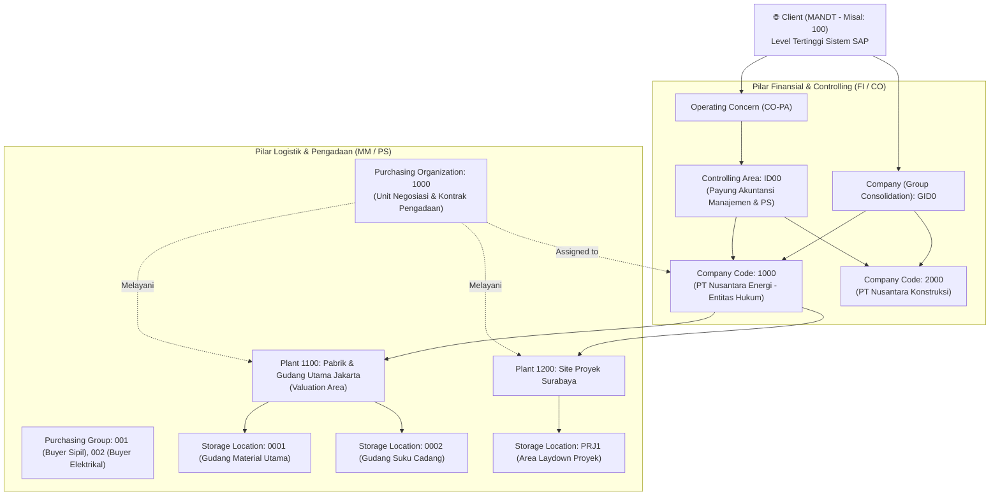

# Modul 01: Arsitektur SAP, Enterprise Structure, & Master Data Terpadu (MM • PS • FI)

> **Tujuan Pembelajaran:**
> 1. Memahami perbedaan fundamental arsitektur **SAP ECC 6.0** dan **SAP S/4HANA** pada tingkat basis data dan proses bisnis.
> 2. Menguasai desain **Enterprise Structure (Struktur Organisasi)** lintas modul FI, CO/PS, dan MM beserta jalur konfigurasi **SPRO (IMG)**.
> 3. Memahami **Master Data Inti** (G/L Account, Business Partner, Material Master, dan WBS Element) serta field-field kritis yang mengendalikan integrasi otomatis antar-modul.

---

## 1. Evolusi Arsitektur: SAP ECC 6.0 vs SAP S/4HANA

Memahami perbedaan antara SAP ECC 6.0 dan SAP S/4HANA sangat penting karena di lapangan (perusahaan korporasi/BUMN/multinasional), Anda akan menemukan perusahaan yang masih menggunakan ECC maupun yang sudah bermigrasi ke S/4HANA.

### 1.1 Perbandingan Arsitektur Teknis & Tabel Database

| Dimensi | SAP ERP Central Component (ECC 6.0) | SAP S/4HANA (Business Suite 4 SAP HANA) |
| :--- | :--- | :--- |
| **Database Engine** | AnyDB (Oracle, MS SQL, DB2, MaxDB) berbasis *Row-Store*. | Hanya berjalan di **SAP HANA** (*In-Memory Columnar Database* — menggabungkan OLTP + OLAP). |
| **Antarmuka Pengguna (UI)** | SAP GUI (berbasis transaksi T-Code tradisional). | **SAP Fiori Launchpad** (berbasis peran/web responsif) + tetap mendukung SAP GUI. |
| **Master Vendor & Customer** | Terpisah: Vendor (`XK01`, `FK01`, `MK01` — tabel `LFA1`/`LFB1`/`LFM1`) dan Customer (`XD01`, `FD01` — tabel `KNA1`). | **Unified Business Partner (`BP`)** wajib. Seluruh pemasok dan pelanggan dikelola dalam satu objek `BP` (tabel `BUT000` terintegrasi via CVI ke `LFA1`/`KNA1`). |
| **Tabel Akuntansi (FI & CO)** | Banyak tabel terpisah & tabel agregat/indeks: `BKPF`, `BSEG`, `BSIS`, `BSAS`, `BSIK`, `BSAK`, `BSID`, `BSAD`, `FAGLFLEXA`, `FAGLFLEXT`, `COEP`, `COSP`. | **Universal Journal (`ACDOCA`)**: Satu tabel *Single Source of Truth* yang menyatukan FI, CO, AA (Asset), dan ML (Material Ledger). Rekonsiliasi FI-CO menjadi instan (real-time). |
| **Tabel Pergerakan Barang (MM)** | Header `MKPF` + Item `MSEG` + puluhan tabel agregat stok (`MARD`, `MBEW`, `MSSQ`, `MSPR`). | Tabel tunggal **`MATDOC`** menyimpan header dan item sekaligus; stok dihitung *on-the-fly* dari `MATDOC`. |
| **Penilaian Material (Material Valuation)** | Material Ledger (ML) bersifat opsional; umumnya hanya memakai tabel `MBEW`. | **Material Ledger (ML) wajib aktif** (mendukung multi-currency valuation dan actual costing). |
| **Integrasi CO Cost Element** | Cost Element dikelola terpisah di CO (`KA01` Primary, `KA06` Secondary). | **Cost Element menyatu ke Master G/L Account (`FS00`)**. Tidak ada lagi T-Code `KA01`/`KA06`. |

### 1.2 Pintasan Navigasi Penting di SAP GUI (Command Field)

Saat bekerja di layar SAP GUI, kuasai prefiks perintah berikut pada *Command Field* (kotak input kiri atas):

* **`/n<TCODE>`**: Menutup transaksi saat ini dan langsung membuka T-Code baru di jendela yang sama (contoh: `/nME21N`).
* **`/o<TCODE>`**: Membuka T-Code baru di **jendela/sesi baru** tanpa menutup layar yang sedang dikerjakan (contoh: `/oFS10N`, maksimal 6 sesi).
* **`/n`**: Keluar dari transaksi aktif kembali ke layar utama *SAP Easy Access*.
* **`/nend`**: Log off dari sistem SAP dengan konfirmasi penyimpanan.
* **`/nex`**: Log off paksa seketika tanpa konfirmasi (*hati-hati: data yang belum di-save akan hilang*).
* **`F1`**: Bantuan dokumentasi teknis pada field tempat kursor berada (klik ikon *Technical Information* / gambar palu-kunci untuk melihat **Nama Tabel & Nama Field** asli di database).
* **`F4`**: Membuka daftar pencarian nilai yang valid (*Search Help / Matchcode*).

---

## 2. Enterprise Structure (Struktur Organisasi SAP)

Sebelum satu pun transaksi dapat diposting di SAP, konsultan harus mendefinisikan **Enterprise Structure** di menu **SPRO** (*SAP Project Reference Object* $\rightarrow$ *SAP Customizing Implementation Guide / IMG*).



### 2.1 Daftar Elemen Organisasi & T-Code Konfigurasi SPRO

| Modul | Elemen Organisasi | Deskripsi & Fungsi Bisnis | Relasi Kardinalitas | T-Code / Jalur SPRO |
| :---: | :--- | :--- | :--- | :--- |
| **BASIS** | **Client (`MANDT`)** | Unit mandiri tertinggi secara teknis dan hukum di SAP. Data master tingkat client berlaku bagi semua perusahaan di bawahnya. | 1 Client : $N$ Company Code | `SCC4` |
| **FI** | **Company Code (`BUKRS`)** | **Entitas hukum terkecil** yang wajib menyusun laporan keuangan lengkap (Neraca / *Balance Sheet* & Laba Rugi / *P&L*) untuk perpajakan dan audit eksternal. | 1 Company Code : $N$ Plant | `OX02` / `EC01`<br>*(SPRO $\rightarrow$ Enterprise Structure $\rightarrow$ Definition $\rightarrow$ Financial Accounting $\rightarrow$ Edit, Copy, Delete, Check Company Code)* |
| **FI** | **Chart of Accounts (`KTOPL`)** | Daftar sistematis seluruh akun Buku Besar (G/L Account) yang digunakan oleh satu atau beberapa Company Code. | 1 CoA : $N$ Company Code | `OB13` (Definisi)<br>`OB62` (Assign ke Company Code) |
| **CO / PS** | **Controlling Area (`KOKRS`)** | Unit organisasi untuk akuntansi biaya internal (Cost Center, Internal Order, dan **WBS Proyek PS**). Seluruh transaksi proyek PS wajib berada di bawah Controlling Area. | 1 Controlling Area : $N$ Company Code *(Syarat: CoA & Fiscal Year Variant harus sama)* | `OKKP` / `OX06` (Definisi)<br>`OX19` (Assign Company Code ke Controlling Area) |
| **MM / PS** | **Plant (`WERKS`)** | Fasilitas operasional tempat barang disimpan, diproduksi, atau tempat proyek dilaksanakan (misal: Pabrik, Kantor Cabang, Site Proyek). Plant juga berfungsi sebagai **Valuation Area** (level penilaian harga stok). | 1 Plant hanya boleh milik **1 Company Code**.<br>1 Company Code bisa punya banyak Plant. | `OX10` (Definisi Plant)<br>`OX18` (Assign Plant ke Company Code)<br>`OMWD` (Grouping Valuation Area) |
| **MM** | **Storage Location (`LGORT`)** | Lokasi fisik/gudang penyimpanan stok di dalam suatu Plant (misal: Gudang Bahan Baku `0001`, Gudang Barang Rusak `0099`). Kuantitas fisik stok dicatat di level ini. | 1 Plant : $N$ Storage Location | `OX09` *(Maintain Storage Location)* |
| **MM** | **Purchasing Organization (`EKORG`)** | Unit organisasi yang bertanggung jawab menegosiasikan harga, syarat pembelian (*Terms of Payment/Incoterm*), dan menerbitkan PO ke Vendor. | Bisa *Plant-Specific*, *Company-Specific* (1:1 dengan CC), atau *Centralized* (1 POrg melayani banyak CC). | `OX08` (Definisi)<br>`OX01` (Assign ke Company Code)<br>`OX17` (Assign ke Plant) |
| **MM** | **Purchasing Group (`EKGRP`)** | Kode individu pembeli (*buyer*) atau tim pengadaan (misal: `B01` Tim Buyer Mekanikal). **Tidak terikat** ke Company Code di SPRO, bersifat lintas organisasi. | Independen | `OME4` |

> **⚠️ Aturan Emas Konsultan (Valuation Level):**
> Di SAP (T-Code `OX14`), *Valuation Level* hampir selalu disetel pada level **Plant** (bukan Company Code). Artinya, material yang sama (`MAT-001`) dapat memiliki harga rata-rata (*Moving Average Price*) Rp 10.000 di Plant Jakarta (`1100`) dan Rp 12.500 di Plant Papua (`1200`) karena perbedaan biaya angkut.

---

## 3. Master Data Inti Lintas Modul

Dalam sistem ERP terintegrasi, **Master Data yang salah akan menghasilkan jurnal akuntansi yang salah**. Berikut adalah empat Master Data paling krusial yang menghubungkan MM, PS, dan FI:

---

### 3.1 Master Data 1: General Ledger (G/L) Account (`FS00`)

G/L Account adalah muara dari seluruh transaksi keuangan di SAP. Di S/4HANA, `FS00` menggabungkan akun FI dan Cost Element CO dalam satu layar.

#### Struktur 2 Segmen di `FS00`:
1. **Chart of Accounts Segment (Level Client - Tabel `SKA1`):**
   - **G/L Account Number & Short/Long Text:** Nomor dan nama akun.
   - **G/L Account Type (Khusus S/4HANA):**
     - `X` — *Balance Sheet Account* (Akun Neraca: Kas, Bank, Persediaan, Hutang, Aset).
     - `N` — *Non-Operating Expense or Income* (Biaya/Pendapatan di luar operasi, tidak masuk CO).
     - `P` — *Primary Costs or Revenue* (Biaya/Pendapatan operasional yang **wajib** memiliki objek biaya CO seperti Cost Center atau **WBS Element PS**!).
     - `S` — *Secondary Costs* (Akun alokasi internal CO/PS seperti *Assessment* atau *Settlement*).
   - **Account Group (`OBD4`):** Mengelompokkan rentang nomor akun (misal: `100000-199999` Aset, `200000-299999` Kewajiban).

2. **Company Code Segment (Level Company Code - Tabel `SKB1`):**
   - **Account Currency:** Mata uang akun. Jika diisi mata uang lokal (`IDR`), akun dapat menerima posting dalam mata uang asing apa saja (`USD`, `EUR`). Jika diisi mata uang spesifik (`USD`), akun hanya bisa menerima posting dalam `USD`.
   - **Reconciliation Account for Account Type:**
     - Diisi `K` (*Vendors*) untuk akun Hutang Dagang, `D` (*Customers*) untuk Piutang Dagang, atau `A` (*Assets*) untuk Akun Aset Tetap.
     - **Prinsip Penting:** Akun Rekonsiliasi **TIDAK BISA dijurnal langsung secara manual** di `FB50`/`F-02`. Akun ini hanya bergerak otomatis ketika sub-ledger (Vendor/Customer/Asset) diposting!
   - **Open Item Management (OIM):** Wajib dicentang untuk akun kliring (seperti **GR/IR Clearing Account** dan akun Bank Kliring) agar setiap item debet dapat dipasangkan (*cleared*) dengan item kreditnya.
   - **Field Status Group (`OBC4`):** Mengatur field mana yang *Required* (Wajib), *Optional*, atau *Suppressed* (Disembunyikan) saat akun tersebut dipakai menjurnal (misal: grup `G004` mewajibkan pengisian Cost Center/WBS, grup `G006` mewajibkan kode Material).
   - **Post Automatically Only:** Wajib dicentang untuk akun **Persediaan Material** dan **GR/IR Clearing** agar tidak ada staf akuntansi yang bisa mengubah saldo stok lewat jurnal manual FI tanpa melalui transaksi barang MM (`MIGO`).

---

### 3.2 Master Data 2: Business Partner — Vendor / Supplier (`BP` / `XK01`)

Di S/4HANA, transaksi lama `XK01`/`FK01`/`MK01` telah digantikan oleh satu transaksi tunggal: **`BP` (Maintain Business Partner)**.

#### 3 Peran Utama (BP Roles) untuk Vendor/Pemasok:
```text
┌────────────────────────────────────────────────────────────────────────────┐
│                        BUSINESS PARTNER (Nomor: 100024)                    │
│                        Nama: PT Baja Konstruksi Utama                      │
├───────────────────────┬──────────────────────────┬─────────────────────────┤
│ 1. Role: 000000       │ 2. Role: FLVN00          │ 3. Role: FLVN01         │
│ (General Data)        │ (FI Vendor - CoCode)     │ (MM Purchasing - POrg)  │
├───────────────────────┼──────────────────────────┼─────────────────────────┤
│ • Nama & Alamat Resmi │ • Reconciliation Account │ • Order Currency (IDR)  │
│ • NPWP / Tax Number   │   (misal: 210010 Hutang) │ • Payment Terms (ZB01)  │
│ • Rekening Bank Vendor│ • Payment Terms FI       │ • Incoterms (CIF/FOB)   │
│   (IBAN / Swift)      │ • Withholding Tax (PPh)  │ • Schema Group Vendor   │
│                       │ • Check Double Invoice   │ • **GR-Based IV** (Cek) │
├───────────────────────┼──────────────────────────┼─────────────────────────┤
│ Tabel: BUT000 / LFA1  │ Tabel: LFB1              │ Tabel: LFM1             │
└───────────────────────┴──────────────────────────┴─────────────────────────┘
```

* **Field Kritis Integrasi MM-FI pada BP:**
  1. **Reconciliation Account (`LFB1-AKONT`):** Menghubungkan nomor kode vendor (`100024`) dengan akun Buku Besar Hutang Usaha (`210010`) di Neraca FI.
  2. **Check Double Invoice (`LFB1-REPRF`):** Mencegah staf keuangan menginput faktur vendor yang sama dua kali di `MIRO` atau `FB60` berdasarkan nomor referensi invoice dan tanggal.
  3. **GR-Based Invoice Verification (`LFM1-WEBRE`):** Jika dicentang di tab Purchasing, sistem **melarang** bagian keuangan memposting tagihan vendor di `MIRO` sebelum bagian gudang memposting penerimaan barang (`MIGO`).

---

### 3.3 Master Data 3: Material Master (`MM01` / `MM02` / `MM03`)

Material Master adalah jantung dari modul logistik dan pabrik. Data material dibagi menjadi beberapa tampilan (*Views*) sesuai departemen yang bertanggung jawab.

#### A. Jenis Material Standar (Material Types - T-Code `OMS2`)

| Kode | Nama Standar | Karakteristik Stok (Quantity Updating) | Karakteristik Nilai (Value Updating) | Contoh Penggunaan |
| :---: | :--- | :---: | :---: | :--- |
| **`ROH`** | Raw Materials (Bahan Baku) | ✅ Ya | ✅ Ya | Bijih besi, plat baja, bahan kimia produksi. |
| **`ERSA`** | Spare Parts (Suku Cadang) | ✅ Ya | ✅ Ya | Bearing mesin, filter oli, trafo cadangan. |
| **`HALB`** | Semi-Finished Goods | ✅ Ya | ✅ Ya | Rangka baja setengah jadi. |
| **`FERT`** | Finished Products (Barang Jadi) | ✅ Ya | ✅ Ya | Produk akhir siap jual ke pelanggan. |
| **`HAWA`** | Trading Goods (Barang Dagangan) | ✅ Ya | ✅ Ya | Barang yang dibeli untuk langsung dijual kembali. |
| **`NLAG`** | Non-Stock Materials | ❌ Tidak | ❌ Tidak | Alat tulis kantor (ATK), konsumsi langsung saat beli. |
| **`UNBW`** | Non-Valuated Materials | ✅ Ya (Kuantitas dicatat di gudang) | ❌ Tidak (Langsung dibiayakan saat beli) | Barang promosi, seragam kerja, material nilai rendah. |
| **`DIEN`** | Services (Jasa) | ❌ Tidak | ❌ Tidak | Jasa instalasi, jasa konsultansi proyek. |

#### B. Struktur Views pada Material Master & Field Kritisnya

1. **Basic Data 1 & 2 (Level Client - Tabel `MARA`):**
   - *Base Unit of Measure* (`MEINS`: PC, KG, TON, M), *Material Group* (`MATKL` — pengelompokan komoditas barang), dimensi & berat.
2. **Purchasing View (Level Plant - Tabel `MARC`):**
   - *Purchasing Group* (`EKGRP`), *Order Unit*, *Purchasing Value Key* (mengatur toleransi pengiriman kurang/lebih dan pengingat vendor), *Automatic PO* (izinkan pembuatan PO otomatis via `ME59N`).
3. **MRP 1, 2, 3, 4 Views (Level Plant - Tabel `MARC`):**
   - *MRP Type* (`PD` MRP reguler, `VB` Reorder Point manual, `ND` No Planning), *Lot Size*, *Procurement Type* (`F` External Procurement / beli dari luar, `E` In-house Production, `X` Keduanya), *Planned Delivery Time* (hari pengiriman).
4. **Plant Data / Storage 1 & 2 (Level Storage Location - Tabel `MARD`):**
   - Kondisi penyimpanan, umur simpan (*Shelf Life Expiration Date*), satuan pengeluaran.
5. **Accounting 1 & 2 Views (Level Valuation Area/Plant - Tabel `MBEW`) — ⚠️ TITIK INTEGRASI UTAMA MM-FI:**
   - **Valuation Class (`BKLAS`):** Jembatan penghubung antara Material Master dengan akun G/L di FI!
     - Contoh: Material Baja menggunakan Valuation Class `3000` (Bahan Baku) $\rightarrow$ otomatis masuk ke G/L Persediaan Bahan Baku `114010`.
     - Suku cadang menggunakan Valuation Class `3040` (Spare Parts) $\rightarrow$ otomatis masuk ke G/L Persediaan Suku Cadang `114040`.
   - **Price Control Indicator (`VPRSV`):**
     - **`V` (Moving Average Price / MAP):** Harga rata-rata bergerak. Setiap kali ada pembelian baru dengan harga berbeda, nilai persediaan dan harga rata-rata per unit menyesuaikan secara otomatis. **Standar untuk Bahan Baku (`ROH`), Suku Cadang (`ERSA`), dan Barang Dagangan (`HAWA`).**
     - **`S` (Standard Price):** Harga standar tetap. Persediaan selalu dinilai dengan harga patokan tetap; jika harga beli PO berbeda dengan harga standar, selisihnya langsung dibuang ke akun **Selisih Harga (*Price Difference / PRD*)**. **Standar untuk Barang Jadi (`FERT`) dan Setengah Jadi (`HALB`).**

---

### 3.4 Master Data 4: Project Definition & WBS Element (`CJ20N`)

Dalam modul **SAP PS**, objek master data utama yang menampung anggaran, komitmen pembelian, dan biaya aktual adalah **WBS Element (*Work Breakdown Structure*)**.

* **Project Definition (Tabel `PROJ`):** Payung tertinggi proyek (misal: `P-2026-GI01` — Proyek Pembangunan Gardu Induk 150kV). Mengatur tanggal mulai/selesai proyek, Company Code, Controlling Area, dan **Project Profile (`OPSA`)**.
* **WBS Element (Tabel `PRPS`):** Hirarki rincian pekerjaan berbentuk pohon (*tree structure*).
  - Setiap WBS Element memiliki 3 indikator kontrol penting (*Operative Indicators*):
    1. **Planning Element:** Boleh dimasukkan rencana biaya (*Cost Planning*).
    2. **Account Assignment Element (`BELKZ`):** Boleh dibebani transaksi aktual (boleh dipilih di PR `ME51N`, PO `ME21N`, MIGO, atau jurnal FI `FB50`). Biasanya hanya WBS level paling bawah (*leaf node*) yang dicentang sebagai Account Assignment Element.
    3. **Billing Element:** Boleh menerima pencatatan pendapatan (*Revenue*) jika proyek tersebut adalah proyek pelanggan (*Customer Project*).

---

## 4. Ringkasan Keterkaitan Master Data (Bagaimana Semuanya Bekerja Sama?)

Ketika seorang pengguna membuat **Purchase Order (`ME21N`)** untuk membeli material proyek:
1. Pengguna memasukkan **Nomor Vendor (`BP`)** $\rightarrow$ SAP menarik syarat pembayaran dari `LFM1` dan tahu akun Hutang `210010` dari `LFB1`.
2. Pengguna memasukkan **Nomor Material (`MM03`)** $\rightarrow$ SAP membaca **Valuation Class `3000`** dari `MBEW` dan tahu akun Persediaan/Biaya mana yang harus didebet melalui tabel konfigurasi **`OBYC`**.
3. Pengguna memilih **Account Assignment Category `P` atau `Q`** dan memasukkan **Kode WBS (`CJ20N`)** $\rightarrow$ SAP langsung memeriksa sisa anggaran proyek di modul **PS** (*Availability Control*) dan mencatat **Commitment** sebesar nilai PO.

---

> **Selanjutnya:** Lanjut ke **[Modul 02: SAP FI (Financial Accounting)](./02-sap-fi-financial-accounting.md)** untuk membedah siklus akuntansi keuangan secara mendalam.
