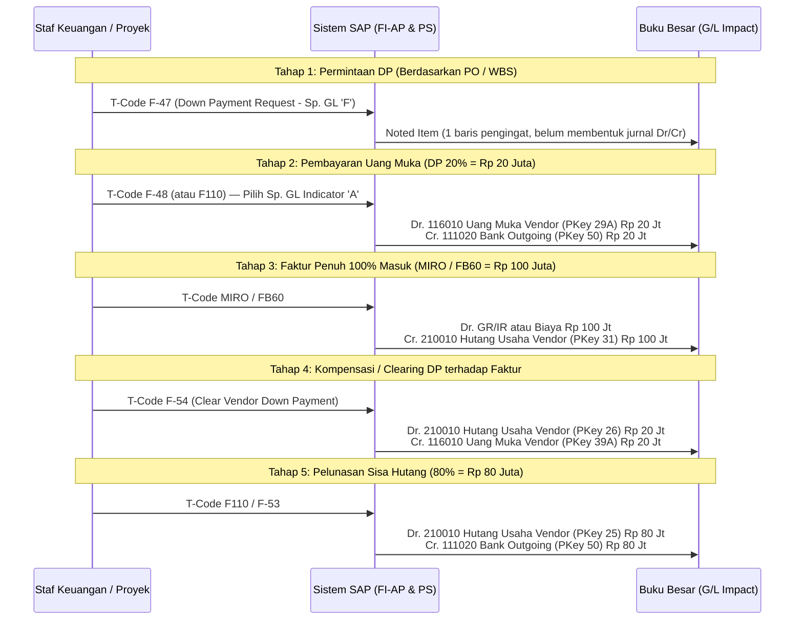

# Modul 02: SAP FI (Financial Accounting) — Panduan Mendalam

> **Tujuan Pembelajaran:**
> 1. Menguasai anatomi dokumen akuntansi SAP (**Document Type**, **Posting Key**, dan **Special G/L Indicator**).
> 2. Memahami operasi harian dan konfigurasi inti pada 4 pilar FI: **FI-GL** (Buku Besar), **FI-AP** (Hutang Vendor & `F110`), **FI-AR** (Piutang Pelanggan), dan **FI-AA** (Aset Tetap & *Asset under Construction*).
> 3. Memahami mekanisme pajak (**PPN `FTXP`** & **PPh *Withholding Tax***) serta prosedur **Tutup Buku Bulanan/Tahunan (*Closing*)**.

---

## 1. Anatomi Dokumen Akuntansi SAP FI

Contoh transaksi GUI/IMG terutama untuk ECC dan S/4HANA on-premise/private; Public Cloud menggunakan aplikasi dan konfigurasi yang dirilis untuk edisinya. Akun, mata uang, kelas aset, tarif dan jurnal di bawah adalah fixture edukasi, bukan konfigurasi standar atau nasihat pajak.

Prinsip **“No Posting Without a Document”** berarti posting akuntansi didukung oleh dokumen. Dokumen FI diidentifikasi antara lain oleh company code (`BUKRS`), document number (`BELNR`) dan fiscal year (`GJAHR`); key penyimpanan lain dapat mencakup client, ledger atau nomor item.

Rujukan SAP Learning S/4HANA: [dokumen FI dan Universal Journal](https://learning.sap.com/courses/configuring-additional-settings-in-financial-accounting-in-sap-s-4hana/executing-data-archiving-for-specific-fi-objects) dan [settlement proyek investasi](https://learning.sap.com/courses/discovering-the-basics-of-sap-s-4hana-project-system/executing-period-end-closing-activities_a362398a-e47c-45fd-b16f-39bce45fb32f). Tautan menjelaskan konsep, bukan validasi angka fixture.

### 1.1 Struktur Dokumen: Header vs Line Items

```text
┌────────────────────────────────────────────────────────────────────────────┐
│ DOCUMENT HEADER (Tabel: BKPF)                                              │
│ • Document Date (BLDAT)  : Tanggal cetak faktur fisik/bukti asli           │
│ • Posting Date (BUDAT)   : Tanggal masuk ke buku besar (menentukan periode)│
│ • Document Type (BLART)  : Klasifikasi transaksi (SA, KR, RE, WE, KZ, AA)  │
│ • Currency (WAERS)       : Mata uang transaksi & kurs (Exchange Rate)      │
│ • Reference (XBLNR)      : Nomor faktur vendor / nomor surat jalan         │
├────────────────────────────────────────────────────────────────────────────┤
│ LINE ITEMS (Tabel: ACDOCA di S/4HANA & BSEG) — Minimal 2 Baris (Dr = Cr)   │
│ Baris 001: PKey [31] | Vendor 100024 (Recon 210010) | Cr. 11.100.000      │
│ Baris 002: PKey [40] | G/L 510020 (Biaya Jasa)      | Dr. 10.000.000 | WBS │
│ Baris 003: PKey [40] | G/L 115010 (PPN Masukan)     | Dr.  1.100.000      │
└────────────────────────────────────────────────────────────────────────────┘
```

### 1.2 Document Types Standar (`OBA7`)

Document Type mengendalikan **Rentang Nomor Dokumen (*Number Range* `FBN1`)** dan **Jenis Akun yang diizinkan** (Asset `A`, Customer `D`, Vendor `K`, Material `M`, G/L `S`):

| Doc. Type | Deskripsi Standar | Modul Asal | Transaksi Pemicu Utama |
| :---: | :--- | :---: | :--- |
| **`SA`** | G/L Account Document | FI-GL | `FB50`, `F-02` (Jurnal Umum Manual) |
| **`KR`** | Vendor Invoice (Faktur Non-PO) | FI-AP | `FB60`, `F-43` (Tagihan langsung tanpa PO MM) |
| **`KG`** | Vendor Credit Memo (Nota Kredit) | FI-AP | `FB65` (Retur/pengurangan tagihan vendor) |
| **`RE`** | Logistics Invoice (Faktur PO) | MM-LIV | `MIRO` (Verifikasi faktur atas PO pengadaan) |
| **`WE`** | Goods Receipt (Penerimaan Barang) | MM-IM | `MIGO` (Movement 101, 105) |
| **`WA`** | Goods Issue (Pengeluaran Barang) | MM-IM / PS | `MIGO` (Movement 201 Cost Center, 221 Proyek WBS) |
| **`KZ`** | Vendor Payment (Pembayaran Manual) | FI-AP | `F-53`, `F-48` (Pembayaran keluar manual) |
| **`ZP`** | Payment Posting (Pembayaran Otomatis) | FI-AP | `F110` (*Automatic Payment Program*) |
| **`DR`** | Customer Invoice (Faktur Penjualan FI) | FI-AR | `FB70` |
| **`RV`** | Billing Document Transfer | SD-FI | `VF01` (Faktur penjualan dari modul Sales & Distribution) |
| **`DZ`** | Customer Payment (Penerimaan Kas) | FI-AR | `F-28` |
| **`AA`** | Asset Posting (Transaksi Aset Tetap) | FI-AA / PS | `F-90`, `ABZON`, `ABAVN`, `CJ88` (Settlement WBS ke Aset) |
| **`AF`** | Depreciation Posting (Penyusutan) | FI-AA | `AFAB` (Run penyusutan bulanan) |

---

### 1.3 Tabel Sakti Posting Keys (`OB41`)

Posting key (`BSCHL`) mengendalikan jenis akun, debit/kredit dan field status; database juga memiliki indikator debit/kredit. Key berikut contoh konfigurasi standar, tidak menjamin key pada setiap jurnal otomatis.

| Jenis Akun | Posting Key **DEBIT** | Posting Key **CREDIT** | Keterangan Penggunaan |
| :--- | :---: | :---: | :--- |
| **G/L Account (`S`)** | **`40`** | **`50`** | Jurnal buku besar umum (Kas, Bank, Biaya, Pendapatan). |
| **Vendor / Supplier (`K`)** | **`25`** *(Outg. Payment)*<br>**`21`** *(Credit Memo)*<br>**`29`** *(Special G/L Dr)* | **`31`** *(Invoice)*<br>**`39`** *(Special G/L Cr)* | `31` saat faktur hutang masuk; `25` saat hutang dibayar lunas; `29` saat bayar DP (`F-48`). |
| **Customer (`D`)** | **`01`** *(Invoice)*<br>**`09`** *(Special G/L Dr)* | **`15`** *(Inc. Payment)*<br>**`11`** *(Credit Memo)*<br>**`19`** *(Special G/L Cr)* | `01` saat menagih piutang pelanggan; `15` saat pelanggan membayar. |
| **Asset (`A`)** | **`70`** | **`75`** | `70` saat penambahan nilai aset/AuC; `75` saat penghapusan/akumulasi penyusutan aset. |
| **Material Stock (`M`)** | **`89`** *(contoh stock inward)* | **`99`** *(contoh stock outward)* | Posting key otomatis bergantung transaksi dan konfigurasi. |

---

### 1.4 Kontrol Periode Posting: FI (`OB52`) vs MM (`MMPV` / `OMSY`)

Sering terjadi error di lapangan ketika user hendak memposting `MIGO` atau `MIRO` pada awal bulan baru. Pahami bahwa SAP memiliki **2 gerbang periode yang berbeda**:
1. **Gerbang Periode FI (`OB52`):**
   - Mengontrol pembukaan/penutupan periode akuntansi berdasarkan Variant dan Jenis Akun (`+` Semua, `A` Aset, `D` Customer, `K` Vendor, `M` Material, `S` GL).
   - Memiliki 3 rentang periode: *Periode 1* (Periode berjalan normal, misal `11/2026`), *Periode 2* (Periode penyesuaian audit tahunan, misal `13-16`), dan *Periode 3* (Integrasi CO-FI).
2. **Gerbang Periode Logistik MM (`MMPV` untuk buka periode baru, `MMRV` untuk cek periode aktif):**
   - Modul MM hanya mengizinkan posting di **bulan berjalan** dan (jika diizinkan di `MMRV`) **1 bulan sebelumnya**.
   - Sekalipun periode FI di `OB52` sudah dibuka untuk tahun depan, `MIGO` tetap akan ditolak jika periode MM belum digeser menggunakan T-Code **`MMPV`**.

---

## 2. Sub-Modul FI-GL (General Ledger Accounting)

### 2.1 Transaksi Harian Buku Besar
* **`FB50` (Enter G/L Account Document):** Layar *Enjoy Transaction* satu layar untuk menjurnal akun G/L (cukup pilih *Debit* atau *Credit*, sistem otomatis mengisi Posting Key `40`/`50`).
* **`F-02` (General Posting):** Layar klasik yang bisa menjurnal lintas jenis akun (G/L, Vendor, Customer, Asset sekaligus) dengan mengetikkan Posting Key manual.
* **`FV50` / `FBV0` (Park & Post Document):** Menyimpan draf jurnal sementara (*Parked Document*) oleh staf junior (belum mengubah saldo buku besar) untuk kemudian diperiksa dan di-*Post* oleh manajer akuntansi.
* **`FB03` (Display Document):** Melihat dokumen akuntansi yang sudah terbentuk.
* **`FB08` (Reverse Individual Document):** Membalik dokumen FI yang memenuhi syarat. Dokumen dari logistik umumnya dibalik dari proses asal (`MIGO` cancellation atau `MR8M`) agar dokumen terkait tetap konsisten.

### 2.2 Document Splitting (Pemecahan Dokumen Otomatis)
Di S/4HANA (dan New GL ECC), laporan Neraca sering diminta tidak hanya per Company Code, tetapi juga per **Profit Center** atau **Segment**.
* **Contoh:** Anda membeli barang dari 1 Vendor senilai Rp 10.000.000 untuk dua proyek di Profit Center berbeda (`PC-JAKARTA` Rp 6.000.000 dan `PC-SURABAYA` Rp 4.000.000).
* Pada tampilan input (*Entry View*), baris Hutang Vendor hanya 1 baris (Rp 10.000.000).
* Jika document splitting aktif dan dikonfigurasi untuk karakteristik dan transaksi tersebut, sistem dapat memecah baris vendor dan pajak sesuai aturan; zero balancing hanya berlaku jika dikonfigurasi.

---

## 3. Sub-Modul FI-AP (Accounts Payable — Siklus Hutang Vendor)

Ada dua jalur timbulnya hutang ke vendor di SAP:
1. **Jalur Tanpa PO (FI-AP Murni):** Tagihan listrik, sewa kantor, biaya administrasi $\rightarrow$ langsung diinput di **`FB60`**.
2. **Jalur Dengan PO (Integrasi MM-PS-FI):** Pengadaan barang/jasa proyek $\rightarrow$ melalui `ME21N` $\rightarrow$ `MIGO` $\rightarrow$ **`MIRO`**.

### 3.1 Alur Uang Muka Vendor (Down Payment — Special G/L Indicator `A`)

Dalam proyek konstruksi (PS) dan pengadaan mesin (MM), vendor sering meminta DP (misal 20% di muka). Jika DP dicatat ke akun Hutang reguler (`210010`), maka Neraca akan terdistorsi (hutang tampak berkurang padahal barang belum dikirim). Oleh karena itu, SAP menggunakan **Special G/L Indicator `A`** yang mengarahkan jurnal ke akun **Uang Muka Pembelian (`116010` - Aset Lancar)** via konfigurasi `OBYR`:



### 3.2 Automatic Payment Program — APP (`F110` & Konfigurasi `FBZP`)

Untuk membayar ratusan faktur jatuh tempo sekaligus secara otomatis dan menghasilkan file transfer bank (*DMEE / Payment Medium*), perusahaan menggunakan **`F110`**.

#### 6 Pilar Konfigurasi `FBZP` (Wajib Dikuasai Konsultan FI):
1. **All Company Codes:** Mengatur toleransi hari kas diskon dan daftar Special G/L yang boleh dibayar via `F110` (misal: `A`, `F`).
2. **Paying Company Codes:** Menentukan Company Code mana yang membayarkan dan nilai minimum pembayaran.
3. **Payment Methods in Country:** Mendefinisikan metode bayar tingkat negara (misal: `T` Bank Transfer, `C` Cek), syarat master data (apakah wajib ada nomor rekening IBAN/Bank di BP Vendor), dan program pencetak DME.
4. **Payment Methods in Company Code:** Menentukan batas nilai minimum/maksimum per transaksi untuk metode transfer tersebut di Company Code terkait.
5. **Bank Determination:**
   - *Ranking Order:* Urutan prioritas bank jika perusahaan punya banyak bank (misal: Prioritas 1 `BMRI` Bank Mandiri, Prioritas 2 `BBCA` BCA).
   - *Bank Accounts:* Memetakan rekening bank ke **Akun G/L Bank Clearing** (misal `111029` Bank Mandiri Outgoing Clearing).
   - *Available Amounts:* Plafon dana maksimal yang siap ditarik di rekening tersebut.
6. **House Banks (`FI12` / Fiori *Manage Bank Accounts*):** Data master bank milik perusahaan kita sendiri (Bank Key, Nomor Rekening Koran).

---

## 4. Sub-Modul FI-AR (Accounts Receivable — Piutang Pelanggan)

**FI-AR** adalah subledger pelanggan di bawah FI. Fokusnya bukan sekadar membuat invoice, tetapi menjaga saldo per pelanggan, open item, jatuh tempo, penerimaan, clearing, dunning, credit exposure, dan rekonsiliasi otomatis ke G/L melalui **reconciliation account**. Untuk transaksi penjualan dari SD, billing `VF01` biasanya membentuk dokumen FI melalui `VKOA`; `FB70` adalah jalur invoice customer langsung tanpa dokumen SD.

### 4.1 Master Data dan Rekonsiliasi

Pada S/4HANA, customer dikelola sebagai Business Partner:

- **Role `FLCU00`**: data FI tingkat company code, termasuk reconciliation account piutang (contoh fixture `113010`) dan terms of payment.
- **Role `FLCU01`**: data Sales Area yang dipakai SD, termasuk partner functions, pricing, dan account assignment group customer.
- **Reconciliation account**: akun G/L otomatis untuk saldo customer; user tidak seharusnya mengubah akun rekonsiliasi secara manual pada baris customer.
- **Open item management**: invoice customer tetap terbuka sampai dibayar, dikompensasi, dibatalkan, atau dipindahkan sesuai proses yang berwenang.

### 4.2 Invoice Customer dan Jurnal

Jalur utama:

1. **`FB70`** untuk invoice FI-AR langsung; masukkan customer, tanggal, net value, tax code, dan due date.
2. **`VF01`** untuk billing SD; sistem membentuk dokumen billing dan mengirim posting ke FI melalui account determination `VKOA`.
3. **`FB03`** menampilkan accounting document; `FBL5N` menampilkan line items customer dan `FD10N` menampilkan saldo customer.

Contoh sintetis invoice jasa internet net `$5,000` dan PPN fixture 11%:

```text
Dr. 113010 Piutang Customer                         $5,550
    Cr. 410010 Pendapatan MRC                       $5,000
    Cr. 215010 PPN Keluaran                           $550
```

Nomor akun, tax code, document type, posting key, dan tarif di atas adalah fixture pembelajaran. Nilai produktif harus mengikuti chart of accounts, konfigurasi pajak, edisi, lokalisasi, dan kebijakan perusahaan.

### 4.3 Incoming Payment dan Tiga Perilaku Clearing

`F-28` atau proses bank statement digunakan untuk penerimaan pelanggan. Sebelum posting, cocokkan customer, reference, nominal, currency, bank account, dan open invoice.

| Mode | Perlakuan open item | Kapan digunakan |
| :--- | :--- | :--- |
| **Partial payment** | Invoice asli tetap open dengan sisa saldo; pembayaran dicatat sebagai item terkait. | Pelanggan membayar sebagian tanpa mengganti invoice asli. |
| **Residual item** | Invoice asli di-clear penuh dan SAP membuat open item baru sebesar sisa saldo. | Perusahaan ingin satu saldo residual baru dengan referensi pembayaran. |
| **Full clearing** | Invoice dan pembayaran saling clear; saldo piutang menjadi nol. | Pembayaran penuh atau kombinasi kas dan withholding menyelesaikan invoice. |

Contoh penerimaan dengan PPh dipotong pelanggan:

```text
Dr. 111020 Bank masuk                         $5,450
Dr. 115030 Prepaid withholding tax              $100
    Cr. 113010 Piutang customer              $5,550
```

Jurnal tersebut hanya benar jika bukti potong sah, withholding memang milik perusahaan, dan akun serta konfigurasi withholding telah disetujui. Jangan mengubah selisih menjadi diskon tanpa dasar proses.

### 4.4 Dunning dan Credit Management

- **Dunning**: memilih open item yang melewati due date, menghitung dunning level, dan menghasilkan surat/notifikasi sesuai dunning procedure. `F150` adalah transaksi klasik; aplikasi Fiori dan job yang tersedia bergantung edisi serta release.
- **Credit management**: membandingkan credit limit dengan exposure, yang dapat mencakup open receivable, sales order, delivery, dan billing exposure sesuai scope konfigurasi. `FD32` adalah transaksi klasik; S/4HANA modern dapat menggunakan **SAP Credit Management/FSCM** dan role `UKM_BP`.
- **Credit block** tidak sama dengan dunning. Credit check mengendalikan risiko transaksi baru; dunning menagih saldo yang telah jatuh tempo.
- Approval, scoring, tolerance, dispute, promise-to-pay, dan workflow adalah konfigurasi bisnis; lab ini hanya menghitung exposure sederhana dan tidak mengklaim implementasi FSCM penuh.

### 4.5 Tabel dan Rekonsiliasi

Untuk pembelajaran dan audit, gunakan konsep berikut lalu verifikasi DDIC sistem target:

| Tabel / objek | Peran |
| :--- | :--- |
| `BSID` | Compatibility view / indeks konseptual open customer items pada skenario yang mendukungnya. |
| `BSAD` | Compatibility view / indeks konseptual cleared customer items pada skenario yang mendukungnya. |
| `BKPF` / `BSEG` | Header dan entry view dokumen FI; struktur dan relevansi field bergantung edisi. |
| `ACDOCA` | Universal Journal S/4HANA untuk line item yang relevan. |
| `KNA1` / `KNB1` / `KNVV` | Data umum customer, company-code data, dan sales-area data; S/4HANA memakai BP sebagai titik pemeliharaan utama. |
| `BUT000` / `BUT100` | General Business Partner dan role BP. |

`SE16N` pada lab hanya menampilkan proyeksi sintetis. Pada S/4HANA, gunakan CDS view, API, atau aplikasi Fiori yang dirilis bila akses tabel langsung tidak tersedia.

---

## 5. Sub-Modul FI-AA (Asset Accounting — Aset Tetap & Kapitalisasi Proyek)

Modul **FI-AA** sangat erat kaitannya dengan **SAP MM** (pembelian aset langsung) dan **SAP PS** (kapitalisasi proyek konstruksi menjadi aset tetap).

### 5.1 Konsep Kunci Arsitektur FI-AA
* **Chart of Depreciation (`EC08`):** Kumpulan depreciation area dan aturan valuasi yang ditetapkan ke company code; kode dan isinya bergantung konfigurasi/lokalisasi.
* **Depreciation Areas:** Dapat mewakili buku komersial, pajak, atau mata uang paralel. Nomor area dan mekanisme posting bukan standar universal.
* **Asset Class (`OAOA`):** Menentukan default dan kontrol master aset, termasuk account determination (`AO90`); masa manfaat dan depreciation key dapat bergantung master serta konfigurasi.

#### Contoh Kelas Aset Fiktif:
| Asset Class | Deskripsi | Masa Manfaat Contoh | Penyusutan? | Keterangan Khusus |
| :---: | :--- | :---: | :---: | :--- |
| **`1000`** | Tanah | - | Umumnya tidak | Kebijakan akuntansi berlaku. |
| **`2000`** | Bangunan | 20 tahun | Sesuai aturan | Contoh aset final. |
| **`3000`** | Mesin | 10 tahun | Sesuai aturan | Dapat diperoleh langsung atau melalui proyek. |
| **`4000`** | Kendaraan | 8 tahun | Sesuai aturan | Field master tergantung konfigurasi. |
| **`8000`** | AuC | - | Contoh tanpa penyusutan | Tidak semua AuC atau kelas memakai pengaturan identik. |

### 5.2 Tiga Cara Perolehan Aset Tetap (Asset Acquisition)

#### Cara 1: Pembelian Langsung via PO Modul MM (Account Assignment Category `A`)
Digunakan untuk membeli aset yang langsung siap pakai (misal: beli 5 unit Laptop atau 1 unit Forklift):
1. Buat Master Aset di **`AS01`** (misal menghasilkan nomor aset `30000045-0`).
2. Buat PO di **`ME21N`** dengan memilih **Account Assignment Category = `A` (Asset)** dan memasukkan nomor aset `30000045-0`.
3. Saat barang tiba dan diposting **`MIGO` (Movement 101)** (jika *Valuated GR* aktif):
   ```text
   Dr. [PKey 70] Aset Tetap Mesin (30000045-0 -> G/L 121030)
       Cr. [PKey 50] GR/IR Clearing Account (G/L 210090)
   ```
   Tanggal kapitalisasi dan mulai penyusutan ditentukan oleh asset value date, depreciation key, period control, area, dan konfigurasi; penerimaan tidak otomatis berarti penyusutan langsung dimulai.

#### Cara 2: Pembelian Langsung via FI-AP Tanpa PO (`F-90`)
```text
Dr. [PKey 70] Aset Tetap (Transaction Type 100)
Dr. [PKey 40] PPN Masukan
    Cr. [PKey 31] Vendor / Hutang Usaha
```
#### Cara 3: Kapitalisasi Bertahap dari Proyek SAP PS (`CJ88` $\rightarrow$ `AIAB` $\rightarrow$ `AIBU`)
Digunakan untuk proyek pembangunan jangka panjang (misal: membangun pabrik selama 6 bulan). Selama bulan 1 s/d 5, biaya dikumpulkan di WBS PS dan di-*settle* tiap akhir bulan ke **AuC (Asset Under Construction)**. Setelah pabrik rampung 100% di bulan ke-6, nilai AuC dipindahkan ke Aset Tetap Gedung & Mesin final. *(Akan dibahas tuntas dengan angka di Modul 04 & Modul 05).*

---

## 6. Perpajakan di SAP FI: PPN (`FTXP`) & PPh (*Withholding Tax*)

Kode dan tarif berikut **contoh sintetis**, bukan tarif hukum Indonesia saat ini. Pajak masukan yang dapat/tidak dapat dikreditkan dan pembebanan ke stok atau biaya bergantung tax code, transaksi dan konfigurasi.

### 6.1 Mekanisme Tax Code PPN (`FTXP` & `OB40`)
* `V0`, `V1`, `V2`, dan `A1` adalah contoh kode yang dapat dikonfigurasi; tidak ada pemetaan tarif universal. Contoh kasus memakai pajak masukan dapat dikreditkan 11% semata-mata untuk latihan.

### 6.2 Extended Withholding Tax (PPh Potong/Pungut)
Contoh sintetis: jasa Rp 100.000.000, pajak masukan 11% Rp 11.000.000, dan withholding 2% Rp 2.000.000. Contoh mengasumsikan withholding diposting saat faktur; waktu posting dan dasar pajak bergantung konfigurasi dan aturan yang berlaku.

```text
Jurnal Saat Verifikasi Faktur Jasa (MIRO / FB60):
----------------------------------------------------------------------
Dr. 510020 Beban Jasa / GR-IR Jasa       Rp 100.000.000
Dr. 115010 PPN Masukan (11%)             Rp  11.000.000
    Cr. 210010 Hutang Vendor (PT Konsultan)             Rp 109.000.000
    Cr. 213023 Hutang PPh Pasal 23 (2%)                 Rp   2.000.000
----------------------------------------------------------------------
Total Debit: Rp 111.000.000              Total Kredit:  Rp 111.000.000
```
Lihat bagaimana hutang bersih yang siap dibayar ke rekening vendor melalui `F110` otomatis tinggal **Rp 109.000.000**, sedangkan Rp 2.000.000 masuk ke akun Hutang Pajak PPh 23 untuk disetorkan ke negara!

---

## 7. Checklist Tutup Buku Bulanan & Tahunan (FI Period-End Closing)

Urutan closing ditentukan kalender dan kebijakan perusahaan; contoh pemeriksaan:
1. Rekonsiliasi penerimaan dan faktur serta transaksi yang masih terbuka.
2. Rekonsiliasi GR/IR; `F.13` hanya membersihkan item yang memenuhi aturan matching, bukan semua perbedaan.
3. Jalankan settlement PS (`CJ88`) sesuai settlement rule dan periode.
4. Jalankan depresiasi (`AFAB`) untuk aset/area/periode yang memenuhi syarat.
5. Lakukan valuasi mata uang asing menggunakan metode dan kurs yang dikonfigurasi, bila relevan.
6. Kelola periode FI (`OB52`) dan MM (`MMPV`/`MMRV`) sesuai prosedur. `MMPV` memajukan periode MM; periode sebelumnya mungkin masih diizinkan sesuai pengaturan.
7. Tinjau laporan keuangan dan exception sebelum menutup periode.
8. **Cetak Laporan Keuangan (`F.01` / Fiori * Financial Statement*):** Menarik laporan Neraca (*Balance Sheet*) dan Laba Rugi (*Income Statement*).

---

> **Selanjutnya:** Lanjut ke **[Modul 03: SAP MM (Materials Management)](./03-sap-mm-materials-management.md)** untuk membedah siklus Procure-to-Pay, pergerakan stok gudang, dan rumus sakti konfigurasi otomatis **`OBYC`**.
