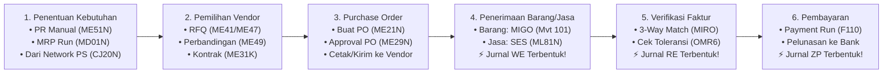
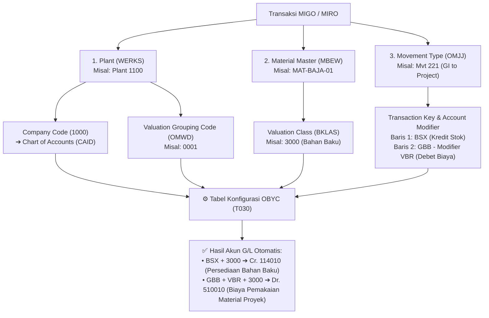

# Modul 03: SAP MM (Materials Management) & Skema Otomatisasi Akuntansi `OBYC`

> **Tujuan Pembelajaran:**
> 1. Menguasai siklus lengkap **Procure-to-Pay (P2P)** untuk pengadaan Barang (*Stock & Non-Stock*) maupun Jasa (*External Services*).
> 2. Memahami matriks **Item Category** & **Account Assignment Category** (`Blank`, `K`, `A`, `P`, `Q`) yang menghubungkan MM ke PS dan FI.
> 3. Menguasai seluruh **Movement Types** di `MIGO` (`101`, `103/105`, `201`, `221`, `281`, `301`, `311`, `412 Q`, `561`).
> 4. Membedah mekanisme **Three-Way Matching (`MIRO`)** dan rumus sakti **Automatic Account Determination (`OBYC`)** (`BSX`, `WRX`, `GBB-VBR`, `PRD`, `FR1`, `KDM`).

---

## 1. Siklus End-to-End Procure-to-Pay (P2P)

Siklus P2P di SAP MM adalah tulang punggung rantai pasok perusahaan yang menghubungkan gudang, tim pengadaan, proyek, dan bagian keuangan.

---

## 2. Purchase Requisition (`ME51N`) & Purchase Order (`ME21N`)

Baik pada dokumen **PR (`ME51N`)** maupun **PO (`ME21N`)**, terdapat dua kolom kecil di tabel *Item Overview* yang menentukan seluruh perilaku logistik dan akuntansi transaksi tersebut: **Item Category (`PSTYP`)** dan **Account Assignment Category (`KNTTP`)**.

### 2.1 Matriks Item Category (Apa Bentuk Fisik yang Dibeli?)

| Kode | Nama Item Category | Karakteristik & Proses |
| :---: | :--- | :--- |
| **`Blank` (Kosong)** | **Standard** | Pembelian barang berwujud standar (masuk gudang atau langsung dipakai proyek). |
| **`D`** | **Service (Jasa)** | Pembelian jasa (konstruksi, instalasi, sewa alat). Tidak menggunakan kode material fisik; menggunakan tab *Services* di item PO dan diterima melalui **Service Entry Sheet (`ML81N`)**. |
| **`K`** | **Consignment (Konsinyasi)** | Barang milik vendor dititipkan di gudang kita. Saat `MIGO` masuk tidak ada jurnal akuntansi; hutang baru timbul saat barang diambil dari gudang konsinyasi untuk dipakai (`Mvt 201 K` / `221 K`). |
| **`L`** | **Subcontracting (Maklon)** | Kita mengirim bahan baku ke vendor (`Mvt 541`), vendor merakitnya menjadi barang jadi, lalu saat barang jadi diterima (`MIGO 101`), bahan baku otomatis terpotong (`Mvt 543`). |
| **`U`** | **Stock Transfer** | Memindahkan stok antar-Plant dalam perusahaan sendiri menggunakan dokumen *Stock Transport Order (STO)*. |
| **`S`** | **Third-Party** | Barang dikirim langsung oleh vendor ke pelanggan kita (*Drop-ship*) tanpa mampir ke gudang kita. |

---

### 2.2 Matriks Account Assignment Category (Siapa yang Menanggung Biayanya?)

Ini adalah **titik penghubung paling krusial** antara modul **MM**, **PS**, dan **FI/CO**:

| Kode | Nama Kategori | Masuk Stok Gudang? | Objek Biaya yang Wajib Diisi | Jurnal Saat Barang Datang (`MIGO 101`) |
| :---: | :--- | :---: | :--- | :--- |
| **`Blank` (Kosong)** | **Stock Material (Persediaan Umum)** | ✅ **Ya** (Masuk *Unrestricted Stock* tabel `MARD`) | Tidak ada (masuk ke neraca persediaan) | **Dr. Persediaan Material (`BSX`)** Cr. GR/IR Clearing (`WRX`) *(Belum menjadi biaya sampai barang dikeluarkan dari gudang!)* |
| **`K`** | **Cost Center** | ❌ **Tidak** (*Direct Consumption*) | **Cost Center** & G/L Account Biaya | **Dr. Biaya Operasional (`GBB-VBR` + Cost Center)** Cr. GR/IR Clearing (`WRX`) |
| **`A`** | **Asset (Aset Tetap)** | ❌ **Tidak** | **Nomor Master Aset (`AS01`)** | **Dr. Aset Tetap (`70` Asset)** Cr. GR/IR Clearing (`WRX`) |
| **`P`** | **Project (Konsumsi Langsung Proyek)** | ❌ **Tidak** (*Direct Consumption ke WBS*) | **WBS Element (`CJ20N`)** & G/L Account Biaya Proyek | **Dr. Biaya Proyek (`GBB-VBR` + WBS Element)** Cr. GR/IR Clearing (`WRX`) *(Biaya aktual langsung masuk ke proyek saat MIGO!)* |
| **`Q`** | **Project Make-to-Order (Stok Khusus Proyek)** | ✅ **Ya** (Masuk **Project Stock `Q`** tabel `MSPR`) | **WBS Element (`CJ20N`)** | **Dr. Persediaan Khusus Proyek (`BSX` - Stok `Q`)** Cr. GR/IR Clearing (`WRX`) *(Barang dikunci di gudang khusus untuk WBS tersebut; baru menjadi biaya aktual proyek saat dikeluarkan dengan `MIGO Mvt 221 Q` / `281 Q`!)* |
| **`N`** | **Network (Aktivitas Jaringan PS)** | ❌ **Tidak** | **Network Number & Activity (`CN22`)** | **Dr. Biaya Proyek (ke Network Activity PS)** Cr. GR/IR Clearing (`WRX`) |

> **💡 Kapan Memilih `P` vs `Q` untuk Proyek SAP PS?**
> * Gunakan **`P` (Direct Project Consumption)** jika material yang dibeli langsung dikirim vendor ke lokasi proyek dan langsung dipasang (misal: beton *ready-mix* cor langsung, atau pembelian jasa konstruksi). Begitu `MIGO` diposting, barang dianggap habis terpakai dan langsung menjadi *Actual Cost* di WBS.
> * Gunakan **`Q` (Project Stock / Valuated Special Stock)** jika material bernilai mahal (misal: Trafo 150kV, Kabel Tegangan Tinggi, Pipa Baja) yang dibeli jauh-jauh hari, disimpan dulu di gudang selama beberapa bulan agar tidak bisa diambil oleh proyek lain, dan baru diakui sebagai realisasi pemakaian proyek pada hari barang tersebut benar-benar diambil dari gudang ke lapangan (`MIGO Goods Issue 221 Q`).

---

### 2.3 Release Strategy (Matriks Persetujuan Berjenjang PR & PO)

Di dunia nyata, PO bernilai ratusan juta tidak boleh langsung terkirim ke vendor sebelum disetujui oleh Manajer dan Direktur. SAP mengatur ini menggunakan **Release Strategy berbasis Classification System**:

1. **Characteristics (`CT04`):** Variabel penentu syarat approval, mengambil data dari struktur tabel `CEBAN` (untuk PR) atau `CEKKO` (untuk PO), contoh:
   - `CEKKO-GNETW` (Total Nilai Bersih PO: Level 1 $\le$ Rp 50 Jt, Level 2 Rp 50 Jt – Rp 500 Jt, Level 3 $>$ Rp 500 Jt).
   - `CEKKO-EKORG` (Purchasing Organization) & `CEKKO-BSART` (Document Type `NB`).
2. **Class (`CL02` — Class Type `032`):** Wadah yang menggabungkan karakteristik di atas.
3. **Release Group, Release Codes, & Release Indicators (SPRO `OMGS`):**
   - *Release Code:* Jabatan penyetuju (misal: `R1` Supervisor Pengadaan, `R2` Manajer Logistik, `R3` Direktur Keuangan).
   - *Release Indicator:* Status dokumen (`B` = *Blocked / Belum bisa di-MIGO*, `R` = *Released / Disetujui penuh*).
4. **Transaksi Eksekusi Approval:**
   - Approval PR: **`ME54N`** (atau Fiori App *My Inbox - Approve Purchase Requisitions*).
   - Approval PO: **`ME29N`** (Individual) atau **`ME28`** (Daftar PO yang menunggu persetujuan).

---

## 3. Pengadaan Jasa Eksternal — Service Entry Sheet (`ML81N`)

Untuk pengadaan jasa (misal: Jasa Pemasangan Rangka Baja atau Jasa Konsultan Proyek), kita tidak menerima barang di gudang via `MIGO`, melainkan membuat **Berita Acara Serah Terima Pekerjaan (BAST)** menggunakan T-Code **`ML81N` (Service Entry Sheet / SES)**:

1. **Buat PO Jasa di `ME21N`:**
   - Isi **Item Category = `D` (Service)** dan **Account Assignment Category = `P` (Project)** atau `K` (Cost Center).
   - Kolom Material dikosongkan; isi *Short Text* (misal: `"Pekerjaan Pondasi Gardu Induk"`), *Quantity = 1 AU*, lalu di tab **Services** di bagian bawah, rincikan baris-baris item pekerjaan dan harganya (misal: Galian Tanah 100 $m^3$ @ Rp 150.000, Pengecoran 50 $m^3$ @ Rp 1.200.000).
2. **Catat Progres Pekerjaan di `ML81N`:**
   - Ketika kontraktor menyelesaikan pekerjaan (misal progres termin 1 sebesar 50%), buat *Service Entry Sheet* mengacu pada nomor PO tadi.
3. **Setujui (Accept/Release) SES di `ML81N`:**
   - Klik ikon **Bendera Hijau (*Release/Accept*)** lalu klik **Save**.
   - **Apa yang terjadi di belakang layar?** Saat SES di-*Save* setelah bendera hijau, SAP **secara otomatis membuat dokumen Goods Receipt (`MIGO 101`)** dan memposting jurnal akuntansi:
     $$\begin{aligned}
     \text{Dr. } & \text{Biaya Jasa Proyek } (\text{G/L } 510020 + \text{WBS Element}) \\
     \text{Cr. } & \text{GR/IR Clearing Services } (\text{G/L } 210095 - \text{WRX})
     \end{aligned}$$

---

## 4. Inventory Management (`MIGO`) & Master Movement Types

Transaksi **`MIGO`** digunakan untuk seluruh pergerakan fisik barang: *Goods Receipt* (Barang Masuk), *Goods Issue* (Barang Keluar), *Transfer Posting* (Pindah Gudang/Status), dan *Cancellation* (Pembatalan).

### Tabel Referensi Lengkap Movement Types (`OMJJ`)

| Mvt Type | Reversal | Nama & Kegunaan Transaksi | Dampak Stok Fisik | Membentuk Jurnal FI? |
| :---: | :---: | :--- | :--- | :---: |
| **`101`** | `102` | **Goods Receipt for PO** ke Gudang (*Unrestricted* / *Quality*) atau langsung ke Proyek. | Stok Bertambah ($+$) | ✅ **Ya** (`Dr. BSX/GBB / Cr. WRX`) |
| **`103`** | `104` | **GR to GR Blocked Stock:** Barang diterima sementara di area karantina/inspeksi sebelum diakui milik perusahaan. | Masuk *GR Blocked* | ❌ **Tidak ada jurnal!** |
| **`105`** | `106` | **Release from GR Blocked Stock:** Meloloskan barang dari `103` masuk ke gudang resmi perusahaan. | Stok *Unrestricted* ($+$) | ✅ **Ya** (Baru membentuk jurnal seperti `101`!) |
| **`122`** | `123` | **Return Delivery to Vendor:** Mengembalikan barang cacat ke vendor atas dokumen MIGO yang sudah diposting. | Stok Berkurang ($-$) | ✅ **Ya** (`Dr. WRX / Cr. BSX`) |
| **`201`** | `202` | **Goods Issue for Cost Center:** Pengambilan barang gudang untuk pemakaian departemen internal (misal: bagian Maintenance). | Stok Berkurang ($-$) | ✅ **Ya** (`Dr. Biaya GBB-VBR / Cr. BSX`) |
| **`221`** | `222` | **Goods Issue for Project (WBS Element):** Pengambilan barang dari gudang untuk dipakai oleh WBS Proyek PS! *(Tambahkan indikator `Q` jika diambil dari Project Stock: **`221 Q`**).* | Stok Berkurang ($-$) | ✅ **Ya** (`Dr. Biaya Proyek GBB-VBR + WBS / Cr. Persediaan BSX`) |
| **`261`** | `262` | **Goods Issue for Order:** Pemakaian bahan baku untuk Production Order (PP) atau Maintenance Order (PM). | Stok Berkurang ($-$) | ✅ **Ya** (`Dr. Pemakaian Bahan / Cr. BSX`) |
| **`281`** | `282` | **Goods Issue for Network (SAP PS):** Pengambilan barang gudang berdasarkan reservasi otomatis dari *Network Activity* modul PS. | Stok Berkurang ($-$) | ✅ **Ya** (`Dr. Biaya Proyek + Network / Cr. BSX`) |
| **`301`** | `302` | **Transfer Posting Plant to Plant (1-Step):** Memindahkan barang antar-Plant berbeda. | Plant Asal ($-$), Plant Tujuan ($+$) | ✅ **Ya** (Karena Plant adalah *Valuation Area*!) |
| **`311`** | `312` | **Transfer Posting SLoc to SLoc (1-Step):** Memindahkan barang antar-gudang (*Storage Location*) **di dalam 1 Plant yang sama**. | SLoc Asal ($-$), SLoc Tujuan ($+$) | ❌ **Tidak ada jurnal!** (Karena masih dalam 1 Plant/Valuation Area yang sama). |
| **`412 Q`** | `411 Q` | **Transfer Unrestricted Stock to Project Stock (`Q`):** Mengamankan stok gudang umum yang sudah ada untuk dialokasikan khusus ke WBS Proyek tertentu (`411 Q` untuk mengembalikan sisa stok proyek ke gudang umum). | Stok Umum ($-$), Stok Proyek `Q` ($+$) | ✅ **Ya** (Jika akun Valuation Stok Proyek dipisah). |
| **`551`** | `552` | **Withdrawal for Scrapping:** Pemusnahan barang rusak/kedaluwarsa dari gudang. | Stok Berkurang ($-$) | ✅ **Ya** (`Dr. Biaya Kerusakan GBB-VNG / Cr. BSX`) |
| **`561`** | `562` | **Initial Entry of Stock Balances:** Memasukkan saldo awal stok saat perusahaan pertama kali *Go-Live* SAP. | Stok Bertambah ($+$) | ✅ **Ya** (`Dr. BSX / Cr. Akun Offset Go-Live GBB-BSA`) |
| **`701` / `702`** | - | **Physical Inventory Difference:** Selisih lebih (`701`) atau selisih kurang (`702`) hasil Stok Opname (`MI07`). | Menyesuaikan stok fisik | ✅ **Ya** (`BSX` $\leftrightarrow$ `GBB-INV`) |

---

## 5. Bedah Tuntas Konfigurasi `OBYC`: Bagaimana MM Menjurnal Otomatis ke FI?

Pertanyaan wawancara dan ujian sertifikasi SAP paling klasik:
> *"Staf gudang saat memposting `MIGO` hanya memasukkan Kode Material dan Kuantitas. Dia sama sekali tidak mengetik nomor akun G/L. Bagaimana sistem SAP tahu akun G/L mana yang harus di-Debet dan di-Kredit?"*

Jawabannya adalah melalui **Mesin Penentu Akun Otomatis (`OBYC` — Tabel `T030`)**.

### 5.1 Rantai Logika Penentuan Akun (`OBYC` Lookup Chain)

### 5.2 Kamus Lengkap Transaction Keys di `OBYC`

Kuasai 6 *Transaction Keys* utama berikut beserta fungsinya:

| Transaction Key | Nama Kunci | Kapan Dipicu? | Modifier Penting | Contoh Akun G/L yang Dipetakan |
| :---: | :--- | :--- | :---: | :--- |
| **`BSX`** | **Inventory Posting** | Setiap ada penambahan atau pengurangan stok bernilai (*valuated stock*) di gudang (`101` Stock, `201`, `221`, `561`). | Tidak pakai modifier (langsung per Valuation Class) | • Val. Class `3000` $\rightarrow$ `114010` Persediaan Bahan Baku • Val. Class `3040` $\rightarrow$ `114040` Persediaan Suku Cadang |
| **`WRX`** | **GR/IR Clearing Account** | Saat penerimaan barang PO (`MIGO 101` — di-Kredit) dan saat verifikasi faktur (`MIRO` — di-Debet). | Tidak pakai modifier | • Val. Class `3000` $\rightarrow$ `210090` GR/IR Clearing Barang • Jasa $\rightarrow$ `210095` GR/IR Clearing Jasa |
| **`GBB`** | **Offsetting Entry for Inventory Posting** | Akun lawan (*offset*) dari `BSX` ketika barang keluar gudang tanpa PO atau konsumsi internal. | **`VBR`**: Konsumsi internal (`201` Cost Center, `221` Proyek WBS, `261` Order, `281` Network PS) **`VNG`**: Scrapping (`551`) **`INV`**: Selisih Stok Opname (`701`/`702`) **`BSA`**: Saldo Awal Go-Live (`561`) **`VBO`**: Konsumsi Maklon (`543`) | • `VBR` + `3000` $\rightarrow$ `510010` Beban Pemakaian Bahan • `VNG` + `3000` $\rightarrow$ `510090` Beban Barang Rusak • `INV` + `3000` $\rightarrow$ `510080` Beban Selisih Inventaris • `BSA` + `3000` $\rightarrow$ `399999` Akun Upload Saldo Awal |
| **`PRD`** | **Price Differences** | Saat terjadi selisih harga pada material ber-Price Control **`S` (Standard Price)**, atau pada material **`V` (MAP)** ketika faktur `MIRO` berbeda harga sedangkan stok di gudang sudah terlanjur habis/kurang (*stock coverage tidak cukup*). | `Blank` / `PRF` | • `520010` Selisih Harga Pembelian (*Purchase Price Variance*) |
| **`FR1` / `FR3`** | **Freight & Customs Clearing** | Saat PO memiliki komponen biaya angkut (*Planned Delivery Cost* `FRA1`/`FRB1`). | - | • `210098` Freight Clearing Account |
| **`KDM`** | **Materials Management Exch. Rate Diffs** | Saat PO dalam mata uang asing (`USD`) memiliki kurs berbeda antara tanggal barang datang (`MIGO`) dan tanggal faktur ditagihkan (`MIRO`). | - | • `710020` Laba/Rugi Selisih Kurs Pembelian |

---

### 5.3 Perbedaan Jurnal Harga `V` (Moving Average) vs `S` (Standard Price)

Mari kita buktikan dengan angka bagaimana indikator **Price Control (`V` vs `S`)** di Material Master mengubah jurnal saat ada kenaikan harga di faktur **`MIRO`**:

* **Kondisi Awal:**
  - Stok awal di gudang = 0.
  - Buat PO 100 unit @ Rp 10.000/unit (Total PO = Rp 1.000.000).
  - Barang datang 100 unit (`MIGO 101`).
  - Ternyata saat tagihan `MIRO` datang, vendor menagih **Rp 1.100.000** (ada kenaikan harga Rp 100.000).

| Tahap Transaksi | Jika Material Memakai **Price Control `V` (Moving Average Price)** | Jika Material Memakai **Price Control `S` (Standard Price = Rp 9.500/unit)** |
| :--- | :--- | :--- |
| **1. Saat `MIGO 101`** | **Dr. Persediaan (`BSX`) Rp 1.000.000** **Cr. GR/IR (`WRX`) Rp 1.000.000** *(MAP menjadi Rp 10.000/unit)* | **Dr. Persediaan (`BSX`) Rp 950.000** *(100 x Harga Standar 9.500)* **Dr. Selisih Harga (`PRD`) Rp 50.000** **Cr. GR/IR (`WRX`) Rp 1.000.000** |
| **2. Saat `MIRO` (Tagihan Rp 1.100.000, stok 100 unit masih utuh di gudang)** | **Dr. GR/IR (`WRX`) Rp 1.000.000** **Dr. Persediaan (`BSX`) Rp 100.000** *(Selisih langsung diserap ke nilai stok!)* **Cr. Hutang Vendor (`31`) Rp 1.100.000** *(MAP naik menjadi Rp 11.000/unit)* | **Dr. GR/IR (`WRX`) Rp 1.000.000** **Dr. Selisih Harga (`PRD`) Rp 100.000** *(Stok tidak boleh berubah dari harga standar!)* **Cr. Hutang Vendor (`31`) Rp 1.100.000** |
| **3. Bagaimana jika pada material `V` (MAP), sebelum `MIRO` masuk, 60 unit sudah dipakai proyek (sisa stok di gudang tinggal 40 unit)?** | Karena stok tersisa hanya 40 unit (40%), maka nilai persediaan hanya boleh menyerap 40% dari selisih (Rp 40.000), sedangkan 60% sisanya (Rp 60.000) masuk ke `PRD`: **Dr. GR/IR (`WRX`) Rp 1.000.000** **Dr. Persediaan (`BSX`) Rp 40.000** **Dr. Selisih Harga (`PRD`) Rp 60.000** **Cr. Hutang Vendor (`31`) Rp 1.100.000** | Tetap masuk ke `PRD` Rp 100.000. |

---

## 6. Logistics Invoice Verification (`MIRO`) & Three-Way Matching

Saat staf keuangan membuka T-Code **`MIRO`** dan memasukkan Nomor PO:
1. Sistem mengambil **Harga PO** dari tabel `EKPO`.
2. Sistem mengambil **Kuantitas Barang Diterima** dari riwayat PO `EKBE` (`MIGO 101` atau `ML81N`).
3. Staf keuangan memasukkan **Jumlah Tagihan Fisik** dari faktur vendor.

Jika ketiganya cocok (atau masih di dalam batas toleransi `OMR6`), faktur langsung siap dibayar di `F110`. Namun jika melebihi batas toleransi (misal toleransi `PP` Price Variance maksimal 5%, tetapi vendor menagih lebih mahal 10%), dokumen `MIRO` tetap bisa di-*Post*, tetapi **otomatis diberi tanda `Payment Block = R` (Invoice Verification Block)** sehingga tidak bisa dicairkan uangnya di `F110` sampai manajer melepaskan blokirnya di T-Code **`MRBR` (Release Blocked Invoices)**!

---

> **Selanjutnya:** Lanjut ke **[Modul 04: SAP PS (Project System)](./04-sap-ps-project-system.md)** untuk membedah cara merancang struktur proyek WBS, mengunci anggaran (*Availability Control*), dan melakukan kapitalisasi aset proyek.
