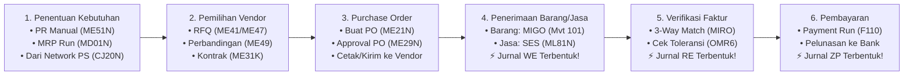
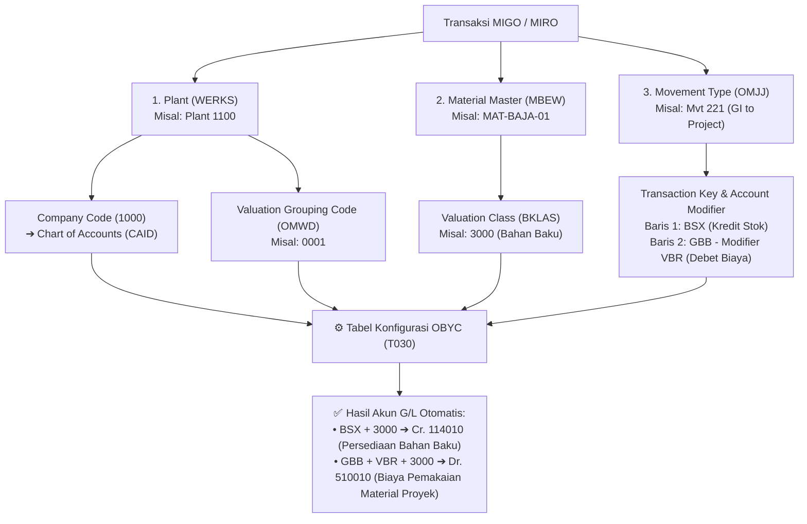

# Modul 03: SAP MM (Materials Management) & Skema Otomatisasi Akuntansi `OBYC`

> **Tujuan Pembelajaran:**
> 1. Menguasai siklus lengkap **Procure-to-Pay (P2P)** untuk pengadaan Barang (*Stock & Non-Stock*) maupun Jasa (*External Services*).
> 2. Memahami matriks **Item Category** & **Account Assignment Category** (`Blank`, `K`, `A`, `P`, `Q`) yang menghubungkan MM ke PS dan FI.
> 3. Memahami contoh **Movement Types** di `MIGO` (`101`, `103/105`, `201`, `221`, `281`, `301`, `311`, `411 Q`, `561`) sesuai produk dan konfigurasi.
> 4. Membedah mekanisme **Three-Way Matching (`MIRO`)** dan rumus sakti **Automatic Account Determination (`OBYC`)** (`BSX`, `WRX`, `GBB-VBR`, `PRD`, `FR1`, `KDM`).

---

## 1. Siklus End-to-End Procure-to-Pay (P2P)

Siklus P2P di SAP MM adalah tulang punggung rantai pasok perusahaan yang menghubungkan gudang, tim pengadaan, proyek, dan bagian keuangan.
Contoh GUI berikut terutama ECC dan S/4HANA on-premise/private. Public Cloud menggunakan aplikasi dan konfigurasi yang dirilis untuk edisinya. Jurnal, akun, nilai, pajak, dan perilaku dalam tabel adalah contoh bersyarat, bukan jaminan untuk semua konfigurasi.

---

## 2. Purchase Requisition (`ME51N`) & Purchase Order (`ME21N`)

Baik pada dokumen **PR (`ME51N`)** maupun **PO (`ME21N`)**, terdapat dua kolom kecil di tabel *Item Overview* yang menentukan seluruh perilaku logistik dan akuntansi transaksi tersebut: **Item Category (`PSTYP`)** dan **Account Assignment Category (`KNTTP`)**.

### 2.1 Matriks Item Category (Apa Bentuk Fisik yang Dibeli?)

| Kode | Nama Item Category | Karakteristik & Proses |
| :---: | :--- | :--- |
| **`Blank` (Kosong)** | **Standard** | Pembelian barang berwujud standar (masuk gudang atau langsung dipakai proyek). |
| **`D`** | **Service (Jasa klasik)** | External Services Management dengan service lines dan SES klasik `ML81N`, bila tersedia. Lean services adalah proses berbeda dengan aplikasi dan item yang didukung edisi/rilis, bukan padanan satu-banding-satu `ML81N`. |
| **`K`** | **Consignment (Konsinyasi)** | Barang milik vendor dititipkan di gudang kita. Saat `MIGO` masuk tidak ada jurnal akuntansi; hutang baru timbul saat barang diambil dari gudang konsinyasi untuk dipakai (`Mvt 201 K` / `221 K`). |
| **`L`** | **Subcontracting (Maklon)** | Kita mengirim bahan baku ke vendor (`Mvt 541`), vendor merakitnya menjadi barang jadi, lalu saat barang jadi diterima (`MIGO 101`), bahan baku otomatis terpotong (`Mvt 543`). |
| **`U`** | **Stock Transfer** | Memindahkan stok antar-Plant dalam perusahaan sendiri menggunakan dokumen *Stock Transport Order (STO)*. |
| **`S`** | **Third-Party** | Barang dikirim langsung oleh vendor ke pelanggan kita (*Drop-ship*) tanpa mampir ke gudang kita. |

---

### 2.2 Matriks Account Assignment Category (Siapa yang Menanggung Biayanya?)

Ini adalah **titik penghubung paling krusial** antara modul **MM**, **PS**, dan **FI/CO**:

| Kode | Nama Kategori | Masuk Stok Gudang? | Objek Biaya yang Wajib Diisi | Jurnal Saat Barang Datang (`MIGO 101`) |
| :---: | :--- | :---: | :--- | :--- |
| **`Blank` (Kosong)** | **Stock Material** | Ya, untuk material stok bernilai | Tidak ada objek biaya langsung | Contoh GR bernilai: Dr persediaan (`BSX`), Cr GR/IR (`WRX`). |
| **`K`** | **Cost Center** | Umumnya konsumsi langsung | Cost Center & G/L sesuai field status | Contoh valuated GR: Dr biaya, Cr GR/IR; akun konsumsi dapat berasal dari account assignment, tidak selalu `GBB-VBR`. |
| **`A`** | **Asset** | Umumnya konsumsi langsung | Nomor aset | Contoh valuated GR: Dr aset, Cr GR/IR; waktu kapitalisasi tergantung setting. |
| **`P`** | **Project** | Umumnya konsumsi langsung | WBS & G/L sesuai konfigurasi | Contoh valuated GR: Dr biaya proyek, Cr GR/IR. Non-valuated GR dapat menunda posting biaya sampai faktur. |
| **`Q`** | **Project Stock** | Stok khusus proyek | WBS | Untuk **valuated project stock**, contoh GR: Dr persediaan proyek, Cr GR/IR; issue ke objek proyek dapat membentuk actual cost. Perlakuan non-valuated berbeda. |
| **`N`** | **Network** | Umumnya konsumsi langsung | Network & activity | Contoh valuated GR: Dr biaya network, Cr GR/IR. |

> **`P` vs `Q`:** Pilih berdasarkan desain direct consumption versus project stock, termasuk valuasi dan kebutuhan proyek. Dalam fixture valuated `Q` di Modul 05, GR belum menjadi actual cost; issue membentuk actual. Perlindungan `heldQ` terhadap anggaran adalah kebijakan reservasi **lab lokal**, bukan interpretasi universal `COOI` SAP.

---

### 2.3 Release Strategy (Matriks Persetujuan Berjenjang PR & PO)

Release strategy berbasis classification adalah salah satu mekanisme klasik ECC/on-premise. S/4HANA juga dapat menggunakan flexible workflow menurut dokumen dan konfigurasi; Public Cloud menggunakan workflow/aplikasi yang dirilis untuk edisinya.

1. **Characteristics (`CT04`):** Variabel penentu syarat approval, mengambil data dari struktur tabel `CEBAN` (untuk PR) atau `CEKKO` (untuk PO), contoh:
   - `CEKKO-GNETW` (Total Nilai Bersih PO: Level 1 $\le$ Rp 50 Jt, Level 2 Rp 50 Jt – Rp 500 Jt, Level 3 $>$ Rp 500 Jt).
   - `CEKKO-EKORG` (Purchasing Organization) & `CEKKO-BSART` (Document Type `NB`).
2. **Class (`CL02` — Class Type `032`):** Wadah yang menggabungkan karakteristik di atas.
3. **Release Group, Release Codes, & Release Indicators (SPRO `OMGS`):**
   - *Release Code:* Jabatan penyetuju (misal: `R1` Supervisor Pengadaan, `R2` Manajer Logistik, `R3` Direktur Keuangan).
   - *Release Indicator:* status dan konsekuensi dokumen ditentukan konfigurasi; jangan mengasumsikan kode `B` atau `R` berlaku di semua sistem.
4. **Transaksi Eksekusi Approval:**
   - Approval PR: **`ME54N`** (atau Fiori App *My Inbox - Approve Purchase Requisitions*).
   - Approval PO: **`ME29N`** (Individual) atau **`ME28`** (Daftar PO yang menunggu persetujuan).

---

## 3. Pengadaan Jasa Eksternal — Service Entry Sheet (`ML81N`)

Untuk jasa klasik pada ECC atau S/4HANA on-premise/private yang mendukung External Services Management, SES `ML81N` dapat mencatat penerimaan jasa. Lean services menggunakan proses SES terpisah; ketersediaannya bergantung edisi dan rilis.

1. **Buat PO Jasa di `ME21N`:**
   - Isi **Item Category = `D` (Service)** dan **Account Assignment Category = `P` (Project)** atau `K` (Cost Center).
   - Kolom Material dikosongkan; isi *Short Text* (misal: `"Pekerjaan Pondasi Gardu Induk"`), *Quantity = 1 AU*, lalu di tab **Services** di bagian bawah, rincikan baris-baris item pekerjaan dan harganya (misal: Galian Tanah 100 $m^3$ @ Rp 150.000, Pengecoran 50 $m^3$ @ Rp 1.200.000).
2. **Catat Progres Pekerjaan di `ML81N`:**
   - Ketika kontraktor menyelesaikan pekerjaan (misal progres termin 1 sebesar 50%), buat *Service Entry Sheet* mengacu pada nomor PO tadi.
3. **Setujui (Accept/Release) SES di `ML81N`:**
   - Klik ikon **Bendera Hijau (*Release/Accept*)** lalu klik **Save**.
   - **Di belakang layar:** Acceptance dapat membuat goods receipt dan, untuk GR bernilai, jurnal seperti contoh berikut; ini bukan operasi manual `MIGO` dan hasil bergantung PO/konfigurasi:
     $$\begin{aligned}
     \text{Dr. } & \text{Biaya Jasa Proyek } (\text{G/L } 510020 + \text{WBS Element}) \\
     \text{Cr. } & \text{GR/IR Clearing Services } (\text{G/L } 210095 - \text{WRX})
     \end{aligned}$$

---

## 4. Inventory Management (`MIGO`) & Master Movement Types

Transaksi **`MIGO`** digunakan untuk seluruh pergerakan fisik barang: *Goods Receipt* (Barang Masuk), *Goods Issue* (Barang Keluar), *Transfer Posting* (Pindah Gudang/Status), dan *Cancellation* (Pembatalan).

### Tabel Referensi Lengkap Movement Types (`OMJJ`)

| Mvt Type | Reversal | Nama & Kegunaan Transaksi | Dampak Stok Fisik | Membentuk Jurnal FI? |
| :---: | :---: | :--- | :--- | :---: |
| **`101`** | `102` | GR PO ke stok atau account assignment. | Bertambah jika masuk stok. | Bergantung valuasi dan item; contoh Dr stok/biaya, Cr GR/IR. |
| **`103`** | `104` | GR ke GR blocked stock non-valuated. | Masuk GR blocked stock. | Biasanya tidak untuk varian non-valuated; periksa setting. |
| **`105`** | `106` | Release dari GR blocked stock. | Masuk stok tujuan atau konsumsi. | Bergantung valuasi dan item. |
| **`107`** | `108` | GR ke valuated GR blocked stock, misalnya origin acceptance. | Nilai dapat diakui sebelum penerimaan fisik. | Dapat membentuk jurnal FI saat penerimaan. |
| **`109`** | `110` | Release valuated GR blocked stock. | Masuk jenis stok tujuan. | Nilai telah diakui pada `107`; efek bergantung konfigurasi. |
| **`122`** | `123` | Return delivery ke vendor. | Berkurang jika dari stok. | Bergantung valuasi; contoh Dr GR/IR, Cr stok. |
| **`201`** | `202` | Issue ke cost center. | Berkurang. | Untuk stok bernilai, contoh Dr biaya, Cr stok. |
| **`221`** | `222` | Issue ke WBS; `Q` menunjukkan project stock. | Berkurang. | Untuk stok bernilai, contoh Dr biaya proyek, Cr stok. |
| **`261`** | `262` | Issue ke order. | Berkurang. | Bergantung valuasi dan account determination. |
| **`281`** | `282` | Issue ke network. | Berkurang. | Bergantung valuasi dan account determination. |
| **`301`** | `302` | Transfer antar-plant satu langkah. | Plant asal berkurang, tujuan bertambah. | Bergantung valuation area, nilai dan akun; tidak selalu jurnal FI. |
| **`311`** | `312` | Transfer antar storage location dalam plant. | Asal berkurang, tujuan bertambah. | Biasanya tidak untuk transfer stok senilai yang sama. |
| **`411 Q`** | Periksa rilis | Transfer dari project stock ke own stock. | Project stock berkurang, own stock bertambah. | Bergantung valuasi dan akun. |
| **`551`** | `552` | Issue untuk scrapping. | Berkurang. | Bergantung valuasi; contoh offset `GBB-VNG`. |
| **`561`** | `562` | Initial stock entry. | Bertambah. | Bergantung valuasi; contoh offset `GBB-BSA`. |
| **`701` / `702`** | Sesuai transaksi pembalikan | Selisih lebih/kurang physical inventory. | Menyesuaikan stok. | Bergantung valuasi; contoh `GBB-INV`. |

Rujukan arah `411 Q`: [SAP Library 4.6C — Project Stock](https://help.sap.com/saphelp_46c/helpdata/en/4d/2b92c943ad11d189410000e829fbbd/content.htm). Ini sumber historis, bukan bukti fitur setiap rilis terbaru; periksa dokumentasi rilis dan konfigurasi sistem tujuan.
Untuk perbedaan `103`/`105` non-valuated dan `107`/`109` valuated, lihat [SAP Learning S/4HANA — goods receipt dengan referensi](https://learning.sap.com/courses/inventory-management-and-physical-inventory-in-sap-s-4hana/posting-a-goods-receipt-with-reference).
---

## 5. Bedah Tuntas Konfigurasi `OBYC`: Bagaimana MM Menjurnal Otomatis ke FI?

Pertanyaan wawancara dan ujian sertifikasi SAP paling klasik:
> *"Staf gudang saat memposting `MIGO` hanya memasukkan Kode Material dan Kuantitas. Dia sama sekali tidak mengetik nomor akun G/L. Bagaimana sistem SAP tahu akun G/L mana yang harus di-Debet dan di-Kredit?"*

Jawabannya antara lain melalui **Automatic Account Determination (`OBYC` — konfigurasi `T030`)**. Kunci yang digunakan bergantung aturan tiap transaksi: chart of accounts, valuation grouping, transaction/event key, account modifier dan valuation class tidak selalu semuanya digunakan. Posting key berbeda dari transaction key; direct account assignment dapat memasok akun konsumsi.

### 5.1 Rantai Logika Penentuan Akun (`OBYC` Lookup Chain)

### 5.2 Kamus Lengkap Transaction Keys di `OBYC`

Kuasai 6 *Transaction Keys* utama berikut beserta fungsinya:

| Transaction Key | Nama Kunci | Kapan Dipicu? | Modifier Penting | Contoh Akun G/L yang Dipetakan |
| :---: | :--- | :--- | :---: | :--- |
| **`BSX`** | **Inventory Posting** | Setiap ada penambahan atau pengurangan stok bernilai (*valuated stock*) di gudang (`101` Stock, `201`, `221`, `561`). | Tidak pakai modifier (langsung per Valuation Class) | • Val. Class `3000` $\rightarrow$ `114010` Persediaan Bahan Baku • Val. Class `3040` $\rightarrow$ `114040` Persediaan Suku Cadang |
| **`WRX`** | **GR/IR Clearing** | GR/IR untuk item dan kondisi relevan. | Aturan account determination bergantung konfigurasi. | Contoh `210090` GR/IR. |
| **`GBB`** | **Offsetting Entry for Inventory Posting** | Offset untuk berbagai inventory posting. | Contoh `VBR` konsumsi, `VNG` scrap, `INV` selisih inventaris, `BSA` saldo awal; modifier bergantung movement/configuration. | Contoh akun biaya dan offset saldo awal. |
| **`PRD`** | **Price Differences** | Selisih harga dapat masuk akun ini, misalnya standard price atau stok MAP tidak mencukupi. | Bergantung konfigurasi. | Contoh akun selisih harga. |
| **`FR1` / `FR3`** | **Planned delivery costs** | Dapat digunakan untuk biaya pengiriman yang direncanakan sesuai kondisi harga dan konfigurasi. | Bergantung kondisi dan konfigurasi. | Contoh clearing freight. |
| **`KDM`** | **Exchange-rate differences** | Dapat digunakan untuk selisih kurs GR/IR sesuai skenario dan konfigurasi; tidak setiap perbedaan kurs otomatis ke KDM. | Bergantung konfigurasi. | Contoh akun selisih kurs. |

---

### 5.3 Perbedaan Jurnal Harga `V` (Moving Average) vs `S` (Standard Price)

Mari kita buktikan dengan angka bagaimana indikator **Price Control (`V` vs `S`)** di Material Master mengubah jurnal saat ada kenaikan harga di faktur **`MIRO`**:

Rujukan SAP Learning S/4HANA: [Material Ledger, price control dan actual costing](https://learning.sap.com/courses/product-cost-planning-in-sap-s-4hana/describing-material-ledger). Contoh di bawah adalah asumsi ilustratif, bukan kutipan jurnal SAP untuk setiap konfigurasi.
* **Kondisi Awal:** Contoh sederhana tanpa pajak, delivery costs, pembulatan, actual costing period-end atau transaksi lain; harga dan toleransi memungkinkan faktur diposting.
  - Stok awal di gudang = 0.
  - Buat PO 100 unit @ Rp 10.000/unit (Total PO = Rp 1.000.000).
  - Barang datang 100 unit (`MIGO 101`).
  - Ternyata saat tagihan `MIRO` datang, vendor menagih **Rp 1.100.000** (ada kenaikan harga Rp 100.000).

| Tahap Transaksi | Jika Material Memakai **Price Control `V` (Moving Average Price)** | Jika Material Memakai **Price Control `S` (Standard Price = Rp 9.500/unit)** |
| :--- | :--- | :--- |
| **1. Saat `MIGO 101`** | **Dr. Persediaan (`BSX`) Rp 1.000.000** **Cr. GR/IR (`WRX`) Rp 1.000.000** *(MAP menjadi Rp 10.000/unit)* | **Dr. Persediaan (`BSX`) Rp 950.000** *(100 x Harga Standar 9.500)* **Dr. Selisih Harga (`PRD`) Rp 50.000** **Cr. GR/IR (`WRX`) Rp 1.000.000** |
| **2. Saat `MIRO` (Tagihan Rp 1.100.000, stok 100 unit masih utuh di gudang)** | **Dr. GR/IR (`WRX`) Rp 1.000.000** **Dr. Persediaan (`BSX`) Rp 100.000** *(Selisih langsung diserap ke nilai stok!)* **Cr. Hutang Vendor (`31`) Rp 1.100.000** *(MAP naik menjadi Rp 11.000/unit)* | **Dr. GR/IR (`WRX`) Rp 1.000.000** **Dr. Selisih Harga (`PRD`) Rp 100.000** *(Stok tidak boleh berubah dari harga standar!)* **Cr. Hutang Vendor (`31`) Rp 1.100.000** |
| **3. Bagaimana jika pada material `V` (MAP), sebelum `MIRO` masuk, 60 unit sudah dipakai proyek (sisa stok di gudang tinggal 40 unit)?** | Karena stok tersisa hanya 40 unit (40%), maka nilai persediaan hanya boleh menyerap 40% dari selisih (Rp 40.000), sedangkan 60% sisanya (Rp 60.000) masuk ke `PRD`: **Dr. GR/IR (`WRX`) Rp 1.000.000** **Dr. Persediaan (`BSX`) Rp 40.000** **Dr. Selisih Harga (`PRD`) Rp 60.000** **Cr. Hutang Vendor (`31`) Rp 1.100.000** | Tetap masuk ke `PRD` Rp 100.000. |

---

## 6. Logistics Invoice Verification (`MIRO`) & Three-Way Matching

Saat staf keuangan membuka T-Code **`MIRO`** dan memasukkan Nomor PO:
1. Sistem mengambil **Harga PO** dari tabel `EKPO`.
2. Sistem mengambil **Kuantitas Barang Diterima** dari riwayat PO `EKBE` (`MIGO 101` atau `ML81N`).
3. Staf keuangan memasukkan **Jumlah Tagihan Fisik** dari faktur vendor.

Jika selisih melampaui toleransi, sistem dapat memblokir pembayaran atau menolak posting menurut jenis pemeriksaan dan konfigurasi. `MRBR` dapat digunakan untuk me-release invoice yang memenuhi syarat; matching sendiri tidak menjamin faktur langsung dibayar, karena jatuh tempo, blokir lain, proposal dan konfigurasi pembayaran juga diperiksa.

Rujukan SAP Learning S/4HANA: [invoice verification dan payment block](https://learning.sap.com/courses/business-processes-in-sap-s-4hana-sourcing-procurement/entering-an-invoice) dan [GR-based invoice verification serta reversal](https://learning.sap.com/courses/invoice-verification-in-sap-s-4hana/using-different-types-of-invoice-verification).

---

> **Selanjutnya:** Lanjut ke **[Modul 04: SAP PS (Project System)](./04-sap-ps-project-system.md)** untuk membedah cara merancang struktur proyek WBS, mengunci anggaran (*Availability Control*), dan melakukan kapitalisasi aset proyek.
