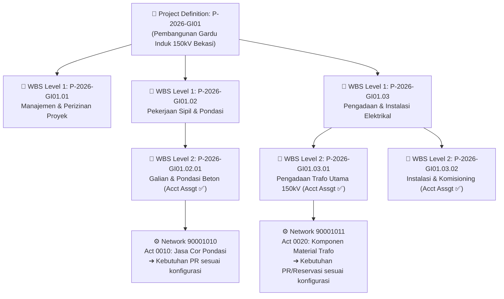
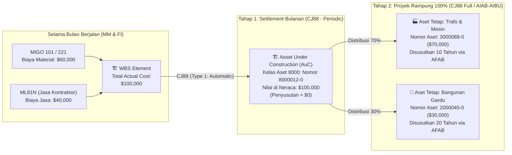

# Modul 04: SAP PS (Project System) — WBS, Budgeting, AVAC, & Kapitalisasi CAPEX

> **Tujuan Pembelajaran:**
> 1. Memahami 3 kategori proyek di SAP PS (**CAPEX Investment Project**, **OPEX Overhead Project**, dan **Customer Revenue Project**).
> 2. Menguasai pembuatan struktur proyek di **`CJ20N` (Project Builder)**: **Project Definition**, **WBS Element**, serta **Network & Activities** yang otomatis memicu pembuatan PR dan Reservasi di modul MM.
> 3. Memahami perbedaan **Cost Planning (`CJ40`)** vs **Budgeting (`CJ30`/`CJ32`)** serta rumus kerja mesin **Availability Control (AVAC)**.
> 4. Menguasai proses **Settlement Akhir Bulan (`CJ88`)** dari WBS $\rightarrow$ *Asset Under Construction (AuC)* $\rightarrow$ *Final Fixed Asset* di modul FI-AA.

---

## 1. Tiga Kategori Proyek di SAP PS

Modul **SAP PS (Project System)** dirancang untuk merencanakan, mengendalikan anggaran, mengeksekusi pengadaan, dan mempertanggungjawabkan biaya proyek secara presisi. Berdasarkan tujuan akhirnya, proyek di SAP PS terbagi menjadi 3 jenis:
Contoh ini terutama menggambarkan classic PS pada ECC dan S/4HANA on-premise/private; Public Cloud memiliki proses, aplikasi, dan opsi konfigurasi yang berbeda menurut rilis. Status, AVAC, commitment dan settlement bergantung profil serta aturan yang dikonfigurasi.

| Jenis Proyek | Contoh Bisnis Nyata | Sumber Pendanaan | Muara Akhir Biaya (*Settlement Receiver* di `CJ88`) |
| :--- | :--- | :--- | :--- |
| **1. Investment / CAPEX Project** *(Proyek Investasi Modal)* | Pembangunan pabrik baru, gardu induk listrik, gudang baru, instalasi mesin produksi utama. | Anggaran Belanja Modal (*Capital Expenditure / CAPEX*). | • **Bulanan:** Masuk ke **AuC (*Asset Under Construction*)**.<br>• **Saat Selesai 100%:** Masuk ke **Fixed Asset (FI-AA)** untuk disusutkan. |
| **2. Overhead / Cost Project** *(Proyek Biaya Internal / R&D)* | Proyek riset produk baru, pelatihan akbar, renovasi ringan, proyek implementasi IT internal. | Anggaran Operasional (*OPEX*). | Di-*settle* ke **Cost Center (CO-OM)** atau G/L Beban pada akhir periode. |
| **3. Customer / Revenue Project** *(Proyek Kontraktor / EPC)* | Perusahaan konstruksi yang membangun gedung milik klien luar dan menagih per termin (*progress billing*). | Pendapatan kontrak dari Pelanggan (*Sales Order* SD `VA01`). | Menghitung WIP/POC via *Results Analysis* (`KKA2`) dan di-*settle* ke **Profitability Segment (CO-PA)** serta FI. |

---

## 2. Arsitektur Struktur Proyek di `CJ20N` (Project Builder)

Transaksi utama yang menyatukan seluruh pengelolaan struktur proyek di SAP PS adalah **`CJ20N` (Project Builder)**. Di dalam `CJ20N`, struktur proyek disusun menggunakan dua komponen utama: **WBS (Work Breakdown Structure)** dan **Network Activities**.



### 2.1 Perbedaan WBS Element vs Network Activity

| Aspek | WBS Element (Tabel `PRPS`) | Network & Activity (Tabel `AUFK` & `AFVC`) |
| :--- | :--- | :--- |
| **Fokus Utama** | **Struktur Hirarki Biaya & Anggaran (Vertikal):** Siapa penanggung jawab anggaran dan berapa plafon budget tiap paket pekerjaan. | **Urutan Eksekusi, Jadwal, & Kebutuhan Logistik (Horizontal):** Pekerjaan apa dilakukan duluan (ketergantungan waktu *Finish-to-Start*) dan material/jasa apa yang harus dibeli. |
| **Fungsi di Keuangan** | Tempat dipasangnya **Budget (`CJ30`)**, tempat **AVAC** memeriksa sisa dana, dan tempat **AuC** dibuat untuk kapitalisasi ke FI-AA. | Tempat menempelnya **Material Components** yang secara otomatis memicu **Purchase Requisition (PR)** atau **Reservation** ke modul SAP MM! |

---

### 2.2 Bagaimana Network Activity PS Memicu Pengadaan Otomatis di MM?

Di dalam `CJ20N`, di bawah suatu WBS Element, seorang *Project Engineer* dapat membuat **Network Activity** dalam 4 jenis:

1. **Internal Activity:** Pekerjaan internal dengan work center dan activity type; konfirmasi/timesheet dicatat melalui transaksi yang tersedia dan ditetapkan dalam proses.
2. **External Processing Activity:** Dapat menghasilkan PR sesuai control key, tanggal pemicu, status, dan konfigurasi; tidak selalu tepat pada saat release.
3. **Service Activity:** Dapat menghasilkan kebutuhan jasa dan PR untuk proses jasa yang didukung; item category dan SES bergantung desain classic/lean serta edisi.
4. **Material Component:** Komponen stok dapat menghasilkan reservasi; kebutuhan external procurement dapat menghasilkan PR. Penetapan network/WBS, jenis stok, account assignment dan waktu pembentukan ditentukan item category, procurement indicator, status, dan konfigurasi.

---

## 3. Siklus Hidup Status Proyek (System Status Lifecycle)

Setiap WBS Element dan Network di SAP PS dikendalikan secara ketat oleh **System Status**. Anda harus hafal apa yang boleh dan tidak boleh dilakukan pada setiap status:

```text
[ CRTD ] ──────► [ REL ] ──────► [ TECO ] ──────► [ CLSD ]
Created          Released        Technically      Closed
                                 Completed
```

| Kode Status | Nama Status | Apa yang Terjadi & Apa yang Diizinkan? |
| :---: | :--- | :--- |
| **`CRTD`** | **Created** | Status awal; planning/budget dan transaksi yang diizinkan bergantung profil, objek dan business transaction control. |
| **`REL`** | **Released** | Memungkinkan transaksi yang relevan sesuai kontrol status. Investment profile dan konfigurasi yang memenuhi syarat dapat menghasilkan AuC; release saja bukan jaminan universal. |
| **`TECO`** | **Technically Completed** | Menandai penyelesaian teknis; konsekuensi PR/PO, invoice dan settlement bergantung status objek dan konfigurasi. |
| **`CLSD`** | **Closed** | Penutupan memerlukan prasyarat dan membatasi transaksi; jangan menganggap irreversibel atau identik pada semua objek. |

---

## 4. Cost Planning vs Budgeting & Mesin Availability Control (AVAC)

Jangan pernah menyamakan **Planning** dengan **Budgeting** di SAP PS:

* **Cost Planning (`CJ40` / Easy Cost Planning):** Perkiraan rincian biaya yang diusulkan dari bawah ke atas (*Bottom-Up*) oleh tim teknis sebelum proyek disetujui. Nilai Plan **tidak mengunci/memblokir** transaksi pembelian.
* **Budgeting (`CJ30` Original Budget & `CJ32` Release Budget):** Budget adalah plafon; release dan aktivasi AVAC adalah pengaturan berbeda. Profil menentukan apakah kontrol memakai current budget atau released budget, kapan aktif, tolerance limits dan respons per transaksi.

### 4.1 Rumus Konseptual Availability Control (AVAC)

Dalam contoh sederhana tanpa overlap atau kategori pengecualian, assigned value terdiri atas commitment relevan dan actual relevan. Budget yang tersedia adalah basis kontrol yang dikonfigurasi dikurangi assigned value. Nilai nyata juga dipengaruhi hierarki, transaksi, tolerance dan konfigurasi; PR yang dikonversi tidak boleh dihitung dua kali sebagai PR dan PO.

Rujukan SAP Learning S/4HANA: [budgeting, release dan budget updates](https://learning.sap.com/courses/project-financials-control-in-sap-s-4hana/performing-budgeting-functions) serta [profil dan toleransi availability control](https://learning.sap.com/courses/project-financials-control-in-sap-s-4hana/configuring-budgeting-functions). Release budget terpisah dari status `REL` WBS.

### 4.2 Simulasi Pergerakan Anggaran Proyek dari PR $\rightarrow$ PO $\rightarrow$ MIGO $\rightarrow$ MIRO

Berikut **ilustrasi direct consumption**, dengan kontrol aktif atas released budget, seluruh PR dikonversi, GR bernilai, invoice selisih dibebankan ke proyek, dan respons error dikonfigurasi. Ini bukan hasil universal untuk project stock `Q` atau semua sistem.

> WBS `P-2026-GI01.03.01` diberi **Budget (`CJ30`) = \$50,000**, seluruhnya direlease.

| Tahap Transaksi | PR Commitment | PO Commitment | Actual Cost | Total Assigned Value | Sisa Budget Tersedia | Penjelasan Logika SAP PS |
| :--- | :---: | :---: | :---: | :---: | :---: | :--- |
| **0. Budget Awal (`CJ30`/`CJ32`)** | \$0 | \$0 | \$0 | **\$0** | **\$50,000** | AVAC diasumsikan aktif oleh profil yang dikonfigurasi. |
| **1. Buat PR 1 Unit Trafo (`ME51N` = \$30,000)** | **\$30,000** | \$0 | \$0 | **\$30,000** | **\$20,000** | PR mengikat anggaran sebesar \$30,000 sebagai *PR Commitment*. |
| **2. PR diubah jadi PO (`ME21N` hasil negosiasi dapat diskon jadi \$28,000)** | **\$0** *(Lunas)* | **\$28,000** | \$0 | **\$28,000** | **\$22,000** | *PR Commitment* \$30,000 otomatis dihapus dan digantikan oleh *PO Commitment* sebesar harga kontrak PO (\$28,000). Sisa budget kembali naik jadi \$22,000! |
| **3. Barang Datang di Lokasi (`MIGO 101` = \$28,000)** | \$0 | **\$0** *(Lunas)* | **\$28,000** | **\$28,000** | **\$22,000** | *PO Commitment* berubah menjadi **Actual Cost** sebesar \$28,000 saat barang diterima. |
| **4. Faktur Vendor Masuk (`MIRO` ternyata ada tambahan biaya kirim tak terduga \$1,000 $\rightarrow$ Total \$29,000)** | \$0 | \$0 | **\$29,000** | **\$29,000** | **\$21,000** | Selisih faktur \$1,000 langsung menambah *Actual Cost* proyek menjadi \$29,000. |
| **5. Staf mencoba buat PO baru untuk Kabel senilai \$25,000** | - | - | - | *Akan menjadi \$54,000 (> \$50,000)* | Contoh penolakan | Kekurangan \$4,000; sistem hanya menolak jika respons error untuk transaksi dan ambang batas tersebut dikonfigurasi. |

### 4.3 Bagaimana Jika Terjadi Error *Budget Exceeded* di Lapangan?
1. Periksa actual, open commitment, profil dan toleransi sebelum mengubah dokumen.
2. Jika disetujui, lakukan supplement, transfer atau return melalui fungsi budget update classic PS. Periksa label transaksi dan arah sender/receiver di IMG sistem: kode `CJ34`/`CJ35` tidak dipetakan di sini karena sumber primer yang dibaca belum menetapkan pemetaan itu. Release tambahan bila profil memerlukannya.
3. Alternatif bisnis: negosiasikan ulang nilai atau kuantitas PO.

---

## 5. Period-End Settlement (`CJ88`) & Kapitalisasi Proyek ke Aset Tetap (FI-AA)

Biaya investasi yang memenuhi kriteria kapitalisasi dapat dikumpulkan di WBS lalu diselesaikan ke AuC dan aset final. Kelayakan akuntansi, receiver, timing dan jenis settlement harus ditentukan kebijakan perusahaan serta konfigurasi; tidak semua biaya proyek otomatis dapat dikapitalisasi.

`CJ88` dapat menjalankan settlement WBS individual dalam classic PS; periodic dan final settlement harus mengikuti investment profile, settlement rule dan proses aset yang digunakan.

Rujukan SAP Learning S/4HANA: [settlement rule, investment measure dan AuC](https://learning.sap.com/courses/discovering-the-basics-of-sap-s-4hana-project-system/executing-period-end-closing-activities_a362398a-e47c-45fd-b16f-39bce45fb32f).



### Jurnal Akuntansi Saat Settlement `CJ88` Dijalankan:

#### A. Jurnal Tahap 1: Settlement Bulanan WBS ke AuC (`CJ88` Processing Type `1 - Automatic`)
```text
Dr. [PKey 70] Aset Dalam Penyelesaian / AuC (8000012-0 -> G/L 129010)     $100,000
    Cr. [PKey 50] Akun Settlement Proyek CAPEX (G/L 599010 + WBS Element) $100,000
```
* **Hasil di Laporan Keuangan Bulan Berjalan:**
  - Di Laporan Laba Rugi (P&L): Biaya proyek (USD 100,000 Debet) dikurangi Akun Settlement Proyek (USD 100,000 Kredit) = **USD 0 (Netral di Laba Rugi)**.
  - Di Laporan Neraca (*Balance Sheet*): Muncul aset baru **AuC senilai USD 100,000**.

#### B. Jurnal Tahap 2: Kapitalisasi Akhir AuC ke Aset Tetap Final (`CJ88` Full Settlement / `AIBU`)
Ketika proyek selesai 100% dan berita acara komisioning ditandatangani:
1. Buat Master Aset Tetap Final di **`AS01`** (misal Aset Mesin Trafo `3000088-0` dan Aset Bangunan Gardu `2000045-0`).
2. Tetapkan aturan distribusi final yang sesuai proses WBS investment measure atau, untuk AuC line-item settlement yang relevan, gunakan `AIAB`.
3. Eksekusi settlement final melalui proses yang dikonfigurasi (`CJ88` atau `AIBU` sesuai jenis AuC):
   ```text
   Dr. [PKey 70] Aset Tetap Mesin & Trafo (3000088-0 -> G/L 121030)       $70,000
   Dr. [PKey 70] Aset Tetap Bangunan Gardu (2000045-0 -> G/L 121020)     $30,000
       Cr. [PKey 75] Aset Dalam Penyelesaian / AuC (8000012-0 -> 129010)  $100,000
   ```
* **Hasil contoh:** AuC menjadi USD 0 setelah seluruh nilai memenuhi syarat dialokasikan. Awal penyusutan aset final ditentukan asset value date, depreciation key, period control dan konfigurasi, bukan semata-mata pelaksanaan settlement.

---

> **Selanjutnya:** Lanjut ke **[Modul 05: Integrasi Emas MM-PS-FI & Studi Kasus End-to-End](./05-integration-and-end-to-end-case-study.md)** untuk mempraktikkan simulasi utuh 10 langkah dari awal proyek hingga pelunasan bank dan kapitalisasi aset.
