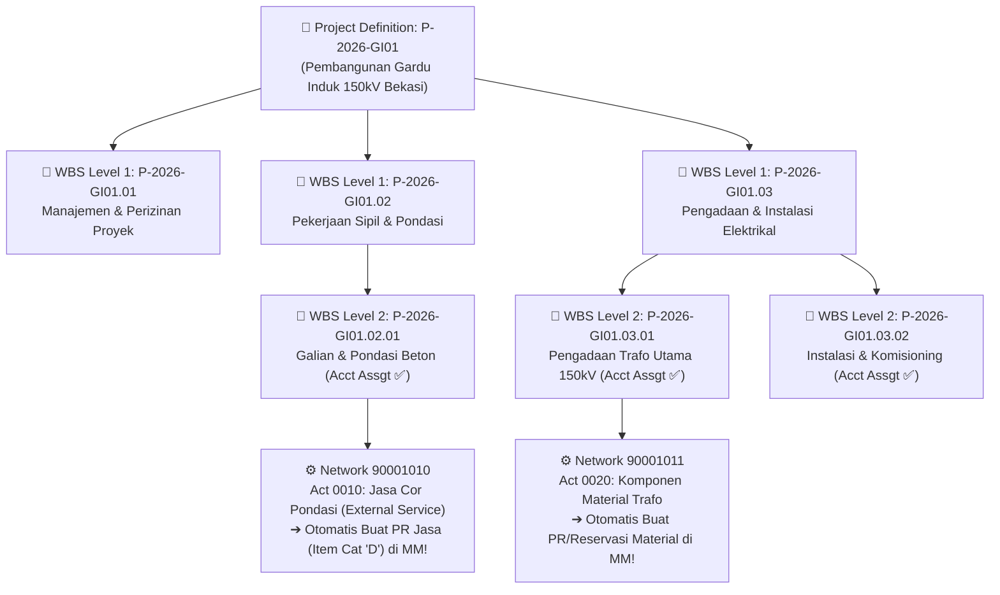
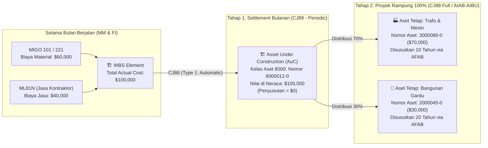

# Modul 04: SAP PS (Project System) — WBS, Budgeting, AVAC, & Kapitalisasi CAPEX

> **Tujuan Pembelajaran:**
> 1. Memahami 3 kategori proyek di SAP PS (**CAPEX Investment Project**, **OPEX Overhead Project**, dan **Customer Revenue Project**).
> 2. Menguasai pembuatan struktur proyek di **`CJ20N` (Project Builder)**: **Project Definition**, **WBS Element**, serta **Network & Activities** yang otomatis memicu pembuatan PR dan Reservasi di modul MM.
> 3. Memahami perbedaan **Cost Planning (`CJ40`)** vs **Budgeting (`CJ30`/`CJ32`)** serta rumus kerja mesin **Availability Control (AVAC)**.
> 4. Menguasai proses **Settlement Akhir Bulan (`CJ88`)** dari WBS $\rightarrow$ *Asset Under Construction (AuC)* $\rightarrow$ *Final Fixed Asset* di modul FI-AA.

---

## 1. Tiga Kategori Proyek di SAP PS

Modul **SAP PS (Project System)** dirancang untuk merencanakan, mengendalikan anggaran, mengeksekusi pengadaan, dan mempertanggungjawabkan biaya proyek secara presisi. Berdasarkan tujuan akhirnya, proyek di SAP PS terbagi menjadi 3 jenis:

| Jenis Proyek | Contoh Bisnis Nyata | Sumber Pendanaan | Muara Akhir Biaya (*Settlement Receiver* di `CJ88`) |
| :--- | :--- | :--- | :--- |
| **1. Investment / CAPEX Project** *(Proyek Investasi Modal)* | Pembangunan pabrik baru, gardu induk listrik, gudang baru, instalasi mesin produksi utama. | Anggaran Belanja Modal (*Capital Expenditure / CAPEX*). | • **Bulanan:** Masuk ke **AuC (*Asset Under Construction*)**.<br>• **Saat Selesai 100%:** Masuk ke **Fixed Asset (FI-AA)** untuk disusutkan. |
| **2. Overhead / Cost Project** *(Proyek Biaya Internal / R&D)* | Proyek riset produk baru, pelatihan akbar, renovasi ringan, proyek implementasi IT internal. | Anggaran Operasional (*OPEX*). | Di-*settle* ke **Cost Center (CO-OM)** atau G/L Beban pada akhir periode. |
| **3. Customer / Revenue Project** *(Proyek Kontraktor / EPC)* | Perusahaan konstruksi yang membangun gedung milik klien luar dan menagih per termin (*progress billing*). | Pendapatan kontrak dari Pelanggan (*Sales Order* SD `VA01`). | Menghitung WIP/POC via *Results Analysis* (`KKA2`) dan di-*settle* ke **Profitability Segment (CO-PA)** serta FI. |

---

## 2. Arsitektur Struktur Proyek di `CJ20N` (Project Builder)

Transaksi utama yang menyatukan seluruh pengelolaan struktur proyek di SAP PS adalah **`CJ20N` (Project Builder)**. Di dalam `CJ20N`, struktur proyek disusun menggunakan dua komponen utama: **WBS (Work Breakdown Structure)** dan **Network Activities**.



### 2.1 Perbedaan WBS Element vs Network Activity

| Aspek | WBS Element (Tabel `PRPS`) | Network & Activity (Tabel `AUFK` & `AFVC`) |
| :--- | :--- | :--- |
| **Fokus Utama** | **Struktur Hirarki Biaya & Anggaran (Vertikal):** Siapa penanggung jawab anggaran dan berapa plafon budget tiap paket pekerjaan. | **Urutan Eksekusi, Jadwal, & Kebutuhan Logistik (Horizontal):** Pekerjaan apa dilakukan duluan (ketergantungan waktu *Finish-to-Start*) dan material/jasa apa yang harus dibeli. |
| **Fungsi di Keuangan** | Tempat dipasangnya **Budget (`CJ30`)**, tempat **AVAC** memeriksa sisa dana, dan tempat **AuC** dibuat untuk kapitalisasi ke FI-AA. | Tempat menempelnya **Material Components** yang secara otomatis memicu **Purchase Requisition (PR)** atau **Reservation** ke modul SAP MM! |

---

### 2.2 Bagaimana Network Activity PS Memicu Pengadaan Otomatis di MM?

Di dalam `CJ20N`, di bawah suatu WBS Element, seorang *Project Engineer* dapat membuat **Network Activity** dalam 4 jenis:

1. **Internal Activity:** Pekerjaan oleh teknisi internal perusahaan. Mengacu pada *Work Center* (`CR01`) dan tarif biaya per jam di *Activity Type* (`KP26`). Realisasi jam kerja diinput di **`CN25`** atau Timesheet **`CAT2`**.
2. **External Processing Activity:** Pekerjaan yang diborongkan ke vendor luar. **Begitu status Activity di-*Release*, SAP PS otomatis menerbitkan nomor Purchase Requisition (PR)** yang langsung muncul di daftar kerja tim pengadaan MM (`ME53N` / `ME5A`)!
3. **Service Activity:** Pekerjaan jasa kontraktor (misal jasa konstruksi sipil). **Otomatis menerbitkan PR dengan Item Category `D` (Service)** untuk kemudian dibuatkan PO Jasa (`ME21N`) dan BAST (`ML81N`).
4. **Material Component (Di bawah Activity):**
   - Engineer memasukkan kode material (`MM03`) dan jumlah yang dibutuhkan proyek.
   - Pada kolom *Procurement Type*, engineer memilih:
     - **`Reservation for WBS / Network`**: Jika barangnya adalah stok gudang reguler $\rightarrow$ sistem membuat nomor **Reservasi (`MB23`)** agar orang gudang tinggal mengeluarkan barang dengan **`MIGO` Movement `281` / `221`**.
     - **`Purchase Requisition + Reservation for WBS`**: Jika barang harus dibeli khusus untuk proyek $\rightarrow$ sistem otomatis membuat **PR dengan Account Assignment `Q` (Project Stock) atau `P` (Direct Consumption)**!

---

## 3. Siklus Hidup Status Proyek (System Status Lifecycle)

Setiap WBS Element dan Network di SAP PS dikendalikan secara ketat oleh **System Status**. Anda harus hafal apa yang boleh dan tidak boleh dilakukan pada setiap status:

```text
[ CRTD ] ──────► [ REL ] ──────► [ TECO ] ──────► [ CLSD ]
Created          Released        Technically      Closed
                                 Completed
```

| Kode Status | Nama Status | Apa yang Terjadi & Apa yang Diizinkan? |
| :---: | :--- | :--- |
| **`CRTD`** | **Created** | • Proyek baru dirancang.<br>• **Boleh:** Input *Cost Planning* (`CJ40`) dan *Original Budget* (`CJ30`).<br>• **DILARANG:** Belum bisa dipakai membuat PR/PO (`ME51N`/`ME21N`), tidak bisa `MIGO`, dan tidak bisa dijurnal di FI (`FB50`). |
| **`REL`** | **Released** | • Proyek resmi disetujui untuk berjalan.<br>• **Keajaiban Integrasi PS-FI (Investment Profile `OITA`):** Begitu WBS proyek investasi diubah dari `CRTD` ke `REL` dan di-*Save*, **SAP secara otomatis membuatkan Master Data Asset Under Construction (AuC)** di modul FI-AA dan menautkannya di *Settlement Rule* WBS!<br>• **Boleh:** Semua transaksi pengadaan PR, PO, MIGO, ML81N, MIRO, FB50, dan Settlement `CJ88`. |
| **`TECO`** | **Technically Completed** | • Pekerjaan fisik konstruksi di lapangan sudah selesai.<br>• **DILARANG:** Tidak boleh lagi membuat PR atau PO baru untuk WBS ini.<br>• **Masih Boleh:** Menerima tagihan faktur `MIRO` atas PO lama yang belum ditagih, dan menjalankan *Full Settlement* (`CJ88`) dari AuC ke Aset Tetap Final. |
| **`CLSD`** | **Closed** | • Proyek sudah selesai 100% baik fisik maupun keuangan (saldo biaya yang belum di-*settle* = 0).<br>• **DILARANG:** Seluruh posting logistik maupun akuntansi dikunci permanen. |

---

## 4. Cost Planning vs Budgeting & Mesin Availability Control (AVAC)

Jangan pernah menyamakan **Planning** dengan **Budgeting** di SAP PS:

* **Cost Planning (`CJ40` / Easy Cost Planning):** Perkiraan rincian biaya yang diusulkan dari bawah ke atas (*Bottom-Up*) oleh tim teknis sebelum proyek disetujui. Nilai Plan **tidak mengunci/memblokir** transaksi pembelian.
* **Budgeting (`CJ30` Original Budget & `CJ32` Release Budget):** Plafon dana resmi yang disahkan oleh Direksi dari atas ke bawah (*Top-Down*). Begitu Budget disimpan dan di-*Release*, mesin **Availability Control (AVAC)** aktif menjaga agar proyek tidak bisa belanja melebihi anggaran!

### 4.1 Rumus Matematika Mesin Availability Control (AVAC)

Setiap kali ada seseorang di perusahaan yang membuat PR (`ME51N`), PO (`ME21N`), mengeluarkan barang gudang (`MIGO`), atau menjurnal biaya (`FB50`/`FB60`) dengan mencantumkan kode WBS, mesin **AVAC** menghitung rumus berikut secara *real-time*:

$$\text{Assigned Value (Dana Terikat)} = \text{PR Commitment} + \text{PO Commitment} + \text{Actual Cost}$$

$$\text{Available Budget (Sisa Anggaran)} = \text{Released Budget} - \text{Assigned Value}$$

### 4.2 Simulasi Pergerakan Anggaran Proyek dari PR $\rightarrow$ PO $\rightarrow$ MIGO $\rightarrow$ MIRO

Perhatikan bagaimana SAP PS memindahkan nilai dari **Commitment (Dana Dipesan)** menjadi **Actual Cost (Biaya Riil)** tanpa pernah menghitung ganda (*double counting*):

> **Misal:** WBS `P-2026-GI01.03.01` diberi **Budget (`CJ30`) = \$50,000**.

| Tahap Transaksi | PR Commitment | PO Commitment | Actual Cost | Total Assigned Value | Sisa Budget Tersedia | Penjelasan Logika SAP PS |
| :--- | :---: | :---: | :---: | :---: | :---: | :--- |
| **0. Budget Awal (`CJ30`)** | \$0 | \$0 | \$0 | **\$0** | **\$50,000** | Anggaran \$50,000 siap dipakai; status AVAC menjadi `AVAC` (Active). |
| **1. Buat PR 1 Unit Trafo (`ME51N` = \$30,000)** | **\$30,000** | \$0 | \$0 | **\$30,000** | **\$20,000** | PR mengikat anggaran sebesar \$30,000 sebagai *PR Commitment*. |
| **2. PR diubah jadi PO (`ME21N` hasil negosiasi dapat diskon jadi \$28,000)** | **\$0** *(Lunas)* | **\$28,000** | \$0 | **\$28,000** | **\$22,000** | *PR Commitment* \$30,000 otomatis dihapus dan digantikan oleh *PO Commitment* sebesar harga kontrak PO (\$28,000). Sisa budget kembali naik jadi \$22,000! |
| **3. Barang Datang di Lokasi (`MIGO 101` = \$28,000)** | \$0 | **\$0** *(Lunas)* | **\$28,000** | **\$28,000** | **\$22,000** | *PO Commitment* berubah menjadi **Actual Cost** sebesar \$28,000 saat barang diterima. |
| **4. Faktur Vendor Masuk (`MIRO` ternyata ada tambahan biaya kirim tak terduga \$1,000 $\rightarrow$ Total \$29,000)** | \$0 | \$0 | **\$29,000** | **\$29,000** | **\$21,000** | Selisih faktur \$1,000 langsung menambah *Actual Cost* proyek menjadi \$29,000. |
| **5. Staf mencoba buat PO baru untuk Kabel senilai \$25,000** | - | - | - | *Akan menjadi \$54,000 (> \$50,000)* | ❌ **DITOLAK (ERROR BP604)!** | Karena sisa budget hanya \$21,000 sedangkan PO baru meminta \$25,000 (kurang \$4,000), **AVAC memunculkan pesan Error Merah (`Budget Exceeded by $4,000`)** dan PO tidak bisa disimpan! |

### 4.3 Bagaimana Jika Terjadi Error *Budget Exceeded* di Lapangan?
Jika PO diblokir oleh AVAC karena anggaran kurang, ada 3 solusi resmi di SAP PS:
1. **Tambah Anggaran (*Budget Supplement* — T-Code `CJ37`):** Jika Direksi menyetujui penambahan plafon anggaran proyek dari cadangan perusahaan.
2. **Geser Anggaran dari WBS Lain (*Budget Transfer* — T-Code `CJ34`):** Memindahkan sisa anggaran dari WBS pekerjaan sipil yang hemat ke WBS elektrikal yang kekurangan dana.
3. **Kurangi Nilai/Kuantitas PO (`ME21N`):** Menegosiasikan ulang harga atau kuantitas barang agar masuk di bawah sisa budget yang tersedia.

---

## 5. Period-End Settlement (`CJ88`) & Kapitalisasi Proyek ke Aset Tetap (FI-AA)

Selama proyek investasi (CAPEX) berjalan, seluruh pembelian material dan jasa (`MIGO`, `ML81N`, `FB60`) berkumpul sebagai biaya di dalam WBS Element. Padahal menurut standar akuntansi (PSAK 16 / IAS 16), pengeluaran untuk membangun pabrik/gardu induk **bukanlah beban rugi-laba bulan tersebut**, melainkan harus dikapitalisasi ke Neraca sebagai **Aset Dalam Penyelesaian (*Asset Under Construction / AuC*)**.

Proses memindahkan biaya dari WBS PS ke modul FI-AA dilakukan setiap akhir bulan menggunakan T-Code **`CJ88` (Actual Settlement: Project/WBS)**.



### Jurnal Akuntansi Saat Settlement `CJ88` Dijalankan:

#### A. Jurnal Tahap 1: Settlement Bulanan WBS ke AuC (`CJ88` Processing Type `1 - Automatic`)
$$\begin{aligned}
\text{Dr. } & \text{Aset Dalam Penyelesaian / AuC } (\text{Asset } 8000012\text{-}0 \rightarrow \text{G/L } 129010, \text{ PKey } 70) \quad \$100,000 \\
\text{Cr. } & \text{Akun Settlement Proyek CAPEX } (\text{G/L } 599010 + \text{WBS Element}, \text{ PKey } 50) \quad \$100,000
\end{aligned}$$
* **Hasil di Laporan Keuangan Bulan Berjalan:**
  - Di Laporan Laba Rugi (P&L): Biaya proyek (\$100,000 Debet) dikurangi Akun Settlement Proyek (\$100,000 Kredit) = **\$0 (Netral di Laba Rugi)**.
  - Di Laporan Neraca (*Balance Sheet*): Muncul aset baru **AuC senilai \$100,000**.

#### B. Jurnal Tahap 2: Kapitalisasi Akhir AuC ke Aset Tetap Final (`CJ88` Full Settlement / `AIBU`)
Ketika proyek selesai 100% dan berita acara komisioning ditandatangani:
1. Buat Master Aset Tetap Final di **`AS01`** (misal Aset Mesin Trafo `3000088-0` dan Aset Bangunan Gardu `2000045-0`).
2. Masukkan aturan pembagian (*Settlement Rule* `CJB2` di WBS atau `AIAB` pada AuC): 70% ke Aset Mesin `3000088-0` dan 30% ke Aset Bangunan `2000045-0`.
3. Eksekusi Settlement Akhir (`CJ88` *Full Settlement* atau `AIBU`):
   $$\begin{aligned}
   \text{Dr. } & \text{Aset Tetap Mesin & Trafo } (\text{Asset } 3000088\text{-}0 \rightarrow \text{G/L } 121030, \text{ PKey } 70) \quad \$70,000 \\
   \text{Dr. } & \text{Aset Tetap Bangunan Gardu } (\text{Asset } 2000045\text{-}0 \rightarrow \text{G/L } 121020, \text{ PKey } 70) \quad \$30,000 \\
   \text{Cr. } & \text{Aset Dalam Penyelesaian / AuC } (\text{Asset } 8000012\text{-}0 \rightarrow \text{G/L } 129010, \text{ PKey } 75) \quad \$100,000
   \end{aligned}$$
* **Hasil Akhir:** Saldo AuC menjadi **\$0**, dan kedua aset tetap final mulai disusutkan setiap bulan melalui T-Code **`AFAB`**!

---

> **Selanjutnya:** Lanjut ke **[Modul 05: Integrasi Emas MM-PS-FI & Studi Kasus End-to-End](./05-integration-and-end-to-end-case-study.md)** untuk mempraktikkan simulasi utuh 10 langkah dari awal proyek hingga pelunasan bank dan kapitalisasi aset.
