# Modul 05: Integrasi Emas (MM • PS • FI) & Simulation End-to-End Infrastruktur Telekomunikasi

> **Tujuan Pembelajaran:**
> Mempraktikkan secara utuh bagaimana satu proyek bisnis nyata mengalir melalui **SAP PS**, **SAP MM**, dan **SAP FI** dalam **10 Langkah Berurutan**, lengkap dengan **Field Input**, **Dampak Budget AVAC**, **Jurnal Akuntansi Debet/Kredit**, dan **Tabel Database SAP** pada setiap langkahnya.

---

## 1. Skenario Bisnis Studi Kasus

**Contoh pembelajaran PT Telkom Infrastruktur Indonesia (TIF/InfraNexia; `Company Code: 1000`, `Plant: 1100`, `Purchasing Org: 1000` sintetis)** mensimulasikan deployment **segmen fiber optic backbone regional (`Project: TINF-2026-01`)** dengan anggaran investasi sebesar **\$100,000**.
Konteks bisnis mengacu pada publikasi Telkom tentang infrastruktur fiber InfraNexia. TIF/InfraNexia berbeda dari PT Infrastruktur Telekomunikasi Indonesia (Telkominfra). **Kasus, lingkup, lokasi, nilai, vendor, akun, kelas aset, umur manfaat, WBS, PPN 11% dan withholding 2% seluruhnya asumsi edukasi**, bukan proyek aktual, data internal atau kebijakan akuntansi/pajak TelkomGroup. Pemilik aset dalam simulasi diasumsikan membeli jaringan untuk penggunaan sendiri, bukan menjual jasa deployment kepada pelanggan. Asumsi SAP: classic PS dan jasa klasik tersedia, GR bernilai, AVAC berbasis released budget, pajak masukan dapat dikreditkan dan withholding saat invoice. Cakupan ECC, S/4HANA on-premise/private dan Public Cloud berbeda.

Untuk `Q` bernilai, penerimaan masuk persediaan dan belum actual cost sampai issue. Fixture lab mempertahankan `heldQ` sebagai reservasi lokal \$50,000 sampai issue untuk mencegah budget dipakai dua kali; ini **bukan** klaim bahwa SAP selalu menyimpan nilai tersebut sebagai commitment `COOI`.

Rujukan konteks industri: [Keterbukaan Informasi Telkom — Spin-Off Segmen Fiber Wholesale ke PT Telkom Infrastruktur Indonesia (InfraNexia)](https://www.sec.gov/Archives/edgar/data/1001807/000100180726000066/tmb-20260930x6k.htm). Rujukan SAP: [SAP Library 4.6C — project stock](https://help.sap.com/saphelp_46c/helpdata/en/4d/2b92c943ad11d189410000e829fbbd/content.htm), [budget dan AVAC](https://learning.sap.com/courses/project-financials-control-in-sap-s-4hana/configuring-budgeting-functions), dan [settlement investment project](https://learning.sap.com/courses/discovering-the-basics-of-sap-s-4hana-project-system/executing-period-end-closing-activities_a362398a-e47c-45fd-b16f-39bce45fb32f). Sumber tersebut tidak menetapkan angka atau kebijakan fixture.

Proyek ini memiliki 2 paket pekerjaan utama (WBS Element):
1. **WBS `P-2026-TINF01.01` (Site preparation, civil works & deployment service):**
   - Diberi plafon Budget: **\$40,000**.
   - Akan memesan jasa deployment ke **Vendor sintetis `100025`** senilai **\$35,000** menggunakan mekanisme **PO Jasa (`Item Category D`, `Acct Assgt P`)** dan pembayaran Uang Muka (DP 20% = \$7,000).
2. **WBS `P-2026-TINF01.02` (Fiber optic backbone & network material):**
   - Diberi plafon Budget: **\$60,000**.
   - Akan membeli material fiber dan perangkat pasif (`Material: MAT-FO-48C`, `Val. Class: 3000`) dari **Vendor sintetis `100024`** seharga **\$50,000** menggunakan **Project Stock (`Acct Assgt Q`)**, ditambah pengambilan material pendukung site dari stok gudang umum senilai **\$5,000** (`MIGO Mvt 221`).

**Penamaan menu:** `CAPEX` berarti *capital expenditure*, bukan nama transaksi SAP. `CAPEX $100k` sebelumnya adalah label buatan aplikasi beserta contoh nilai budget. Tab sekarang bernama **Simulation**; proses SAP terkait adalah investment project, budgeting, procurement, settlement dan depreciation. Nilai \$100,000 tetap dipakai hanya agar rekonsiliasi latihan konsisten.

---

## 2. Peta Alur 10 Langkah Transaksi End-to-End

```mermaid
flowchart TD
    S1["Langkah 1 (PS): Buat WBS & Network\nT-Code: CJ20N (Status: CRTD)"] --> S2["Langkah 2 (PS): Input & Release Budget $100k\nT-Code: CJ30 & CJ32 (AVAC Aktif)"]
    S2 --> S3["Langkah 3 (PS ➔ FI-AA): Release WBS\nT-Code: CJ20N (Status: REL)\nAuC dibuat jika profile dan prasyarat terpenuhi"]
    S3 --> S4["Langkah 4 (PS ➔ MM): Buat PR & PO material fiber ($50k) & jasa deployment ($35k)\nT-Code: ME51N ➔ ME21N ➔ ME29N\n⚡ Potong Sisa Budget jadi PO Commitment!"]
    S4 --> S5["Langkah 5 (FI-AP): Bayar Uang Muka (DP 20%) ke vendor deployment\nT-Code: F-47 ➔ F-48 ($7,000)\n⚡ Jurnal Special G/L 'A'"]
    S5 --> S6["Langkah 6 (MM-IM): Terima material fiber di project stock & pakai ke site\nT-Code: MIGO 101 Q ➔ MIGO 221 Q ($50,000)\n+ Ambil material pendukung dari stok umum ($5,000)"]
    S6 --> S7["Langkah 7 (MM-SRV): Serah terima jasa instalasi dan commissioning\nT-Code: ML81N ($35,000)"]
    S7 --> S8["Langkah 8 (MM-LIV & FI-AP): Verifikasi faktur vendor, potong DP & bayar lunas\nT-Code: MIRO ➔ F-54 ➔ F110"]
    S8 --> S9["Langkah 9 (PS ➔ FI-AA): Settlement periodik WBS ke AuC\nT-Code: CJ88 (Periodic) — $90,000 masuk ke AuC"]
    S9 --> S10["Langkah 10 (PS ➔ FI-AA): Deployment selesai, kapitalisasi AuC ke aset tetap & penyusutan\nT-Code: AS01 ➔ CJ88 (Full) ➔ AFAB"]
```



---

## 3. Simulasi Langkah demi Langkah (Hands-On Detail)

---

### 🔹 LANGKAH 1: Membuat Struktur Proyek & WBS (`CJ20N`)
* **Modul:** SAP PS
* **T-Code:** `CJ20N` (*Project Builder*)
* **Data yang Diinput:**
  - *Project Definition:* `TINF-2026-01` (*Regional Fiber Optic Backbone Deployment*)
  - *Project Profile:* `ZCAPEX1` (*Investment Project with Auto-AuC*)
  - *Company Code:* `1000` | *Controlling Area:* `1000` | *Plant:* `1100`
  - *WBS Level 1:* `P-2026-TINF01.01` (Site preparation & deployment service — *Acct Assgt Element* = ✅)
  - *WBS Level 1:* `P-2026-TINF01.02` (Fiber optic backbone & network material — *Acct Assgt Element* = ✅)
* **Dampak Sistem & Database:**
  - Status sistem saat disimpan: **`CRTD` (Created)**.
  - Tabel yang terisi: **`PROJ`** (Header Proyek) dan **`PRPS`** (Master WBS).
  - **Jurnal Akuntansi FI:** *Tidak ada jurnal.*

---

### 🔹 LANGKAH 2: Memasang & Mencairkan Anggaran Proyek (`CJ30` & `CJ32`)
* **Modul:** SAP PS
* **T-Code:** `CJ30` (*Change Original Budget*) $\rightarrow$ lanjut `CJ32` (*Release Budget*)
* **Data yang Diinput:**
  - WBS `P-2026-TINF01.01`: Original Budget = **\$40,000** | Released = **\$40,000**
  - WBS `P-2026-TINF01.02`: Original Budget = **\$60,000** | Released = **\$60,000**
  - **Total Budget Proyek (`TINF-2026-01`):** **\$100,000**
* **Dampak Sistem & Database:**
  - Fixture mengasumsikan budget direlease dan AVAC aktif; status aktual bergantung profil dan konfigurasi.
  - Contoh objek anggaran klasik meliputi `BPGE` dan `BPJA`; penyimpanan dan pelaporan tergantung produk/rilis.
  - **Jurnal Akuntansi FI:** *Tidak ada jurnal (Budget di SAP PS adalah plafon kontrol internal, bukan jurnal buku besar).*

---

### 🔹 LANGKAH 3: Me-Release Proyek & Pembuatan Otomatis AuC (`CJ20N`)
* **Modul:** SAP PS $\leftrightarrow$ SAP FI-AA
* **T-Code:** `CJ20N` (Menu: *Edit $\rightarrow$ Status $\rightarrow$ Release* lalu klik **Save**)
* **Apa yang Terjadi di Belakang Layar?**
  1. WBS direlease; status yang terlihat bergantung pada konfigurasi.
  2. **Dalam contoh yang dikonfigurasi**, investment profile dan prasyaratnya menghasilkan 2 master AuC fiktif:
     - AuC `8000015-0` otomatis tertaut ke *Settlement Rule* WBS `P-2026-TINF01.01`.
     - AuC `8000016-0` otomatis tertaut ke *Settlement Rule* WBS `P-2026-TINF01.02`.

---

### 🔹 LANGKAH 4: Menerbitkan Purchase Order Material & Jasa (`ME21N` & `ME29N`)
* **Modul:** SAP MM $\leftrightarrow$ SAP PS
* **T-Code:** `ME21N` (*Create Purchase Order*) $\rightarrow$ disetujui oleh Manajer di `ME29N` (*Release PO*)

#### PO Pertama: Material Fiber & Perangkat Pasif (`PO Nomor: 4500010001`)
* **Vendor sintetis:** `100024` (PT Mitra Fiber Sintetis)
* **Account Assignment Category:** **`Q`** (*Project Make-to-Order Stock*)
* **Item Category:** `Blank` (*Standard*)
* **Material:** `MAT-FO-48C` | **Qty:** `1 LOT` | **Net Price:** **\$50,000**
* **WBS Element:** `P-2026-TINF01.02`

#### PO Kedua: Jasa Deployment Network (`PO Nomor: 4500010002`)
* **Vendor sintetis:** `100025` (PT Network Deployment Sintetis)
* **Account Assignment Category:** **`P`** (*Project Direct*)
* **Item Category:** **`D`** (*Service / Jasa*)
* **Short Text:** `"Instalasi, testing & commissioning fiber site"` | **Net Price:** **\$35,000**
* **WBS Element:** `P-2026-TINF01.01` (G/L Account `510020` diasumsikan ditentukan dalam account assignment).

#### 📊 Dampak pada Tabel Kontrol Anggaran PS (`S_ALR_87013558`) Setelah Langkah 4:
| WBS Element | Released Budget | PO Commitment | Actual Cost | Total Assigned | Sisa Available Budget |
| :--- | :---: | :---: | :---: | :---: | :---: |
| **`P-2026-TINF01.01` (Site & deployment)** | \$40,000 | **\$35,000** | \$0 | \$35,000 | **\$5,000** |
| **`P-2026-TINF01.02` (Fiber & network material)** | \$60,000 | **\$50,000** | \$0 | \$50,000 | **\$10,000** |
| **TOTAL PROYEK** | **\$100,000** | **\$85,000** | **\$0** | **\$85,000** | **\$15,000** |


* **Contoh data terkait:** `EKKO`, `EKPO`, `EKKN`, dan untuk jasa klasik `ESLH`/`ESLL`. Representasi commitment seperti `COOI` bergantung produk dan proses.
* **Jurnal Akuntansi FI:** *Belum ada jurnal G/L (PO baru membentuk Commitment di CO/PS, belum menjadi hutang atau aset di Neraca FI).*

---

### 🔹 LANGKAH 5: Membayar Uang Muka (DP 20% = \$7,000) ke Vendor Deployment (`F-47` $\rightarrow$ `F-48`)
* **Modul:** SAP FI-AP $\leftrightarrow$ SAP MM/PS
* **T-Code:** `F-47` (*Down Payment Request*) dilanjutkan **`F-48`** (*Post Vendor Down Payment*)
* **Data yang Diinput di `F-48`:**
  - *Vendor:* `100025` (vendor sintetis) | *Special G/L Indicator:* **`A`** (*Down Payment on Current Assets*)
  - *Bank Account:* `111020` (*Bank Mandiri USD*) | *Amount:* **\$7,000** (20% dari PO `4500010002`)
  - *Purchase Order Reference:* `4500010002` Item `00010`
* **Jurnal Akuntansi FI yang Terbentuk (`Doc. Type: KZ`):**
  ```text
  Dr. [PKey 29A] Vendor 100025 (Recon G/L 116010 Uang Muka Pembelian)   $7,000
      Cr. [PKey 50]  G/L 111020 Bank Outgoing Account                           $7,000
  ```
* **Contoh data terkait:** `BKPF`, `BSEG` dan, pada S/4HANA untuk posting relevan, `ACDOCA`; pencatatan referensi PO bergantung transaksi dan konfigurasi.

---

### 🔹 LANGKAH 6: Penerimaan Material Fiber di Project Stock (`MIGO 101 Q`) & Pemakaian (`MIGO 221 Q` & `221`)
* **Modul:** SAP MM-IM $\leftrightarrow$ SAP PS $\leftrightarrow$ SAP FI-GL

#### Bagian 6A: Material Fiber Masuk ke Stok Khusus Proyek (`MIGO` — Movement `101 Q`)
Staf gudang menerima material fiber dan perangkat pasif mengacu pada PO `4500010001`:
* **Jurnal Akuntansi FI Saat `MIGO 101 Q` (`Doc. Type: WE`):**
  ```text
  Dr. [PKey 89] G/L 114015 Persediaan Material Proyek (OBYC Key: BSX)   $50,000
      Cr. [PKey 96] G/L 210090 GR/IR Clearing Account (OBYC Key: WRX)           $50,000
  ```
* **Stok:** Project stock terikat WBS; contoh data terkait `MSPR`, serta `MATDOC` pada S/4HANA atau dokumen material `MKPF`/`MSEG` pada ECC. Fixture ini mempertahankan `heldQ` \$50,000 sampai issue, bukan actual cost saat GR.

#### Bagian 6B: Material Fiber Dikeluarkan dari Stok Proyek ke Site (`MIGO` — Movement `221 Q`)
Tim deployment mengambil material tersebut dari gudang untuk dipasang dan diuji pada site jaringan:
* **Jurnal Akuntansi FI Saat `MIGO 221 Q` (`Doc. Type: WA`):**
  ```text
  Dr. [PKey 40] G/L 510010 Biaya Pemakaian Material Proyek (OBYC: GBB-VBR)  $50,000
                [Objek Biaya CO/PS: WBS P-2026-TINF01.02]
      Cr. [PKey 99] G/L 114015 Persediaan Material Proyek (OBYC: BSX)               $50,000
  ```

#### Bagian 6C: Pengambilan Material Pendukung dari Stok Gudang Umum (`MIGO` — Movement `221`)
Selain material fiber yang dibeli khusus, tim proyek mengambil material pendukung site (`MAT-ODF-01`) dari stok gudang umum senilai **\$5,000** menggunakan **`MIGO` Goods Issue $\rightarrow$ Others $\rightarrow$ Movement Type `221`** ke WBS `P-2026-TINF01.02`:
* **Jurnal Akuntansi FI Saat `MIGO 221` (`Doc. Type: WA`):**
  ```text
  Dr. [PKey 40] G/L 510010 Biaya Pemakaian Material Proyek (OBYC: GBB-VBR)   $5,000
                [Objek Biaya CO/PS: WBS P-2026-TINF01.02]
      Cr. [PKey 99] G/L 114010 Persediaan Bahan Baku Umum (OBYC: BSX)                $5,000
  ```
* **Dampak pada Budget PS:** Pemakaian material pendukung \$5,000 langsung menambah **Actual Cost** WBS `P-2026-TINF01.02` menjadi **\$55,000** (Sisa Budget tinggal **\$5,000**).

---

### 🔹 LANGKAH 7: Serah Terima Jasa Instalasi dan Commissioning 100% (`ML81N`)
* **Modul:** SAP MM-SRV $\leftrightarrow$ SAP PS $\leftrightarrow$ SAP FI-GL
* **T-Code:** `ML81N` (*Service Entry Sheet*) mengacu pada PO Jasa `4500010002`
* **Tindakan:** Buat SES sebesar 100% (**\$35,000**), klik **Bendera Hijau (*Accept*)**, lalu klik **Save**.
* **Jurnal Akuntansi FI yang Terbentuk Otomatis (`Doc. Type: WE`):**
  ```text
  Dr. [PKey 40] G/L 510020 Biaya Jasa Deployment (akun assignment)   $35,000
                [Objek Biaya CO/PS: WBS P-2026-TINF01.01]
      Cr. [PKey 96] G/L 210095 GR/IR Clearing Jasa (OBYC: WRX)                      $35,000
  ```

#### 📊 Status Budget Proyek PS (`S_ALR_87013558`) Setelah Langkah 6 & 7:
| WBS Element | Released Budget | PO Commitment | Actual Cost | Total Assigned | Sisa Available Budget |
| :--- | :---: | :---: | :---: | :---: | :---: |
| **`P-2026-TINF01.01` (Site & deployment)** | \$40,000 | **\$0** *(Sudah jadi Actual)* | **\$35,000** | \$35,000 | **\$5,000** |
| **`P-2026-TINF01.02` (Fiber & network material)** | \$60,000 | **\$0** *(Sudah jadi Actual)* | **\$55,000** | \$55,000 | **\$5,000** |
| **TOTAL PROYEK** | **\$100,000** | **\$0** | **\$90,000** | **\$90,000** | **\$10,000** *(Hemat \$10k!)* |

---

### 🔹 LANGKAH 8: Verifikasi Faktur (`MIRO`), Clearing DP (`F-54`), & Pelunasan Bank (`F110`)
* **Modul:** SAP MM-LIV $\leftrightarrow$ SAP FI-AP

#### 8A. Posting Faktur Vendor Material Fiber (`MIRO` atas PO `4500010001` = \$50,000 + PPN 11% \$5,500)
```text
Dr. [PKey 86] G/L 210090 GR/IR Clearing Barang (OBYC: WRX)                  $50,000
Dr. [PKey 40] G/L 115010 PPN Masukan (Tax Code V1 - 11%)                     $5,500
    Cr. [PKey 31] Vendor 100024 PT Mitra Fiber Sintetis (Recon G/L 210010 Hutang)    $55,500
```

#### 8B. Posting Faktur Jasa Deployment (`MIRO` atas PO `4500010002` = \$35,000 + PPN 11% \$3,850 - PPh 23 2% \$700)
*(Peringatan atau perlakuan down payment bergantung referensi dan konfigurasi; clearing \$7,000 diasumsikan dilakukan pada langkah berikut.)*
```text
Dr. [PKey 86] G/L 210095 GR/IR Clearing Jasa (OBYC: WRX)                    $35,000
Dr. [PKey 40] G/L 115010 PPN Masukan (Tax Code V1 - 11%)                     $3,850
    Cr. [PKey 31] Vendor 100025 PT Network Deployment Sintetis (Recon G/L 210010 Hutang) $38,150
    Cr. [PKey 50] G/L 213023 Hutang Pajak PPh Pasal 23 (2%)                            $700
```

#### 8C. Memotong Uang Muka DP \$7,000 terhadap Hutang Vendor Deployment (`F-54`)
```text
Dr. [PKey 26]  Vendor 100025 PT Network Deployment Sintetis (Recon G/L 210010 Hutang) $7,000
    Cr. [PKey 39A] Vendor 100025 (Recon G/L 116010 Uang Muka Pembelian)              $7,000
```
*(Kini sisa hutang bersih vendor deployment tinggal $\$38,150 - \$7,000 = \$31,150$).*

#### 8D. Pelunasan Otomatis Kedua Vendor via Payment Run (`F110`)
```text
Dr. [PKey 25] Vendor 100024 PT Mitra Fiber Sintetis (G/L 210010 Hutang Usaha) $55,500
Dr. [PKey 25] Vendor 100025 PT Network Deployment Sintetis (G/L 210010 Hutang Usaha) $31,150
    Cr. [PKey 50] G/L 111020 Bank Outgoing Account                                  $86,650
```

---

### 🔹 LANGKAH 9: Settlement Akhir Bulan dari WBS ke Asset Under Construction (`CJ88`)
* **Modul:** SAP PS $\leftrightarrow$ SAP FI-AA
* **T-Code:** `CJ88` (*Actual Settlement: Project/WBS*)
* **Parameter:** Project `TINF-2026-01` | Period `11/2026` | processing type sesuai settlement rule dan konfigurasi.
* **Jurnal Akuntansi FI yang Terbentuk (`Doc. Type: AA`):**
  ```text
  Dr. [PKey 70] AuC 8000015-0 (G/L 129010 Konstruksi Dalam Pengerjaan)      $35,000
  Dr. [PKey 70] AuC 8000016-0 (G/L 129010 Konstruksi Dalam Pengerjaan)      $55,000
      Cr. [PKey 50] G/L 599010 Settlement Proyek CAPEX [WBS .01]                    $35,000
      Cr. [PKey 50] G/L 599010 Settlement Proyek CAPEX [WBS .02]                    $55,000
  ```
* **Dampak Keuangan:** Seluruh biaya proyek sebesar **\$90,000** kini resmi berpindah dari akun biaya ke Neraca sebagai **Aset Dalam Penyelesaian (AuC)**.

---

### 🔹 LANGKAH 10: Proyek Selesai (`TECO`), Kapitalisasi ke Aset Tetap Final, & Penyusutan (`AS01` $\rightarrow$ `CJ88` $\rightarrow$ `AFAB`)
* **Modul:** SAP PS $\leftrightarrow$ SAP FI-AA
1. **Buat Master Aset Tetap Final di `AS01`:**
   - Aset `2000099-0` (*Network site & civil works* — Asset Class `2000`, Masa Manfaat 20 Tahun / 240 Bulan).
   - Aset `3000099-0` (*Fiber optic & network equipment* — Asset Class `3000`, Masa Manfaat 10 Tahun / 120 Bulan).
2. **Masukkan Settlement Rule Final di `CJ20N` & Ubah Status Proyek ke `TECO`:**
   - WBS `.01` (\$35,000) di-*settle* 100% (`FUL`) ke aset network site `2000099-0`.
   - WBS `.02` (\$55,000) di-*settle* 100% (`FUL`) ke aset fiber/network `3000099-0`.
3. **Jalankan final settlement di `CJ88` sesuai settlement rule dan konfigurasi:**
   ```text
   Dr. [PKey 70] Asset 2000099-0 (G/L 121020 Network Site & Civil Works)       $35,000
   Dr. [PKey 70] Asset 3000099-0 (G/L 121030 Fiber & Network Equipment)      $55,000
       Cr. [PKey 75] AuC 8000015-0 (G/L 129010 Aset Dalam Penyelesaian)              $35,000
       Cr. [PKey 75] AuC 8000016-0 (G/L 129010 Aset Dalam Penyelesaian)              $55,000
   ```
   *(Saldo AuC kini bersih menjadi **\$0**, dan aset network site serta fiber/network equipment aktif di Neraca!).*
4. **Contoh Penyusutan Bulanan di `AFAB`:** Jika aset siap digunakan, tanggal nilai, depreciation key, period control dan area menghasilkan satu bulan penuh:
   - Network site: $\$35,000 \div 240 = \$145.83$.
   - Fiber/network equipment: $\$55,000 \div 120 = \$458.33$. Pembulatan dan periode aktual bergantung sistem.
   - **Jurnal Otomatis `AFAB` (`Doc. Type: AF`):**
     ```text
     Dr. [PKey 40] G/L 610010 Beban Penyusutan Aset Tetap [Cost Center]        $604.16
         Cr. [PKey 75] G/L 122020 Akumulasi Penyusutan Network Site                    $145.83
         Cr. [PKey 75] G/L 122030 Akumulasi Penyusutan Fiber & Network Equipment       $458.33
     ```

**Rekonsiliasi fixture:** actual \$35,000 + \$55,000 = \$90,000; AuC/final asset sebelum depresiasi \$90,000. Pajak masukan \$5,500 + \$3,850 = \$9,350 dan withholding \$700 tidak dikapitalisasi dalam contoh. Invoice vendor bersih \$55,500 + \$38,150 = \$93,650; dikurangi DP \$7,000 menghasilkan pembayaran akhir \$86,650. Total kas keluar \$7,000 + \$86,650 = \$93,650.

---

> **Selanjutnya:** Lanjut ke **[Modul 06: Kamus T-Code, SPRO, Arsitektur Tabel Database, & Latihan Ujian](./06-tcode-spro-tables-and-exam-prep.md)** untuk referensi cepat sehari-hari dan uji pemahaman.
