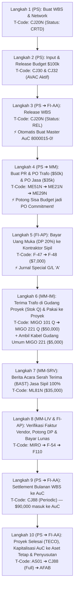

# Modul 05: Integrasi Emas (MM • PS • FI) & Studi Kasus End-to-End Proyek CAPEX \$100,000

> **Tujuan Pembelajaran:**
> Mempraktikkan secara utuh bagaimana satu proyek bisnis nyata mengalir melalui **SAP PS**, **SAP MM**, dan **SAP FI** dalam **10 Langkah Berurutan**, lengkap dengan **Field Input**, **Dampak Budget AVAC**, **Jurnal Akuntansi Debet/Kredit**, dan **Tabel Database SAP** pada setiap langkahnya.

---

## 1. Skenario Bisnis Studi Kasus

**PT Nusantara Energi (`Company Code: 1000`, `Plant: 1100`, `Purchasing Org: 1000`)** hendak membangun fasilitas **Gardu Induk Listrik 150kV (`Proyek: P-2026-GI01`)** dengan total anggaran investasi (**CAPEX Budget**) sebesar **\$100,000**.

Proyek ini memiliki 2 paket pekerjaan utama (WBS Element):
1. **WBS `P-2026-GI01.01` (Pekerjaan Konstruksi Sipil & Jasa Instalasi):**
   - Diberi plafon Budget: **\$40,000**.
   - Akan memesan jasa kontraktor ke **Vendor `100025` (PT Karya Sipil Nusantara)** senilai **\$35,000** menggunakan mekanisme **PO Jasa (`Item Category D`, `Acct Assgt P`)** dan pembayaran Uang Muka (DP 20% = \$7,000).
2. **WBS `P-2026-GI01.02` (Pengadaan Material Utama & Trafo):**
   - Diberi plafon Budget: **\$60,000**.
   - Akan membeli 1 unit **Trafo Daya 150kV (`Material: MAT-TRAFO-150`, `Val. Class: 3000`)** dari **Vendor `100024` (PT Elektro Utama)** seharga **\$50,000** menggunakan **Project Stock (`Acct Assgt Q`)**, ditambah pengambilan kabel tembaga dari stok gudang umum perusahaan senilai **\$5,000** (`MIGO Mvt 221`).

---

## 2. Peta Alur 10 Langkah Transaksi End-to-End



---

## 3. Simulasi Langkah demi Langkah (Hands-On Detail)

---

### 🔹 LANGKAH 1: Membuat Struktur Proyek & WBS (`CJ20N`)
* **Modul:** SAP PS
* **T-Code:** `CJ20N` (*Project Builder*)
* **Data yang Diinput:**
  - *Project Definition:* `P-2026-GI01` (*Pembangunan Gardu Induk 150kV*)
  - *Project Profile:* `ZCAPEX1` (*Investment Project with Auto-AuC*)
  - *Company Code:* `1000` | *Controlling Area:* `1000` | *Plant:* `1100`
  - *WBS Level 1:* `P-2026-GI01.01` (Pekerjaan Sipil & Instalasi — *Acct Assgt Element* = ✅)
  - *WBS Level 1:* `P-2026-GI01.02` (Pengadaan Trafo & Material — *Acct Assgt Element* = ✅)
* **Dampak Sistem & Database:**
  - Status sistem saat disimpan: **`CRTD` (Created)**.
  - Tabel yang terisi: **`PROJ`** (Header Proyek) dan **`PRPS`** (Master WBS).
  - **Jurnal Akuntansi FI:** *Tidak ada jurnal.*

---

### 🔹 LANGKAH 2: Memasang & Mencairkan Anggaran Proyek (`CJ30` & `CJ32`)
* **Modul:** SAP PS
* **T-Code:** `CJ30` (*Change Original Budget*) $\rightarrow$ lanjut `CJ32` (*Release Budget*)
* **Data yang Diinput:**
  - WBS `P-2026-GI01.01`: Original Budget = **\$40,000** | Released = **\$40,000**
  - WBS `P-2026-GI01.02`: Original Budget = **\$60,000** | Released = **\$60,000**
  - **Total Budget Proyek (`P-2026-GI01`):** **\$100,000**
* **Dampak Sistem & Database:**
  - Status sistem WBS bertambah menjadi: **`CRTD BUDG AVAC`** (*Budgeted & Availability Control Active*).
  - Tabel yang terisi: **`BPGE`** (Total Budget) dan **`BPJA`** (Annual Budget).
  - **Jurnal Akuntansi FI:** *Tidak ada jurnal (Budget di SAP PS adalah plafon kontrol internal, bukan jurnal buku besar).*

---

### 🔹 LANGKAH 3: Me-Release Proyek & Pembuatan Otomatis AuC (`CJ20N`)
* **Modul:** SAP PS $\leftrightarrow$ SAP FI-AA
* **T-Code:** `CJ20N` (Menu: *Edit $\rightarrow$ Status $\rightarrow$ Release* lalu klik **Save**)
* **Apa yang Terjadi di Belakang Layar?**
  1. Status sistem berubah dari `CRTD` menjadi **`REL BUDG AVAC AUC`** (*Released & AuC Created*).
  2. Karena WBS memakai *Investment Profile*, SAP otomatis memanggil mesin FI-AA dan membuat 2 nomor **Master Asset Under Construction (Asset Class `8000`)** di tabel **`ANLA`**:
     - AuC `8000015-0` otomatis tertaut ke *Settlement Rule* WBS `P-2026-GI01.01`.
     - AuC `8000016-0` otomatis tertaut ke *Settlement Rule* WBS `P-2026-GI01.02`.

---

### 🔹 LANGKAH 4: Menerbitkan Purchase Order Material & Jasa (`ME21N` & `ME29N`)
* **Modul:** SAP MM $\leftrightarrow$ SAP PS
* **T-Code:** `ME21N` (*Create Purchase Order*) $\rightarrow$ disetujui oleh Manajer di `ME29N` (*Release PO*)

#### PO Pertama: Pembelian Trafo 150kV (`PO Nomor: 4500010001`)
* **Vendor:** `100024` (PT Elektro Utama)
* **Account Assignment Category:** **`Q`** (*Project Make-to-Order Stock*)
* **Item Category:** `Blank` (*Standard*)
* **Material:** `MAT-TRAFO-150` | **Qty:** `1 UN` | **Net Price:** **\$50,000**
* **WBS Element:** `P-2026-GI01.02`

#### PO Kedua: Kontrak Jasa Konstruksi Sipil (`PO Nomor: 4500010002`)
* **Vendor:** `100025` (PT Karya Sipil Nusantara)
* **Account Assignment Category:** **`P`** (*Project Direct*)
* **Item Category:** **`D`** (*Service / Jasa*)
* **Short Text:** `"Pekerjaan Pondasi & Gedung Gardu Induk"` | **Net Price:** **\$35,000**
* **WBS Element:** `P-2026-GI01.01` (G/L Account otomatis terisi: `510020` *Biaya Jasa Proyek*)

#### 📊 Dampak pada Tabel Kontrol Anggaran PS (`S_ALR_87013558`) Setelah Langkah 4:
| WBS Element | Released Budget | PO Commitment | Actual Cost | Total Assigned | Sisa Available Budget |
| :--- | :---: | :---: | :---: | :---: | :---: |
| **`P-2026-GI01.01` (Sipil)** | \$40,000 | **\$35,000** | \$0 | \$35,000 | **\$5,000** |
| **`P-2026-GI01.02` (Trafo)** | \$60,000 | **\$50,000** | \$0 | \$50,000 | **\$10,000** |
| **TOTAL PROYEK** | **\$100,000** | **\$85,000** | **\$0** | **\$85,000** | **\$15,000** |

* **Tabel Database yang Terisi:** `EKKO` (Header PO), `EKPO` (Item PO), `EKKN` (Account Assignment WBS di PO), `ESLH`/`ESLL` (Detail baris Jasa), dan **`COOI`** (Line Item Commitment PS).
* **Jurnal Akuntansi FI:** *Belum ada jurnal G/L (PO baru membentuk Commitment di CO/PS, belum menjadi hutang atau aset di Neraca FI).*

---

### 🔹 LANGKAH 5: Membayar Uang Muka (DP 20% = \$7,000) ke Kontraktor Sipil (`F-47` $\rightarrow$ `F-48`)
* **Modul:** SAP FI-AP $\leftrightarrow$ SAP MM/PS
* **T-Code:** `F-47` (*Down Payment Request*) dilanjutkan **`F-48`** (*Post Vendor Down Payment*)
* **Data yang Diinput di `F-48`:**
  - *Vendor:* `100025` | *Special G/L Indicator:* **`A`** (*Down Payment on Current Assets*)
  - *Bank Account:* `111020` (*Bank Mandiri USD*) | *Amount:* **\$7,000** (20% dari PO `4500010002`)
  - *Purchase Order Reference:* `4500010002` Item `00010`
* **Jurnal Akuntansi FI yang Terbentuk (`Doc. Type: KZ`):**
  ```text
  Dr. [PKey 29A] Vendor 100025 (Recon G/L 116010 Uang Muka Pembelian)   $7,000
      Cr. [PKey 50]  G/L 111020 Bank Outgoing Account                           $7,000
  ```
* **Tabel Database yang Terisi:** `BKPF`, `ACDOCA`, `BSEG`, dan riwayat PO `EKBE` (mencatat bahwa PO `4500010002` sudah menerima DP sebesar \$7,000!).

---

### 🔹 LANGKAH 6: Penerimaan Trafo di Gudang Proyek (`MIGO 101 Q`) & Pemakaian Material (`MIGO 221 Q` & `221`)
* **Modul:** SAP MM-IM $\leftrightarrow$ SAP PS $\leftrightarrow$ SAP FI-GL

#### Bagian 6A: Trafo Tiba dari Vendor Masuk ke Stok Khusus Proyek (`MIGO` — Movement `101 Q`)
Staf gudang menerima 1 unit Trafo mengacu pada PO `4500010001`:
* **Jurnal Akuntansi FI Saat `MIGO 101 Q` (`Doc. Type: WE`):**
  ```text
  Dr. [PKey 89] G/L 114015 Persediaan Material Proyek (OBYC Key: BSX)   $50,000
      Cr. [PKey 96] G/L 210090 GR/IR Clearing Account (OBYC Key: WRX)           $50,000
  ```
* **Tabel Stok yang Terisi:** `MATDOC` dan **`MSPR`** (*Project Stock* — 1 unit Trafo terkunci khusus untuk WBS `P-2026-GI01.02`).

#### Bagian 6B: Trafo Dikeluarkan dari Stok Proyek ke Lapangan untuk Dipasang (`MIGO` — Movement `221 Q`)
Seminggu kemudian, tim teknik mengambil Trafo tersebut dari gudang untuk dipasang di gardu induk:
* **Jurnal Akuntansi FI Saat `MIGO 221 Q` (`Doc. Type: WA`):**
  ```text
  Dr. [PKey 40] G/L 510010 Biaya Pemakaian Material Proyek (OBYC: GBB-VBR)  $50,000
                [Objek Biaya CO/PS: WBS P-2026-GI01.02]
      Cr. [PKey 99] G/L 114015 Persediaan Material Proyek (OBYC: BSX)               $50,000
  ```

#### Bagian 6C: Pengambilan Kabel Tembaga dari Stok Gudang Umum Perusahaan (`MIGO` — Movement `221`)
Selain Trafo yang dibeli khusus, tim proyek juga mengambil 100 meter Kabel Tembaga (`MAT-KABEL-01`) yang sudah tersedia di gudang umum perusahaan senilai **\$5,000** menggunakan **`MIGO` Goods Issue $\rightarrow$ Others $\rightarrow$ Movement Type `221`** ke WBS `P-2026-GI01.02`:
* **Jurnal Akuntansi FI Saat `MIGO 221` (`Doc. Type: WA`):**
  ```text
  Dr. [PKey 40] G/L 510010 Biaya Pemakaian Material Proyek (OBYC: GBB-VBR)   $5,000
                [Objek Biaya CO/PS: WBS P-2026-GI01.02]
      Cr. [PKey 99] G/L 114010 Persediaan Bahan Baku Umum (OBYC: BSX)                $5,000
  ```
* **Dampak pada Budget PS:** Pemakaian kabel gudang \$5,000 langsung menambah **Actual Cost** WBS `P-2026-GI01.02` menjadi **\$55,000** (Sisa Budget tinggal \$5,000!).

---

### 🔹 LANGKAH 7: Serah Terima Pekerjaan Jasa Sipil 100% (`ML81N`)
* **Modul:** SAP MM-SRV $\leftrightarrow$ SAP PS $\leftrightarrow$ SAP FI-GL
* **T-Code:** `ML81N` (*Service Entry Sheet*) mengacu pada PO Jasa `4500010002`
* **Tindakan:** Buat SES sebesar 100% (**\$35,000**), klik **Bendera Hijau (*Accept*)**, lalu klik **Save**.
* **Jurnal Akuntansi FI yang Terbentuk Otomatis (`Doc. Type: WE`):**
  ```text
  Dr. [PKey 40] G/L 510020 Biaya Jasa Kontraktor Proyek (OBYC: GBB-VBR)     $35,000
                [Objek Biaya CO/PS: WBS P-2026-GI01.01]
      Cr. [PKey 96] G/L 210095 GR/IR Clearing Jasa (OBYC: WRX)                      $35,000
  ```

#### 📊 Status Budget Proyek PS (`S_ALR_87013558`) Setelah Langkah 6 & 7:
| WBS Element | Released Budget | PO Commitment | Actual Cost | Total Assigned | Sisa Available Budget |
| :--- | :---: | :---: | :---: | :---: | :---: |
| **`P-2026-GI01.01` (Sipil)** | \$40,000 | **\$0** *(Sudah jadi Actual)* | **\$35,000** | \$35,000 | **\$5,000** |
| **`P-2026-GI01.02` (Trafo & Kabel)** | \$60,000 | **\$0** *(Sudah jadi Actual)* | **\$55,000** | \$55,000 | **\$5,000** |
| **TOTAL PROYEK** | **\$100,000** | **\$0** | **\$90,000** | **\$90,000** | **\$10,000** *(Hemat \$10k!)* |

---

### 🔹 LANGKAH 8: Verifikasi Faktur (`MIRO`), Clearing DP (`F-54`), & Pelunasan Bank (`F110`)
* **Modul:** SAP MM-LIV $\leftrightarrow$ SAP FI-AP

#### 8A. Posting Faktur Vendor Trafo (`MIRO` atas PO `4500010001` = \$50,000 + PPN 11% \$5,500)
```text
Dr. [PKey 86] G/L 210090 GR/IR Clearing Barang (OBYC: WRX)                  $50,000
Dr. [PKey 40] G/L 115010 PPN Masukan (Tax Code V1 - 11%)                     $5,500
    Cr. [PKey 31] Vendor 100024 PT Elektro Utama (Recon G/L 210010 Hutang)          $55,500
```

#### 8B. Posting Faktur Kontraktor Jasa Sipil (`MIRO` atas PO `4500010002` = \$35,000 + PPN 11% \$3,850 - PPh 23 2% \$700)
*(Catatan: Saat memasukkan PO `4500010002` di `MIRO`, SAP otomatis memunculkan pop-up peringatan: **"Down payments of $7,000 exist for this PO!"**).*
```text
Dr. [PKey 86] G/L 210095 GR/IR Clearing Jasa (OBYC: WRX)                    $35,000
Dr. [PKey 40] G/L 115010 PPN Masukan (Tax Code V1 - 11%)                     $3,850
    Cr. [PKey 31] Vendor 100025 PT Karya Sipil (Recon G/L 210010 Hutang)            $38,150
    Cr. [PKey 50] G/L 213023 Hutang Pajak PPh Pasal 23 (2%)                            $700
```

#### 8C. Memotong Uang Muka DP \$7,000 terhadap Hutang Kontraktor Sipil (`F-54`)
```text
Dr. [PKey 26]  Vendor 100025 PT Karya Sipil (Recon G/L 210010 Hutang)        $7,000
    Cr. [PKey 39A] Vendor 100025 (Recon G/L 116010 Uang Muka Pembelian)              $7,000
```
*(Kini sisa hutang bersih ke PT Karya Sipil tinggal $\$38,150 - \$7,000 = \$31,150$).*

#### 8D. Pelunasan Otomatis Kedua Vendor via Payment Run (`F110`)
```text
Dr. [PKey 25] Vendor 100024 PT Elektro Utama (G/L 210010 Hutang Usaha)      $55,500
Dr. [PKey 25] Vendor 100025 PT Karya Sipil (G/L 210010 Hutang Usaha)        $31,150
    Cr. [PKey 50] G/L 111020 Bank Outgoing Account                                  $86,650
```

---

### 🔹 LANGKAH 9: Settlement Akhir Bulan dari WBS ke Asset Under Construction (`CJ88`)
* **Modul:** SAP PS $\leftrightarrow$ SAP FI-AA
* **T-Code:** `CJ88` (*Actual Settlement: Project/WBS*)
* **Parameter:** Project `P-2026-GI01` | Period `11/2026` | Processing Type: `1 (Automatic)`
* **Jurnal Akuntansi FI yang Terbentuk (`Doc. Type: AA`):**
  ```text
  Dr. [PKey 70] AuC 8000015-0 (G/L 129010 Konstruksi Dalam Pengerjaan)      $35,000
  Dr. [PKey 70] AuC 8000016-0 (G/L 129010 Konstruksi Dalam Pengerjaan)      $55,000
      Cr. [PKey 50] G/L 599010 Settlement Proyek CAPEX [WBS .01]                    $35,000
      Cr. [PKey 50] G/L 599010 Settlement Proyek CAPEX [WBS .02]                    $55,000
  ```
* **Dampak Keuangan:** Seluruh biaya proyek sebesar **\$90,000** kini resmi berpindah dari akun biaya ke Neraca sebagai **Aset Dalam Penyelesaian (AuC)**.

---

### 🔹 LANGKAH 10: Proyek Selesai (`TECO`), Kapitalisasi ke Aset Tetap Final, & Penyusutan (`AS01` $\rightarrow$ `CJ88` $\rightarrow$ `AFAB`)
* **Modul:** SAP PS $\leftrightarrow$ SAP FI-AA
1. **Buat Master Aset Tetap Final di `AS01`:**
   - Aset `2000099-0` (*Bangunan Gardu Induk Bekasi* — Asset Class `2000`, Masa Manfaat 20 Tahun / 240 Bulan).
   - Aset `3000099-0` (*Instalasi Trafo 150kV Bekasi* — Asset Class `3000`, Masa Manfaat 10 Tahun / 120 Bulan).
2. **Masukkan Settlement Rule Final di `CJ20N` & Ubah Status Proyek ke `TECO`:**
   - WBS `.01` (\$35,000) di-*settle* 100% (`FUL`) ke Aset Bangunan `2000099-0`.
   - WBS `.02` (\$55,000) di-*settle* 100% (`FUL`) ke Aset Trafo `3000099-0`.
3. **Jalankan Full Settlement di `CJ88` (Processing Type `8 - Full Settlement`):**
   ```text
   Dr. [PKey 70] Asset 2000099-0 (G/L 121020 Aset Tetap Bangunan)           $35,000
   Dr. [PKey 70] Asset 3000099-0 (G/L 121030 Aset Tetap Mesin & Trafo)      $55,000
       Cr. [PKey 75] AuC 8000015-0 (G/L 129010 Konstruksi Dalam Pengerjaan)         $35,000
       Cr. [PKey 75] AuC 8000016-0 (G/L 129010 Konstruksi Dalam Pengerjaan)         $55,000
   ```
   *(Saldo AuC kini bersih menjadi **\$0**, dan Aset Tetap Gedung serta Trafo aktif di Neraca!).*
4. **Jalankan Penyusutan Bulanan Pertama di `AFAB`:**
   - Penyusutan Bangunan: $\$35,000 \div 240 \text{ bulan} = \$145.83 / \text{bulan}$.
   - Penyusutan Trafo: $\$55,000 \div 120 \text{ bulan} = \$458.33 / \text{bulan}$.
   - **Jurnal Otomatis `AFAB` (`Doc. Type: AF`):**
     ```text
     Dr. [PKey 40] G/L 610010 Beban Penyusutan Aset Tetap [Cost Center]        $604.16
         Cr. [PKey 75] G/L 122020 Akumulasi Penyusutan Bangunan                        $145.83
         Cr. [PKey 75] G/L 122030 Akumulasi Penyusutan Mesin & Trafo                   $458.33
     ```

---

> **Selanjutnya:** Lanjut ke **[Modul 06: Kamus T-Code, SPRO, Arsitektur Tabel Database, & Latihan Ujian](./06-tcode-spro-tables-and-exam-prep.md)** untuk referensi cepat sehari-hari dan uji pemahaman.
