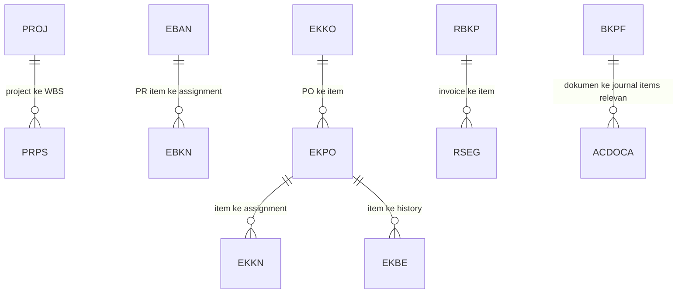

# Modul 06: Kamus T-Code, Konfigurasi SPRO, Arsitektur Tabel Database (`SE16N`), Troubleshooting, & Bank Soal

> **Tujuan Pembelajaran:**
> 1. Memiliki buku saku contoh **T-Code Operasional**, aplikasi Fiori, dan **T-Code Konfigurasi SPRO** untuk modul MM, PS, dan FI, dengan memperhatikan edisi dan rilis.
> 2. Memahami contoh **relasi dan field tabel SAP (`SE16N`)** untuk penarikan data dan audit, dengan memeriksa key lengkap pada DDIC sistem yang relevan.
> 3. Mampu mendiagnosa dan memperbaiki **Error Lapangan Paling Umum** di SAP.
> 4. Menguji pemahaman melalui **lima studi kasus edukasi**; ini bukan soal sertifikasi resmi SAP.

---

## 1. Kamus Lengkap T-Code Operasional & Padanan SAP Fiori Apps
Transaksi GUI/IMG di bawah terutama untuk ECC dan S/4HANA on-premise/private bila tersedia. Nama aplikasi adalah petunjuk fungsional, **bukan padanan satu-banding-satu**; Public Cloud memakai aplikasi dan konfigurasi yang dirilis untuk edisi dan versinya. Periksa Fiori Apps Library menurut produk, versi, peran dan deployment sebelum memilih app. Field, akun dan kode adalah contoh, bukan DDIC lengkap atau jaminan akses langsung.

Rujukan: [SAP Fiori Apps Reference Library](https://fioriappslibrary.hana.ondemand.com/sap/fix/externalViewer/) mengarahkan ke library baru; [SAP Learning — budget PS dan AVAC](https://learning.sap.com/courses/project-financials-control-in-sap-s-4hana/configuring-budgeting-functions) dan [SAP Library 4.6C — project stock](https://help.sap.com/saphelp_46c/helpdata/en/4d/2b92c943ad11d189410000e829fbbd/content.htm). Sumber 4.6C bersifat historis; periksa rilis target.

### 1.1 Modul SAP MM (Materials Management)

| Kategori | T-Code GUI | Nama Transaksi | Padanan SAP Fiori App (S/4HANA) |
| :--- | :---: | :--- | :--- |
| **Master Data** | `MM01` / `MM02` / `MM03` | Create / Change / Display Material Master | Aplikasi product master sesuai edisi |
| **Master Data** | `BP` *(ECC: `XK01`)* | Maintain Business Partner (Supplier/Vendor) | Aplikasi business partner sesuai edisi |
| **Master Data** | `ME11` / `ME12` / `ME13` | Create / Change / Display Purchasing Info Record | Aplikasi purchasing info record |
| **Master Data** | `ME01` | Maintain Source List | Aplikasi source list jika tersedia |
| **Purchasing (PR)** | `ME51N` / `ME52N` / `ME53N` | Create / Change / Display Purchase Requisition | Aplikasi purchase requisition |
| **Purchasing (PR)** | `ME54N` / `ME55` | Release Purchase Requisition (Individual / Collective) | Workflow approval sesuai konfigurasi |
| **Purchasing (PR)** | `ME5A` | List Display of Purchase Requisitions | Aplikasi monitoring requisition |
| **Purchasing (PO)** | `ME21N` / `ME22N` / `ME23N` | Create / Change / Display Purchase Order | Aplikasi purchase order |
| **Purchasing (PO)** | `ME29N` / `ME28` | Release Purchase Order | Workflow approval sesuai konfigurasi |
| **Purchasing (PO)** | `ME2N` / `ME2L` / `ME2M` | PO Reporting by PO Number / Vendor / Material | Aplikasi monitoring PO |
| **Purchasing (PO)** | `ME2J` / `ME2K` | PO Reporting by Project / Account Assignment | Aplikasi laporan PO sesuai cakupan |
| **Services (BAST)** | `ML81N` | Maintain Service Entry Sheet klasik | Lean service entry sheet adalah proses berbeda, bukan padanan identik |
| **Inventory (IM)** | `MIGO` | Goods Movement | Aplikasi goods movement sesuai skenario |
| **Inventory (IM)** | `MB52` | Warehouse Stocks | Aplikasi stock overview |
| **Inventory (IM)** | `MMBE` | Stock Overview | Aplikasi stock overview |
| **Inventory (IM)** | `MB51` | Material Document List | Aplikasi material documents |
| **Inventory (IM)** | `MB5B` | Stocks for Posting Date | Aplikasi stok historis jika tersedia |
| **Inventory (IM)** | `MI01` $\rightarrow$ `MI04` $\rightarrow$ `MI07` | Physical Inventory | Aplikasi physical inventory |
| **Inventory (IM)** | `MMPV` / `MMRV` | Advance MM Period / View Period Settings | Aplikasi period management sesuai edisi |
| **Invoice (LIV)** | `MIRO` / `MIR7` / `MIR4` | Enter / Park / Display Logistics Invoice | Aplikasi supplier invoice |
| **Invoice (LIV)** | `MRBR` | Release Blocked Invoices | Aplikasi release blocked invoices |
| **Invoice (LIV)** | `MR8M` | Cancel Invoice Document | Aplikasi pembatalan sesuai edisi |
| **Invoice (LIV)** | `MR11` | GR/IR Account Maintenance | Aplikasi GR/IR reconciliation |

---

### 1.2 Modul SAP PS (Project System)

| Kategori | T-Code GUI | Nama Transaksi | Padanan SAP Fiori App (S/4HANA) |
| :--- | :---: | :--- | :--- |
| **Struktur Proyek** | `CJ20N` | **Project Builder** (Project, WBS, Network) | Aplikasi proyek tergantung tipe proyek dan edisi; bukan padanan identik |
| **Struktur Proyek** | `CJ01` / `CJ02` / `CJ03` | Create / Change / Display Work Breakdown Structure (WBS) | *Project Builder* |
| **Struktur Proyek** | `CN21` / `CN22` / `CN23` | Create / Change / Display Network & Activities | *Manage Project Networks* |
| **Cost Planning** | `CJ40` / `CJ41` | Change / Display Project Cost Plan (Annual/Overall) | *Plan Customer Projects / Project Cost Report* |
| **Budgeting** | `CJ30` / `CJ31` | Change / Display Project Original Budget | *Manage Project Budget* |
| **Budgeting** | `CJ32` | Change Budget Release (Pencairan Plafon Anggaran) | *Release Project Budget* |
| **Budgeting** | `CJ36` / `CJ37` | Budget supplement (classic PS); periksa varian dan mode di IMG sistem | Fungsi budget supplement sesuai edisi |
| **Budgeting** | `CJ34` | Budget update classic PS; periksa label dan arah di IMG sistem | Fungsi budget update sesuai edisi |
| **Budgeting** | `CJ35` | Budget update classic PS; periksa label dan arah di IMG sistem | Fungsi budget update sesuai edisi |
| **AVAC Control** | `CJBV` / `CJBW` | Activate / Deactivate Availability Control (AVAC) | - |
| **AVAC Control** | `CJBN` | Reconstruct Availability Control (Refresh kalkulasi AVAC) | - |
| **Eksekusi** | `CN25` / `CAT2` | Konfirmasi aktivitas / timesheet sesuai transaksi tersedia | Aplikasi konfirmasi/timesheet sesuai edisi |
| **Closing Proyek** | `CJB2` | Generate Settlement Rules Automatically | - |
| **Closing Proyek** | `CJ88` / `CJ8G` | Actual Settlement: Project/WBS (Individual / Collective) | Aplikasi settlement sesuai skenario |
| **Pelaporan PS** | `S_ALR_87013558` | Budget / Actual / Commitment / Remaining Plan | Laporan proyek sesuai edisi |
| **Pelaporan PS** | `CJI3` | Project Actual Cost Line Items | Laporan actual cost sesuai edisi |
| **Pelaporan PS** | `CJI5` | Project Commitment Line Items (Rincian PR & PO Menggantung) | *Project Commitment Line Items* |
| **Pelaporan PS** | `CN41N` | Project Structure Overview (Hirarki Lengkap Proyek) | *Monitor Projects* |

---

### 1.3 Modul SAP FI (Financial Accounting)

| Kategori | T-Code GUI | Nama Transaksi | Padanan SAP Fiori App (S/4HANA) |
| :--- | :---: | :--- | :--- |
| **FI-GL (Master)** | `FS00` | Maintain G/L Account Centrally | Aplikasi G/L master |
| **FI-GL (Jurnal)** | `FB50` / `F-02` | Enter G/L Account Document / General Posting | Aplikasi jurnal umum |
| **FI-GL (Jurnal)** | `FV50` / `FBV0` | Park / Post Parked Document | Aplikasi verifikasi jurnal |
| **FI-GL (Jurnal)** | `FB03` / `FB02` / `FB08` | Display / Change / Reverse Document | Aplikasi jurnal sesuai skenario |
| **FI-GL (Clearing)** | `F-03` / `F.13` | Clear G/L Account Manually / Automatically | Aplikasi clearing sesuai skenario |
| **FI-GL (Saldo)** | `FS10N` / `FAGLB03` | Display G/L Account Balances | Aplikasi saldo G/L |
| **FI-GL (Line Item)** | `FBL3N` / `FAGLL03` | G/L Account Line Item Display | Aplikasi line item G/L |
| **FI-AP (Hutang)** | `FB60` / `FB65` | Vendor Invoice / Credit Memo Non-PO | Aplikasi supplier invoice |
| **FI-AP (DP)** | `F-47` $\rightarrow$ `F-48` $\rightarrow$ `F-54` | Request / Post / Clear Vendor Down Payment | Aplikasi down payment sesuai proses |
| **FI-AP (Bayar)** | `F-53` / `F110` | Manual / Automatic Payment | Aplikasi pembayaran sesuai edisi |
| **FI-AP (Report)** | `FK10N` / `FBL1N` | Vendor Balance / Line Items | Aplikasi supplier line items |
| **FI-AR (Piutang)** | `FB70` / `F-28` | Customer Invoice / Incoming Payment | Aplikasi customer invoice / payment |
| **FI-AR (Report)** | `FD10N` / `FBL5N` | Customer Balance / Line Items | Aplikasi customer line items |
| **FI-AA (Aset)** | `AS01` / `AS02` / `AS03` | Create / Change / Display Asset | Aplikasi fixed asset |
| **FI-AA (Aset)** | `AW01N` | Asset Explorer | Aplikasi asset values |
| **FI-AA (Aset)** | `AIAB` $\rightarrow$ `AIBU` | Distribute / Settle AuC Line Items | Fungsi AuC settlement sesuai proses |
| **FI-AA (Closing)** | `AFAB` | Post Depreciation | Aplikasi/job depresiasi sesuai edisi |
| **FI-Closing** | `OB52` / `F.01` | Posting Periods / Financial Statements | Aplikasi period dan laporan sesuai edisi |

---

## 2. Peta Konfigurasi SPRO (IMG) untuk Konsultan

Bagi konsultan fungsional, berikut adalah T-Code pintasan menuju layar konfigurasi **SPRO**:

| Area Konfigurasi | T-Code Pintas SPRO | Fungsi Pengaturan |
| :--- | :---: | :--- |
| **Enterprise Structure** | `OX02` / `OX10` / `OX09` / `OX08` | Definisi Company Code, Plant, Storage Location, Purchasing Org. |
| **Enterprise Assignment** | `OX18` / `OX01` / `OX17` / `OX19` | Hubungkan Plant ke CC, POrg ke CC/Plant, CC ke Controlling Area. |
| **FI Global Settings** | `OB29` / `OBBO` / `OB52` / `OBA7` | Fiscal Year Variant, Posting Period Variant, Document Types. |
| **FI Account Group & Field** | `OBD4` / `OBC4` | G/L Account Groups & Field Status Variants (`G001`, `G004`, dll.). |
| **FI-AP Payment Program** | `FBZP` / `FI12_HBANK` | Konfigurasi 6 langkah Automatic Payment Program (`F110`) & House Bank. |
| **FI-AP Special G/L (DP)** | `OBYR` / `OBXT` | Pemetaan akun rekonsiliasi alternatif untuk Uang Muka (`A`, `F`). |
| **FI Tax Configuration** | `FTXP` / `OB40` | Pembuatan Tax Code PPN & pemetaan akun G/L Pajak (`MWS`, `VST`, `NVV`). |
| **FI-AA Asset Accounting** | `OAOA` / `AO90` | Definisi Asset Class & Pemetaan Akun G/L Aset Tetap / Penyusutan. |
| **MM Material Types** | `OMS2` / `OMSK` | Atribut Material Type (`ROH`, `ERSA`, `DIEN`) & Valuation Class (`BKLAS`). |
| **MM Account Determination** | **`OBYC`** / `OMWD` / `OMWN` | **Otomatisasi Jurnal MM-FI (`BSX`, `WRX`, `GBB`, `PRD`)** & Grouping Plant. |
| **MM Release Strategy** | `CT04` / `CL02` / `OMGS` | Karakteristik, Class `032`, dan Matriks Persetujuan PR/PO. |
| **MM Tolerance Limits** | `OMR6` | Batas toleransi selisih harga/kuantitas faktur `MIRO` (`PP`, `DQ`, `BD`). |
| **PS Project & Coding** | `OPSJ` / `OPSA` / `OITA` | Coding Mask WBS, Project Profile, & Investment Profile (Auto-AuC). |
| **PS Budget & AVAC** | `OPS9` / `OPTK` / `OKO7` | Budget Profile, Tolerance Limits AVAC (80% Warning, 100% Error), Settlement Profile. |

---

## 3. Arsitektur Tabel Database SAP (`SE16N` / `SQVI`)

Gunakan peta berikut sebagai **contoh hubungan**, bukan daftar primary/foreign key lengkap. `SE16N`/`SQVI` hanya jika tersedia dan diotorisasi; di Public Cloud gunakan API, CDS view, atau aplikasi yang dirilis. Periksa DDIC dan dokumentasi versi aktual, termasuk client, ledger, fiscal year dan nomor item sebelum join. Relasi konseptual berikut bukan bukti foreign key DDIC:

Untuk peran `BKPF`, `BSEG`, dan `ACDOCA` pada S/4HANA, lihat [SAP Learning — Financial Accounting documents](https://learning.sap.com/courses/configuring-additional-settings-in-financial-accounting-in-sap-s-4hana/executing-data-archiving-for-specific-fi-objects).



### Daftar Tabel Inti Berdasarkan Modul

1. **Tabel Master & Transaksi MM:**
   - `MARA` (material; contoh field `MATNR`), `MARC` (plant; `MATNR`, `WERKS`), `MARD` (storage location; `MATNR`, `WERKS`, `LGORT`), `MBEW` (valuation; `MATNR`, `BWKEY`, valuation type jika relevan), `MSPR` (project stock). Ini field terpilih, bukan seluruh key.
   - `EBAN` (Purchase Requisition Item), `EBKN` (PR Account Assignment — menyimpan kode WBS `PS_PSP_PNR`).
   - `EKKO` (PO Header), `EKPO` (PO Item), `EKKN` (PO Account Assignment — menyimpan kode WBS `PS_PSP_PNR` atau Asset `ANLN1`), `EKBE` (PO History — mencatat semua dokumen `MIGO` & `MIRO` atas PO tersebut).
   - `MATDOC` (Tabel tunggal mutasi barang di S/4HANA; di ECC menggunakan `MKPF` + `MSEG`).
   - `RBKP` (Header Faktur `MIRO`) + `RSEG` (Item Faktur `MIRO`).

2. **Tabel Master, Anggaran, & Transaksi PS:**
   - `PROJ` (Project Definition — Key: `PSPNR` internal / `PSPID` eksternal).
   - `PRPS` (WBS Element Master — Key: `PSPNR` internal / `POSID` eksternal).
   - `BPGE` (Overall Budget per Object `OBJNR`), `BPJA` (Annual Budget), `RPSCO` (Summary Tabel Biaya/Budget/Commitment Proyek), `COOI` (Commitment Line Items dari PR/PO).
   - `COBRB` (Settlement Rules — menyimpan aturan pembagian dari WBS ke AuC/Fixed Asset).

3. **Tabel Master & Jurnal FI:**
   - `SKA1` (G/L Chart of Accounts), `SKB1` (G/L Company Code), `BUT000` (Business Partner General), `LFA1`/`LFB1`/`LFM1` (Vendor Master).
   - `BKPF` (accounting header), `BSEG` (entry-view FI items yang tetap relevan), `ACDOCA` (Universal Journal S/4HANA untuk item relevan per ledger). Tabel lama tertentu punya compatibility view; tidak semuanya dihapus atau identik.
   - `ANLA` (Asset Master Record), `ANLB` (Depreciation Terms), `ANLC` (Asset Value Fields).

> **💡 Trik Teknis Penting (`OBJNR` & `PSPNR` di Tabel PS):**
> `PRPS` memiliki WBS internal, external ID dan object number; contoh object number dapat dipakai untuk menelusuri objek terkait dalam laporan/tabel yang mendukungnya. Konversi identifier, key lengkap dan struktur penyimpanan bergantung produk/rilis.

---

## 4. Panduan Troubleshooting 6 Error Lapangan Paling Sering Terjadi

| No | Pesan Error SAP (Message Code) | Kapan Muncul? | Penyebab Akar Masalah | Solusi Tepat (Step-by-Step) |
| :-: | :--- | :--- | :--- | :--- |
| **1** | **`M7 053`: periode MM** | Posting material. | Tanggal posting di luar periode MM yang diizinkan. | Periksa `MMRV`, periode dan prosedur; gunakan `MMPV` hanya jika periode memang harus dimajukan. |
| **2** | **`F5 201`: periode FI** | Posting FI/logistik terintegrasi. | Periode/jenis akun belum dibuka. | Periksa variant, jenis akun dan tahun di `OB52`; ubah hanya dengan otorisasi. |
| **3** | **`BP 604`: budget exceeded** | PR/PO/GI. | AVAC menolak transaksi menurut basis dan toleransi aktif. | Periksa budget dan commitment; jika disetujui gunakan supplement, return atau transfer sesuai label IMG, lalu release jika diperlukan. |
| **4** | **`Account determination (OBYC)`** | Posting MM. | Kombinasi account determination yang diperlukan tidak tersedia. | Periksa detail pesan, chart, valuation grouping, transaction key, modifier dan valuation class yang relevan; ubah `OBYC` hanya melalui kontrol konfigurasi. |
| **5** | **`KI 235`: CO assignment** | Posting akun biaya. | Objek CO yang diperlukan tidak tersedia. | Isi objek yang valid atau tinjau default assignment yang disetujui. |
| **6** | **`Project settlement rule`** | Settlement proyek. | Receiver, rule, profile, status atau prasyarat lain tidak sesuai. | Baca pesan sebenarnya; periksa `CJ20N`, settlement rule dan profile sebelum mengubah receiver. |

---

## 5. Bank Soal Latihan & Studi Kasus Wawancara (Dengan Pembahasan)

Lima skenario edukasi berikut bukan soal atau simulasi sertifikasi resmi SAP.

---

### ❓ Kasus 1: Perbedaan Perlakuan Stok & Biaya pada Proyek (`P` vs `Q`)
**Pertanyaan:**  
Manajer Proyek mengeluh: *"Minggu lalu kita sudah menerima 10 gulung kabel tegangan tinggi di gudang via `MIGO 101` senilai \$20,000 menggunakan PO ber-Account Assignment **`Q`**. Mengapa saat saya buka laporan biaya aktual proyek (`CJI3`), biaya aktual proyek masih \$0?"* Jelaskan penyebabnya dan apa yang harus dilakukan!

<details>
<summary><b>👉 Klik untuk Melihat Jawaban & Pembahasan Konsultan</b></summary>

* **Analisis Penyebab:**  
  Dengan asumsi **valuated project stock `Q`**, `101 Q` menambah persediaan proyek dan bukan actual cost konsumsi; stok non-valuated dapat diperlakukan berbeda. Efek availability control bergantung konfigurasi; `heldQ` pada lab adalah reservasi lokal, bukan aturan `COOI` universal.
* **Solusi:**  
  Saat kabel benar-benar digunakan, lakukan goods issue `221 Q` ke WBS yang sesuai; jurnal dan actual cost bergantung valuasi dan konfigurasi.
</details>

---

### ❓ Kasus 2: Membatalkan Dokumen Akuntansi dari `MIGO` / `MIRO`
**Pertanyaan:**  
Seorang staf akuntansi baru melihat ada kesalahan nominal pada jurnal akuntansi nomor `500001234` (Document Type `WE`) yang berasal dari penerimaan barang `MIGO`. Ia mencoba membatalkan dokumen tersebut melalui T-Code `FB08` (Reverse FI Document), namun sistem menolak dengan pesan error. Mengapa ditolak dan bagaimana prosedur pembatalan yang benar?

<details>
<summary><b>👉 Klik untuk Melihat Jawaban & Pembahasan Konsultan</b></summary>

* **Analisis Penyebab:**  
  Prinsip integrasi SAP melarang pembatalan sepihak di modul FI (`FB08`) untuk dokumen yang lahir dari modul logistik (MM/SD), karena jika hanya jurnal FI-nya yang dibatalkan, maka **saldo stok di gudang (`MATDOC`/`MARD`) dan riwayat PO (`EKBE`) menjadi tidak sinkron dengan saldo Neraca FI (`ACDOCA`)**.
* **Solusi:**  
  Dokumen harus dibatalkan dari modul asalnya:
  - Untuk penerimaan `101`, gunakan **`MIGO` Cancellation** dengan material document; pembalikan movement mengikuti dokumen asal dan prasyarat. Issue atau movement lain tidak selalu dibalik dengan `102`.
  - Jika berasal dari faktur logistik `MIRO` (`Doc. Type RE`), batalkan melalui T-Code **`MR8M`**!
  - Jika invoice sudah diposting, periksa urutan pembatalan dan konfigurasi GR-based IV. [SAP Learning S/4HANA](https://learning.sap.com/courses/invoice-verification-in-sap-s-4hana/using-different-types-of-invoice-verification) menjelaskan prasyarat reversal setelah invoice.
</details>

---

### ❓ Kasus 3: Selisih Kurs & Selisih Harga pada `MIRO`
**Pertanyaan:**  
Perusahaan (mata uang lokal `IDR`) memesan suku cadang (`Price Control = V / MAP`) seharga **\$1,000 USD**.
- Tanggal 1 November (saat `MIGO 101`), kurs adalah **Rp 15.000/USD** dan barang langsung dipakai habis ke proyek (`MIGO 221`) pada hari yang sama.
- Tanggal 20 November (saat faktur `MIRO` datang), kurs naik menjadi **Rp 16.000/USD**.
Bagaimana jurnal saat `MIRO` diposting? Ke akun mana selisih Rp 1.000.000 tersebut dibukukan?

<details>
<summary><b>👉 Klik untuk Melihat Jawaban & Pembahasan Konsultan</b></summary>

* **Pembahasan:** Asumsikan GR-based invoice verification, seluruh penerimaan terkait ditagih, tanpa pajak/selisih harga, dan konfigurasi memposting selisih kurs ke `KDM`. Kurs dan account determination dapat menghasilkan perlakuan lain.
  1. GR mengkredit GR/IR Rp 15.000.000.
  2. Pada contoh ini invoice mendebit GR/IR pada nilai historis Rp 15.000.000.
  3. Hutang pada kurs contoh Rp 16.000.000; selisih Rp 1.000.000 masuk akun KDM yang dikonfigurasi:
     ```text
     Dr. 210090 GR/IR Clearing (WRX)                Rp 15.000.000
     Dr. 710020 Rugi Selisih Kurs MM (OBYC: KDM)    Rp  1.000.000
         Cr. 210010 Hutang Usaha Vendor (PKey 31)                 Rp 16.000.000
     ```
</details>

---

### ❓ Kasus 4: Sisa Commitment PO yang Mengunci Budget Proyek
**Pertanyaan:**  
Sebuah PO pembelian pasir proyek dipesan sebanyak **100 Ton @ \$100 (Total PO = \$10,000)**. Vendor hanya mampu mengirim **90 Ton (\$9,000)** dan menyatakan tidak akan mengirim 10 Ton sisanya lagi. Barang 90 Ton sudah di-`MIGO` dan di-`MIRO` lunas. Namun di laporan anggaran proyek `S_ALR_87013558`, anggaran sebesar **\$1,000 (10 Ton)** masih terkunci sebagai *PO Commitment* sehingga tidak bisa dipakai membeli barang lain. Bagaimana cara membebaskan anggaran \$1,000 tersebut?

<details>
<summary><b>👉 Klik untuk Melihat Jawaban & Pembahasan Konsultan</b></summary>

* **Analisis Penyebab:**  
  Sisa penerimaan dan faktur yang belum final dapat menyisakan commitment sesuai konfigurasi dan status PO.
* **Solusi:**  
  1. Periksa item dan riwayat PO di `ME22N`; pastikan sisa pengiriman memang dibatalkan dan tidak ada tagihan lanjutan.
  2. Jika sesuai keputusan bisnis, tandai **Delivery Completed (`ELIKZ`)** dan, bila memang faktur final, **Final Invoice**; simpan.
  3. Periksa ulang commitment dan laporan anggaran. Hasil dan kebutuhan rekonstruksi bergantung konfigurasi; flag bukan jaminan universal langsung nol.
</details>

---

### ❓ Kasus 5: Mengapa Aset Proyek Tidak Muncul Nilai Penyusutannya di `AFAB`?
**Pertanyaan:**  
Proyek pembangunan gedung pabrik sudah berjalan 3 bulan dan setiap akhir bulan tim keuangan sudah rajin menjalankan `CJ88` (Periodic Settlement) senilai total \$500,000. Namun saat mereka menjalankan `AFAB` (Depreciation Run), tidak ada beban penyusutan yang terbentuk atas nilai \$500,000 tersebut. Apakah ini bug sistem?

<details>
<summary><b>👉 Klik untuk Melihat Jawaban & Pembahasan Konsultan</b></summary>

* **Analisis Penyebab:**  
  Tidak selalu bug. Jika \$500,000 benar-benar disettle ke AuC yang dikonfigurasi tanpa penyusutan, tidak adanya beban atas AuC itu sesuai contoh. Periksa `AW01N`, area, depreciation key, tanggal nilai, posting run dan pesan sebelum menyimpulkan.
* **Solusi (Kapan Penyusutan Dimulai?):**  
  Bila aset siap digunakan dan memenuhi kebijakan, tetapkan aset final serta settlement sesuai proses; tanggal mulai dan nilai penyusutan ditentukan asset value date, key, period control, area dan konfigurasi, bukan hanya status atau `CJ88`.
</details>

---

> **Kembali ke Halaman Utama:** **[Indeks Kurikulum SAP Mastery Lab (`README.md`)](../../README.md)**
