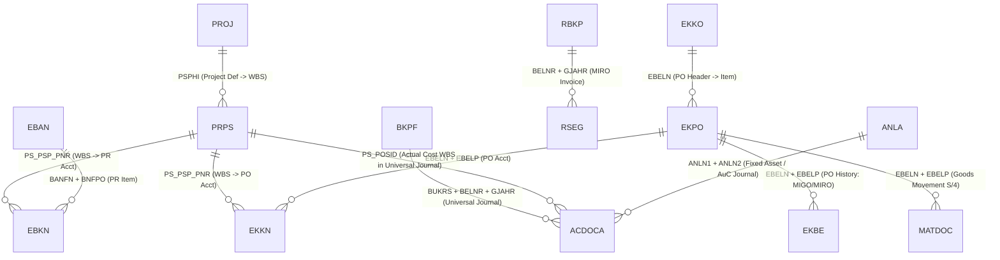

# Modul 06: Kamus T-Code, Konfigurasi SPRO, Arsitektur Tabel Database (`SE16N`), Troubleshooting, & Bank Soal

> **Tujuan Pembelajaran:**
> 1. Memiliki buku saku cepat (*Cheat Sheet*) seluruh **T-Code Operasional**, **Fiori Apps ID**, dan **T-Code Konfigurasi SPRO** untuk modul MM, PS, dan FI.
> 2. Menguasai **Relasi Tabel Database SAP (`SE16N`)** beserta *Primary Key / Foreign Key* untuk kebutuhan penarikan data, audit, dan spesifikasi teknis ABAP.
> 3. Mampu mendiagnosa dan memperbaiki **Error Lapangan Paling Umum** di SAP.
> 4. Menguji penguasaan materi melalui **10 Soal Studi Kasus Sertifikasi & Wawancara Konsultan SAP**.

---

## 1. Kamus Lengkap T-Code Operasional & Padanan SAP Fiori Apps

### 1.1 Modul SAP MM (Materials Management)

| Kategori | T-Code GUI | Nama Transaksi | Padanan SAP Fiori App (S/4HANA) |
| :--- | :---: | :--- | :--- |
| **Master Data** | `MM01` / `MM02` / `MM03` | Create / Change / Display Material Master | *Manage Product Master Data* (`F1602`) |
| **Master Data** | `BP` *(ECC: `XK01`)* | Maintain Business Partner (Supplier/Vendor) | *Manage Business Partner Master Data* (`F3163`) |
| **Master Data** | `ME11` / `ME12` / `ME13` | Create / Change / Display Purchasing Info Record | *Manage Purchasing Info Records* (`F1982`) |
| **Master Data** | `ME01` | Maintain Source List | *Manage Source Lists* (`F1859`) |
| **Purchasing (PR)** | `ME51N` / `ME52N` / `ME53N` | Create / Change / Display Purchase Requisition | *Manage Purchase Requisitions - Professional* (`F2229`) |
| **Purchasing (PR)** | `ME54N` / `ME55` | Release Purchase Requisition (Individual / Collective) | *My Inbox - Approve Purchase Requisitions* |
| **Purchasing (PR)** | `ME5A` | List Display of Purchase Requisitions (Report) | *Monitor Purchase Requisition Items* (`F2424`) |
| **Purchasing (PO)** | `ME21N` / `ME22N` / `ME23N` | Create / Change / Display Purchase Order | *Manage Purchase Orders* (`F0842A`) |
| **Purchasing (PO)** | `ME29N` / `ME28` | Release (Approve) Purchase Order | *My Inbox - Approve Purchase Orders* |
| **Purchasing (PO)** | `ME2N` / `ME2L` / `ME2M` | PO Reporting by PO Number / Vendor / Material | *Monitor Purchase Order Items* (`F2358`) |
| **Purchasing (PO)** | `ME2J` / `ME2K` | **PO Reporting by Project (WBS) / Account Assignment** | *Purchase Order Items by Account Assignment* |
| **Services (BAST)** | `ML81N` | Maintain Service Entry Sheet (SES) | *Manage Service Entry Sheets - Lean Services* (`F2027`) |
| **Inventory (IM)** | `MIGO` | Goods Movement (GR, GI, Transfer Posting, Cancellation) | *Post Goods Movement* / *Post Goods Receipt for PO* (`F0843`) |
| **Inventory (IM)** | `MB52` | List of Warehouse Stocks on Hand | *Stock - Multiple Materials* (`F1595`) |
| **Inventory (IM)** | `MMBE` | Stock Overview (Single Material per Plant/SLoc/Special Stock) | *Stock - Single Material* (`F1076`) |
| **Inventory (IM)** | `MB51` | Material Document List (Daftar Riwayat Mutasi Barang) | *Material Documents Overview* (`F1077`) |
| **Inventory (IM)** | `MB5B` | Stocks for Posting Date (Saldo Stok Historis Tanggal Tertentu) | *Stock on Posting Date* |
| **Inventory (IM)** | `MI01` $\rightarrow$ `MI04` $\rightarrow$ `MI07` | Physical Inventory: Create Doc $\rightarrow$ Enter Count $\rightarrow$ Post Diff. | *Manage Physical Inventory Documents* (`F0379A`) |
| **Inventory (IM)** | `MMPV` / `MMRV` | Close & Open Next MM Period / View Current MM Period | *Close Periods* (`F4685`) |
| **Invoice (LIV)** | `MIRO` / `MIR7` / `MIR4` | Enter / Park / Display Incoming Logistics Invoice | *Create Supplier Invoice - Advanced* (`F0859`) |
| **Invoice (LIV)** | `MRBR` | Release Blocked Invoices (Lepas blokir harga/kuantitas) | *Release Blocked Invoices* (`F1688`) |
| **Invoice (LIV)** | `MR8M` | Cancel Invoice Document (Reversal Faktur MIRO) | *Cancel Supplier Invoice* |
| **Invoice (LIV)** | `MR11` | GR/IR Account Maintenance (Bersihkan selisih kuantitas GR/IR) | *Reconcile GR/IR Accounts* (`F3302`) |

---

### 1.2 Modul SAP PS (Project System)

| Kategori | T-Code GUI | Nama Transaksi | Padanan SAP Fiori App (S/4HANA) |
| :--- | :---: | :--- | :--- |
| **Struktur Proyek** | `CJ20N` | **Project Builder** (Pusat Pembuatan Project, WBS, Network) | *Project Control - Enterprise Projects* (`F3215`) |
| **Struktur Proyek** | `CJ01` / `CJ02` / `CJ03` | Create / Change / Display Work Breakdown Structure (WBS) | *Project Builder* |
| **Struktur Proyek** | `CN21` / `CN22` / `CN23` | Create / Change / Display Network & Activities | *Manage Project Networks* |
| **Cost Planning** | `CJ40` / `CJ41` | Change / Display Project Cost Plan (Annual/Overall) | *Plan Customer Projects / Project Cost Report* |
| **Budgeting** | `CJ30` / `CJ31` | Change / Display Project Original Budget | *Manage Project Budget* |
| **Budgeting** | `CJ32` | Change Budget Release (Pencairan Plafon Anggaran) | *Release Project Budget* |
| **Budgeting** | `CJ37` / `CJ38` | Budget Supplement (Tambah) / Budget Return (Kurang) | *Project Budget Supplement / Return* |
| **Budgeting** | `CJ34` | Project Budget Transfer (Geser Budget Antar-WBS) | *Transfer Project Budget* |
| **AVAC Control** | `CJBV` / `CJBW` | Activate / Deactivate Availability Control (AVAC) | - |
| **AVAC Control** | `CJBN` | Reconstruct Availability Control (Refresh kalkulasi AVAC) | - |
| **Eksekusi** | `CN25` / `CAT2` | Confirm Network Activity / Enter Timesheet (CATS) | *Confirm Network Activity* (`F0291`) |
| **Closing Proyek** | `CJB2` | Generate Settlement Rules Automatically | - |
| **Closing Proyek** | `CJ88` / `CJ8G` | Actual Settlement: Project/WBS (Individual / Collective) | *Run Settlement - Actual* (`F4568`) |
| **Pelaporan PS** | `S_ALR_87013558` | **Laporan Utama: Budget / Actual / Commitment / Rem. Plan** | *Project Budget Report* (`F2513`) |
| **Pelaporan PS** | `CJI3` | Project Actual Cost Line Items (Rincian Jurnal Aktual WBS) | *Project Cost Line Items* (`F2538`) |
| **Pelaporan PS** | `CJI5` | Project Commitment Line Items (Rincian PR & PO Menggantung) | *Project Commitment Line Items* |
| **Pelaporan PS** | `CN41N` | Project Structure Overview (Hirarki Lengkap Proyek) | *Monitor Projects* |

---

### 1.3 Modul SAP FI (Financial Accounting)

| Kategori | T-Code GUI | Nama Transaksi | Padanan SAP Fiori App (S/4HANA) |
| :--- | :---: | :--- | :--- |
| **FI-GL (Master)** | `FS00` | Maintain G/L Account Centrally ( & Cost Element di S/4HANA) | *Manage G/L Account Master Data* (`F0731A`) |
| **FI-GL (Jurnal)** | `FB50` / `F-02` | Enter G/L Account Document / General Posting | *Post General Journal Entries* (`F0718`) |
| **FI-GL (Jurnal)** | `FV50` / `FBV0` | Park G/L Document / Post Parked Document | *Verify General Journal Entries* |
| **FI-GL (Jurnal)** | `FB03` / `FB02` / `FB08` | Display / Change / Reverse Document | *Manage Journal Entries* (`F0717`) |
| **FI-GL (Clearing)** | `F-03` / `F.13` | Clear G/L Account Manually / Automatic Clearing (GR/IR) | *Clear G/L Accounts* (`F1579`) |
| **FI-GL (Saldo)** | `FS10N` / `FAGLB03` | Display G/L Account Balances | *Display G/L Account Balances* (`F0707A`) |
| **FI-GL (Line Item)** | `FBL3N` / `FAGLL03` | G/L Account Line Item Display (Open & Cleared Items) | *Display Line Items in General Ledger* (`F2217`) |
| **FI-AP (Hutang)** | `FB60` / `FB65` | Enter Vendor Invoice (Non-PO) / Vendor Credit Memo | *Create Incoming Invoices* |
| **FI-AP (DP)** | `F-47` $\rightarrow$ `F-48` $\rightarrow$ `F-54` | Down Payment Request $\rightarrow$ Post DP $\rightarrow$ Clear DP | *Post Outgoing Payments* (`F1612`) |
| **FI-AP (Bayar)** | `F-53` / `F110` | Post Outgoing Payment Manually / **Automatic Payment Run** | *Manage Automatic Payments* (`F0770`) |
| **FI-AP (Report)** | `FK10N` / `FBL1N` | Vendor Balance Display / Vendor Line Item Display | *Manage Supplier Line Items* (`F0712`) |
| **FI-AR (Piutang)** | `FB70` / `F-28` | Enter Customer Invoice / Post Incoming Payment | *Post Incoming Payments* (`F1345`) |
| **FI-AR (Report)** | `FD10N` / `FBL5N` | Customer Balance Display / Customer Line Item Display | *Manage Customer Line Items* (`F0711`) |
| **FI-AA (Aset)** | `AS01` / `AS02` / `AS03` | Create / Change / Display Asset Master Record | *Manage Fixed Assets* (`F3425`) |
| **FI-AA (Aset)** | `AW01N` | **Asset Explorer** (Simulasi & Rincian Nilai Aset per Area) | *Asset Values* |
| **FI-AA (Aset)** | `AIAB` $\rightarrow$ `AIBU` | Distribute AuC Line Items $\rightarrow$ Settle AuC to Final Asset | *Settle Asset Under Construction* |
| **FI-AA (Closing)** | `AFAB` | Post Depreciation Run (Penyusutan Bulanan) | *Schedule Asset Accounting Jobs* (`F1914`) |
| **FI-Closing** | `OB52` / `F.01` | Open/Close FI Posting Periods / Financial Statements | *Manage Posting Periods* (`F2293`) / *Balance Sheet/Income Statement* (`F0708`) |

---

## 2. Peta Konfigurasi SPRO (IMG) untuk Konsultan

Bagi konsultan fungsional, berikut adalah T-Code pintasan menuju layar konfigurasi **SPRO**:

| Area Konfigurasi | T-Code Pintas SPRO | Fungsi Pengaturan |
| :--- | :---: | :--- |
| **Enterprise Structure** | `OX02` / `OX10` / `OX09` / `OX08` | Definisi Company Code, Plant, Storage Location, Purchasing Org. |
| **Enterprise Assignment** | `OX18` / `OX01` / `OX17` / `OX19` | Hubungkan Plant ke CC, POrg ke CC/Plant, CC ke Controlling Area. |
| **FI Global Settings** | `OB29` / `OBBO` / `OB52` / `OBA7` | Fiscal Year Variant, Posting Period Variant, Document Types. |
| **FI Account Group & Field** | `OBD4` / `OBC4` | G/L Account Groups & Field Status Variants (`G001`, `G004`, dll.). |
| **FI-AP Payment Program** | `FBZP` / `FI12_HBANK` | Konfigurasi 6 langkah Automatic Payment Program (`F110`) & House Bank. |
| **FI-AP Special G/L (DP)** | `OBYR` / `OBXT` | Pemetaan akun rekonsiliasi alternatif untuk Uang Muka (`A`, `F`). |
| **FI Tax Configuration** | `FTXP` / `OB40` | Pembuatan Tax Code PPN & pemetaan akun G/L Pajak (`MWS`, `VST`, `NVV`). |
| **FI-AA Asset Accounting** | `OAOA` / `AO90` | Definisi Asset Class & Pemetaan Akun G/L Aset Tetap / Penyusutan. |
| **MM Material Types** | `OMS2` / `OMSK` | Atribut Material Type (`ROH`, `ERSA`, `DIEN`) & Valuation Class (`BKLAS`). |
| **MM Account Determination** | **`OBYC`** / `OMWD` / `OMWN` | **Otomatisasi Jurnal MM-FI (`BSX`, `WRX`, `GBB`, `PRD`)** & Grouping Plant. |
| **MM Release Strategy** | `CT04` / `CL02` / `OMGS` | Karakteristik, Class `032`, dan Matriks Persetujuan PR/PO. |
| **MM Tolerance Limits** | `OMR6` | Batas toleransi selisih harga/kuantitas faktur `MIRO` (`PP`, `DQ`, `BD`). |
| **PS Project & Coding** | `OPSJ` / `OPSA` / `OITA` | Coding Mask WBS, Project Profile, & Investment Profile (Auto-AuC). |
| **PS Budget & AVAC** | `OPS9` / `OPTK` / `OKO7` | Budget Profile, Tolerance Limits AVAC (80% Warning, 100% Error), Settlement Profile. |

---

## 3. Arsitektur Tabel Database SAP (`SE16N` / `SQVI`)

Saat melakukan investigasi data atau membuat spesifikasi laporan kustom (*Functional Specification / FS*) untuk programmer ABAP, gunakan peta relasi tabel berikut di T-Code **`SE16N`**:



### Daftar Tabel Inti Berdasarkan Modul

1. **Tabel Master & Transaksi MM:**
   - `MARA` (General Material Data - Key: `MATNR`), `MARC` (Plant Data - Key: `MATNR + WERKS`), `MARD` (Storage Location Stock - Key: `MATNR + WERKS + LGORT`), `MBEW` (Material Valuation/Price & Valuation Class `BKLAS` - Key: `MATNR + BWKEY`), `MSPR` (**Project Stock `Q`**).
   - `EBAN` (Purchase Requisition Item), `EBKN` (PR Account Assignment — menyimpan kode WBS `PS_PSP_PNR`).
   - `EKKO` (PO Header), `EKPO` (PO Item), `EKKN` (PO Account Assignment — menyimpan kode WBS `PS_PSP_PNR` atau Asset `ANLN1`), `EKBE` (PO History — mencatat semua dokumen `MIGO` & `MIRO` atas PO tersebut).
   - `MATDOC` (Tabel tunggal mutasi barang di S/4HANA; di ECC menggunakan `MKPF` + `MSEG`).
   - `RBKP` (Header Faktur `MIRO`) + `RSEG` (Item Faktur `MIRO`).

2. **Tabel Master, Anggaran, & Transaksi PS:**
   - `PROJ` (Project Definition — Key: `PSPNR` internal / `PSPID` eksternal).
   - `PRPS` (WBS Element Master — Key: `PSPNR` internal / `POSID` eksternal).
   - `BPGE` (Overall Budget per Object `OBJNR`), `BPJA` (Annual Budget), `RPSCO` (Summary Tabel Biaya/Budget/Commitment Proyek), `COOI` (Commitment Line Items dari PR/PO).
   - `COBRB` (Settlement Rules — menyimpan aturan pembagian dari WBS ke AuC/Fixed Asset).

3. **Tabel Master & Jurnal FI:**
   - `SKA1` (G/L Chart of Accounts), `SKB1` (G/L Company Code), `BUT000` (Business Partner General), `LFA1`/`LFB1`/`LFM1` (Vendor Master).
   - `BKPF` (Accounting Document Header), **`ACDOCA`** (Universal Journal Line Items S/4HANA — menyatukan `BSEG`, `COEP`, `ANEP`, `FAGLFLEXA`).
   - `ANLA` (Asset Master Record), `ANLB` (Depreciation Terms), `ANLC` (Asset Value Fields).

> **💡 Trik Teknis Penting (`OBJNR` & `PSPNR` di Tabel PS):**
> Di tabel SAP PS (`BPGE`, `RPSCO`, `COOI`), sistem tidak mencari berdasarkan kode WBS teks seperti `P-2026-GI01.01`, melainkan menggunakan **Object Number (`OBJNR`)** yang berawalan **`PR...`** (misal `PR00012345`). Anda cukup buka tabel `PRPS` di `SE16N`, masukkan kode WBS di kolom `POSID`, lalu salin nilai kolom `OBJNR` untuk dipakai mencari data anggaran/komitmen di `BPGE` atau `COOI`!

---

## 4. Panduan Troubleshooting 6 Error Lapangan Paling Sering Terjadi

| No | Pesan Error SAP (Message Code) | Kapan Muncul? | Penyebab Akar Masalah | Solusi Tepat (Step-by-Step) |
| :-: | :--- | :--- | :--- | :--- |
| **1** | **`M7 053`: *Posting only possible in periods 2026/10 and 2026/09 in company code 1000*** | Saat klik *Post* di `MIGO`. | Periode logistik MM belum digeser ke bulan baru (misal sekarang sudah bulan 11, tapi MM masih di bulan 10). | Jalankan T-Code **`MMPV`**, masukkan Company Code `1000`, periode `11` tahun `2026`, lalu eksekusi untuk membuka periode MM bulan baru. |
| **2** | **`F5 201`: *Posting period 011 2026 is not open*** | Saat posting `MIGO`, `MIRO`, `FB50`, atau `CJ88`. | Periode akuntansi FI di `OB52` masih terkunci untuk jenis akun terkait (`+`, `M`, `K`, `A`, `S`). | Buka T-Code **`OB52`**, cari *Posting Period Variant* perusahaan, dan ubah kolom *To Period 1* menjadi `11` tahun `2026` untuk jenis akun yang diblokir. |
| **3** | **`BP 604`: *In document item 00010 WBS Element P-2026-GI01.02, budget for WBS was exceeded by 4,000.00 USD*** | Saat menyimpan PR (`ME51N`), PO (`ME21N`), atau GI (`MIGO 221`). | Nilai pembelian + pemakaian aktual melebihi sisa *Released Budget* pada WBS tersebut (diblokir oleh **AVAC**). | 1. Cek sisa anggaran di **`S_ALR_87013558`**.<br>2. Cek apakah ada PR/PO lama yang batal tapi belum ditutup di **`CJI5`** (beri tanda *Delivery Completed* / hapus item PR).<br>3. Jika memang butuh dana tambahan, tambah budget via **`CJ37`** atau transfer via **`CJ34`** lalu release di **`CJ32`**. |
| **4** | **`M8 534`: *Account determination for entry CAID GBB 0001 VBR 3000 not possible*** | Saat posting `MIGO` atau `MIRO`. | Kombinasi Chart of Accounts `CAID`, Transaction Key `GBB`, Valuation Grouping `0001`, Modifier `VBR`, dan Valuation Class `3000` belum dipetakan ke akun G/L di **`OBYC`**. | Buka **`OBYC`**, klik dua kali pada key **`GBB`**, lalu tambahkan baris pemetaan untuk Valuation Class `3000` dan Modifier `VBR` ke nomor G/L Account Biaya yang sesuai. |
| **5** | **`KI 235`: *Account 510010 requires an assignment to a CO object*** | Saat posting jurnal biaya di `FB50`, `MIRO`, atau `MIGO`. | Akun `510010` adalah *Primary Cost Element* (G/L Type `P`), tetapi user lupa mengisi Cost Center, Internal Order, atau **WBS Element**. | Isi kolom **WBS Element** atau **Cost Center** pada baris jurnal tersebut (atau atur *Default Cost Assignment* di `OKB9` untuk akun selisih otomatis seperti `PRD`/`KDM`). |
| **6** | **`KD 503`: *Create a settlement cost element / Maintain settlement rule for WBS*** | Saat menjalankan Settlement proyek di `CJ88`. | WBS belum berstatus `REL` (sehingga AuC belum terbentuk), atau proyek sudah siap *Full Settlement* tapi nomor Aset Tetap Final belum dimasukkan ke *Settlement Rule*. | Buka **`CJ20N`**, pilih WBS terkait, klik tombol **Settlement Rule**, dan pastikan penerima (*Category `FXA` Asset*) sudah terisi dengan persentase total 100%. |

---

## 5. Bank Soal Ujian & Studi Kasus Wawancara Konsultan SAP (Dengan Pembahasan)

Uji pemahaman Anda dengan menjawab 5 skenario kasus nyata berikut sebelum membaca pembahasannya:

---

### ❓ Kasus 1: Perbedaan Perlakuan Stok & Biaya pada Proyek (`P` vs `Q`)
**Pertanyaan:**  
Manajer Proyek mengeluh: *"Minggu lalu kita sudah menerima 10 gulung kabel tegangan tinggi di gudang via `MIGO 101` senilai \$20,000 menggunakan PO ber-Account Assignment **`Q`**. Mengapa saat saya buka laporan biaya aktual proyek (`CJI3`), biaya aktual proyek masih \$0?"* Jelaskan penyebabnya dan apa yang harus dilakukan!

<details>
<summary><b>👉 Klik untuk Melihat Jawaban & Pembahasan Konsultan</b></summary>

* **Analisis Penyebab:**  
  Karena PO menggunakan **Account Assignment Category `Q` (*Project Make-to-Order Stock*)**, maka saat `MIGO 101 Q` dilakukan, barang tersebut masuk sebagai **Harta Persediaan Khusus Proyek** di Neraca (`Dr. Persediaan Proyek BSX / Cr. GR/IR WRX` di tabel `MSPR`), **bukan langsung menjadi biaya**. Di laporan anggaran `S_ALR_87013558`, nilai \$20,000 tersebut tercatat mengurangi budget, namun statusnya masih berupa persediaan proyek.
* **Solusi:**  
  Ketika kabel tersebut benar-benar diambil dari gudang ke lapangan untuk dipasang, bagian gudang harus melakukan **Goods Issue to Project di `MIGO` dengan Movement Type `221 Q`** mengacu ke WBS terkait. Barulah jurnal `Dr. Biaya Material Proyek (GBB-VBR + WBS) / Cr. Persediaan Proyek (BSX)` terbentuk dan muncul sebagai *Actual Cost* di `CJI3`!
</details>

---

### ❓ Kasus 2: Membatalkan Dokumen Akuntansi dari `MIGO` / `MIRO`
**Pertanyaan:**  
Seorang staf akuntansi baru melihat ada kesalahan nominal pada jurnal akuntansi nomor `500001234` (Document Type `WE`) yang berasal dari penerimaan barang `MIGO`. Ia mencoba membatalkan dokumen tersebut melalui T-Code `FB08` (Reverse FI Document), namun sistem menolak dengan pesan error. Mengapa ditolak dan bagaimana prosedur pembatalan yang benar?

<details>
<summary><b>👉 Klik untuk Melihat Jawaban & Pembahasan Konsultan</b></summary>

* **Analisis Penyebab:**  
  Prinsip integrasi SAP melarang pembatalan sepihak di modul FI (`FB08`) untuk dokumen yang lahir dari modul logistik (MM/SD), karena jika hanya jurnal FI-nya yang dibatalkan, maka **saldo stok di gudang (`MATDOC`/`MARD`) dan riwayat PO (`EKBE`) menjadi tidak sinkron dengan saldo Neraca FI (`ACDOCA`)**.
* **Solusi:**  
  Dokumen harus dibatalkan dari modul asalnya:
  - Jika berasal dari penerimaan/pengeluaran barang (`Doc. Type WE/WA`), batalkan melalui **`MIGO` $\rightarrow$ pilih aksi `Cancellation` $\rightarrow$ masukkan nomor Material Document** (sistem otomatis memposting Movement `102` dan membalik jurnal FI-nya).
  - Jika berasal dari faktur logistik `MIRO` (`Doc. Type RE`), batalkan melalui T-Code **`MR8M`**!
</details>

---

### ❓ Kasus 3: Selisih Kurs & Selisih Harga pada `MIRO`
**Pertanyaan:**  
Perusahaan (mata uang lokal `IDR`) memesan suku cadang (`Price Control = V / MAP`) seharga **\$1,000 USD**.
- Tanggal 1 November (saat `MIGO 101`), kurs adalah **Rp 15.000/USD** dan barang langsung dipakai habis ke proyek (`MIGO 221`) pada hari yang sama.
- Tanggal 20 November (saat faktur `MIRO` datang), kurs naik menjadi **Rp 16.000/USD**.
Bagaimana jurnal saat `MIRO` diposting? Ke akun mana selisih Rp 1.000.000 tersebut dibukukan?

<details>
<summary><b>👉 Klik untuk Melihat Jawaban & Pembahasan Konsultan</b></summary>

* **Pembahasan Jurnal:**  
  1. Saat `MIGO 101` (1 Nov), akun **GR/IR Clearing (`WRX`)** dikredit sebesar $\$1,000 \times 15.000 = \text{Rp } 15.000.000$.
  2. Saat `MIRO` (20 Nov), akun **GR/IR Clearing (`WRX`)** **wajib didebet sebesar nilai awal saat MIGO yaitu Rp 15.000.000** agar saldo GR/IR kliring menjadi nol (*cleared*).
  3. Sementara itu, Hutang Vendor (`31`) harus dicatat sesuai kurs tanggal faktur: $\$1,000 \times 16.000 = \text{Rp } 16.000.000$.
  4. Selisih Rp 1.000.000 akibat perubahan kurs antara waktu GR dan IR dipetakan oleh SAP melalui Transaction Key **`KDM` (Exchange Rate Rounding/Difference in `OBYC`)** (atau jika stok masih ada dan pengaturan CCode membebankan ke stok/PRD):
     ```text
     Dr. 210090 GR/IR Clearing (WRX)                Rp 15.000.000
     Dr. 710020 Rugi Selisih Kurs MM (OBYC: KDM)    Rp  1.000.000
         Cr. 210010 Hutang Usaha Vendor (PKey 31)                 Rp 16.000.000
     ```
</details>

---

### ❓ Kasus 4: Sisa Commitment PO yang Mengunci Budget Proyek
**Pertanyaan:**  
Sebuah PO pembelian pasir proyek dipesan sebanyak **100 Ton @ \$100 (Total PO = \$10,000)**. Vendor hanya mampu mengirim **90 Ton (\$9,000)** dan menyatakan tidak akan mengirim 10 Ton sisanya lagi. Barang 90 Ton sudah di-`MIGO` dan di-`MIRO` lunas. Namun di laporan anggaran proyek `S_ALR_87013558`, anggaran sebesar **\$1,000 (10 Ton)** masih terkunci sebagai *PO Commitment* sehingga tidak bisa dipakai membeli barang lain. Bagaimana cara membebaskan anggaran \$1,000 tersebut?

<details>
<summary><b>👉 Klik untuk Melihat Jawaban & Pembahasan Konsultan</b></summary>

* **Analisis Penyebab:**  
  Selama kuantitas diterima (`MIGO` = 90 Ton) masih lebih kecil dari kuantitas pesan (`PO` = 100 Ton), SAP menganggap 10 Ton sisanya masih dalam perjalanan (*Open PO Quantity*), sehingga tetap menahan *PO Commitment* senilai \$1,000 di tabel `COOI`.
* **Solusi:**  
  1. Buka PO tersebut di **`ME22N` (Change Purchase Order)**.
  2. Masuk ke detail item *Tab **Delivery*** $\rightarrow$ centang kotak **`Delivery Completed` (`ELIKZ`)** (dan di *Tab **Invoice*** centang **`Final Invoice`**), lalu klik **Save**.
  3. Begitu *Delivery Completed* dicentang, SAP langsung menghapus sisa *PO Commitment* \$1,000 tersebut menjadi **\$0**, dan dana \$1,000 langsung kembali masuk ke **Available Budget** WBS!
</details>

---

### ❓ Kasus 5: Mengapa Aset Proyek Tidak Muncul Nilai Penyusutannya di `AFAB`?
**Pertanyaan:**  
Proyek pembangunan gedung pabrik sudah berjalan 3 bulan dan setiap akhir bulan tim keuangan sudah rajin menjalankan `CJ88` (Periodic Settlement) senilai total \$500,000. Namun saat mereka menjalankan `AFAB` (Depreciation Run), tidak ada beban penyusutan yang terbentuk atas nilai \$500,000 tersebut. Apakah ini bug sistem?

<details>
<summary><b>👉 Klik untuk Melihat Jawaban & Pembahasan Konsultan</b></summary>

* **Analisis Penyebab:**  
  **Bukan bug — ini adalah perilaku standar akuntansi yang benar!** Selama proyek masih berstatus `REL` (dalam masa pembangunan), `CJ88` *Periodic Settlement* memindahkan biaya ke **Asset Under Construction (AuC — Asset Class `8000`)**. Menurut standar akuntansi (PSAK 16 / IAS 16), aset yang masih dalam proses konstruksi dan belum siap digunakan **tidak boleh disusutkan** (sehingga Asset Class `8000` memiliki *Depreciation Key = `0000` No Depreciation*).
* **Solusi (Kapan Penyusutan Dimulai?):**  
  Penyusutan baru akan dihitung oleh `AFAB` setelah proyek selesai, dibuatkan Master Aset Tetap Gedung final di **`AS01`** (Asset Class `2000` dengan *Depreciation Key `LINR`*), dan nilai \$500,000 dipindahkan dari AuC ke Aset Tetap Gedung final melalui **`CJ88` (Full Settlement)** atau **`AIAB`/`AIBU`**!
</details>

---

> **Kembali ke Halaman Utama:** **[Indeks Kurikulum SAP Mastery Lab (`README.md`)](../../README.md)**
