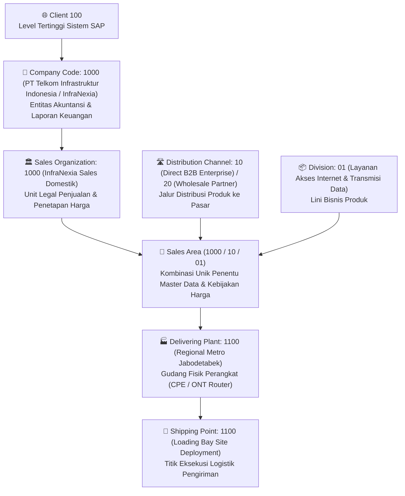
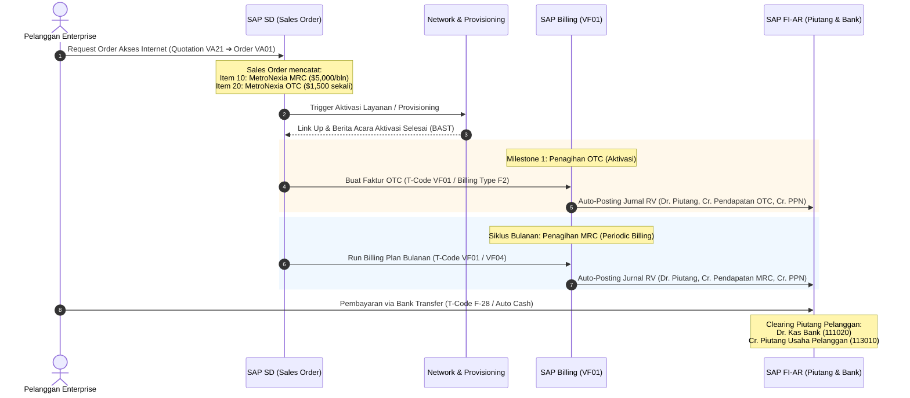

# Modul 07: SAP SD (Sales and Distribution) & Order-to-Cash (O2C) di Industri Telco (InfraNexia / MetroNexia)

> **Tujuan Pembelajaran:**
> 1. Menguasai struktur organisasi **SAP SD (Sales and Distribution)**: Sales Organization (`VKORG`), Distribution Channel (`VTWEG`), Division (`SPART`), dan Sales Area.
> 2. Memahami master data pelanggan via **Business Partner (BP)** dengan role SD (`FLCU00` FI-AR & `FLCU01` Sales Data), Customer-Material Info Record (`VD51`), dan Condition Record (`VK11`).
> 3. Membedah siklus end-to-end **Order-to-Cash (O2C)** standar: Penawaran (`VA21`), Sales Order (`VA01`), Outbound Delivery (`VL01N`), Billing Document (`VF01`), dan Incoming Payment (`F-28`).
> 4. Menguasai arsitektur produk internet telco InfraNexia: **Material 1 Root MetroNexia**, **Material 2 MetroNexia MRC**, dan **Material 3 MetroNexia OTC**.
> 5. Memahami logika **Billing Plan** di SAP SD: *Periodic Billing* untuk MRC (Monthly Recurring Charge) dan *Milestone Billing* untuk OTC (One-Time Charge).
> 6. Menguasai skema penentuan harga (**Pricing Procedure**) berbasis Condition Technique (`PR00`, `MWST`, diskon).
> 7. Menguasai otomatisasi akuntansi pendapatan SD ke FI melalui **`VKOA` (Revenue Account Determination)** dan anatomi dokumen billing transfer (Doc. Type `RV`).

---

## 1. Fondasi Struktur Organisasi SAP SD (Sales Enterprise Structure)

Modul **SAP SD (Sales and Distribution)** bertanggung jawab mengelola seluruh aktivitas komersial penjualan barang dan jasa perusahaan kepada pelanggan eksternal (*Order-to-Cash*).



### 1.1 T-Code SPRO Pembentukan Struktur SD:
1. **Define Sales Organization (`OVX5` / `OX05`):** Unit legal yang bertanggung jawab atas penjualan, distribusi produk, kewajiban garansi, dan tuntutan hukum komersial.
2. **Define Distribution Channel (`OVX1` / `OVXI`):** Saluran bagaimana barang/jasa sampai ke pelanggan (misal: `10` Penjualan Korporasi Langsung / B2B, `20` Partner Reseller / Wholesale).
3. **Define Division (`OVXB`):** Pengelompokan produk atau layanan (misal: `01` Internet Connectivity, `02` Leased Core Fiber, `03` Managed Cloud).
4. **Set Up Sales Area (`OVXG`):** Kombinasi tiga serangkai `Sales Org` + `Dist. Channel` + `Division`. Satu pelanggan atau material hanya dapat ditransaksikan pada Sales Area yang telah diaktifkan.
5. **Assign Sales Organization to Company Code (`OVX3`):** Menghubungkan unit penjualan ke entitas akuntansi pembukuan FI.
6. **Assign Sales Area to Plant (`OVX6`):** Menentukan Plant logistik mana yang berwenang memasok produk untuk Sales Area tersebut.

---

## 2. Master Data Pelanggan & Produk Penjualan SD

### 2.1 Business Partner Customer (`BP` / ECC: `XD01`)
Di SAP S/4HANA, pelanggan dikelola melalui transaksi **`BP`** dengan dua peran (*roles*) utama untuk penjualan:
1. **Role `FLCU00` (FI Customer):** Mengelola data keuangan tingkat Company Code, termasuk **Reconciliation Account** piutang usaha (contoh akun `113010` Piutang Usaha Pihak Ketiga) dan Terms of Payment (`Z030` - Net 30 hari).
2. **Role `FLCU01` (Sales Customer):** Mengelola data operasional tingkat Sales Area, termasuk **Currency** (IDR / USD), **Pricing Procedure**, **Customer Account Assignment Group** (`KTGRD` penentu `VKOA`), Delivery Priority, dan Partner Functions.

#### 4 Partner Functions Wajib Pelanggan di SAP SD:
- **`SP` (Sold-to Party):** Pihak yang menandatangani kontrak atau menerbitkan Purchase Order pembelian layanan.
- **`BP` (Bill-to Party):** Pihak penerima dokumen tagihan faktur (*Billing Document*).
- **`PY` (Payer):** Pihak yang bertanggung jawab melunasi pembayaran uang tagihan ke rekening bank InfraNexia.
- **`SH` (Ship-to Party):** Lokasi fisik titik terminasi di mana layanan internet atau perangkat CPE/ONT dipasang dan diaktivasi.

---

### 2.2 Arsitektur Material Produk Telco: Root, MRC, dan OTC

Dalam penawaran produk internet **MetroNexia** oleh InfraNexia, terdapat kebutuhan komersial untuk membedakan biaya berulang (*Monthly Recurring Charge*) dan biaya aktivasi satu kali (*One-Time Charge*):

```text
MATERIAL 1 — MetroNexia (ID: PROD-MN-ROOT)
├── MATERIAL 2 — MetroNexia MRC (ID: MAT-MN-MRC) ➔ Tagihan Berulang Bulanan
└── MATERIAL 3 — MetroNexia OTC (ID: MAT-MN-OTC) ➔ Biaya Aktivasi / Instalasi Awal
```

#### Peran Teknis Masing-Masing Material di SAP:
| Material | Tipe Material SAP | Item Category Group | Penjelasan Fungsi | Perlakuan Akuntansi & Billing |
| :--- | :---: | :---: | :--- | :--- |
| **Material 1 — MetroNexia** | `KMAT` (Configurable) / `DIEN` | `ERLA` (Structure at header) | **Root Product Family / Grouping Header.** Merepresentasikan portofolio internet MetroNexia secara utuh; bukan item penagihan mandiri. | Non-valuated pada baris header; tidak memicu piutang langsung kecuali dijadikan *pricing at header level*. |
| **Material 2 — MetroNexia MRC** | `DIEN` (Service) | `BANS` / `DIEN` | **Monthly Recurring Charge.** Layanan bandwidth internet aktif bulanan (misal: 1 Gbps Dedicated Backbone Access). | Ditagihkan secara berkala (*Periodic Billing Plan*); memicu pengakuan pendapatan berulang per bulan. |
| **Material 3 — MetroNexia OTC** | `DIEN` (Service) | `DIEN` / `BANC` | **One-Time Charge.** Biaya non-recurring: instalasi fisik kabel drop, patching ODF, konfigurasi port BGP, dan aktivasi link. | Ditagihkan satu kali (*Milestone Billing Plan* atau *Standard Delivery*); diakui saat serah terima aktivasi link selesai. |

> **⚠️ Aturan Emas Konsultan SAP:**
> Penamaan string `"MetroNexia"` pada teks material tidak secara otomatis menciptakan hubungan hierarki parent-child di database SAP. Di SAP SD, keterkaitan antara Header Material dan Sub-Items harus dibentuk melalui **Sales BOM (Bill of Materials `CS01`)**, **Product Hierarchy (Tabel `T179`)**, **Material Group (`MATKL`)**, atau konfigurasi bundling pada **SAP Subscription Order Management (SOM)**.

---

## 3. Siklus Lengkap Order-to-Cash (O2C) di Industri Telco



---

## 4. Logika Billing Plan: Periodic Billing (MRC) vs Milestone Billing (OTC)

Untuk model bisnis berbasis langganan dan instalasi proyek seperti telco, SAP SD menyediakan fitur **Billing Plan (`VBKD-FPLNR`)** di dalam Sales Order:

### 4.1 Periodic Billing Plan (Billing Plan Type `02`) — untuk MRC:
- **Konsep:** Sistem secara otomatis memecah horizon kontrak (misal: 12 bulan atau 24 bulan) menjadi tanggal-tanggal penagihan berkala (*billing dates*).
- **Aturan Periode:** Setiap tanggal 01 awal bulan atau akhir bulan, job background (`VF04` / `VF06` Billing Due List) akan memproses penagihan otomatis untuk periode berjalan.
- **Proration (Prorata):** Jika link pelanggan aktif pada tanggal 15 November, sistem SD secara proporsional menghitung nilai tagihan bulan pertama = $(30 - 15 + 1) / 30 \times \text{Nilai MRC}$.

### 4.2 Milestone Billing Plan (Billing Plan Type `01`) — untuk OTC:
- **Konsep:** Tanggal penagihan dikaitkan dengan penyelesaian tahapan (*Milestones*) pekerjaan fisik atau administratif.
- **Contoh Milestone Aktivasi Telco:**
  - Milestone 1: Uang Muka Registrasi (20% saat order disetujui).
  - Milestone 2: Penyelesaian Penarikan Kabel & Patching ODF (50%).
  - Milestone 3: Final Acceptance Test / Link Commissioning UAT (30% saat link siap beroperasi komersial).

---

## 5. Skema Penentuan Harga (Pricing Procedure) & Condition Technique

Di SAP SD, harga akhir yang tertera pada Sales Order dan Faktur dihitung menggunakan **Condition Technique**:

$$\text{Net Price} = \text{Base Price (PR00)} - \text{Discount (K007/RA00)} + \text{Surcharge (KF00)} + \text{PPN Keluaran (MWST)}$$

```text
┌─────────────────────────────────────────────────────────────────────────────┐
│                    PRICING PROCEDURE DI SAP SD (Contoh: ZTEL01)            │
├─────┬──────────┬─────────────────────────────┬───────────┬────────┬─────────┤
│Step │Cond Type │ Deskripsi                   │ From-To   │ Stat   │ Acct Key│
├─────┼──────────┼─────────────────────────────┼───────────┼────────┼─────────┤
│ 10  │ PR00     │ Base Price Layanan          │           │        │ ERL     │
│ 20  │ K007     │ Customer Discount (%)       │ From: 10  │        │ ERS     │
│ 30  │ SUBTOTAL │ Harga Bersih Komersial      │ 10 - 20   │ Subtot │         │
│ 40  │ MWST     │ PPN Keluaran (11%)          │ From: 30  │        │ MWS     │
│ 50  │ TOTAL    │ Total Nilai Tagihan Faktur  │ 30 + 40   │ Total  │         │
└─────┴──────────┴─────────────────────────────┴───────────┴────────┴─────────┘
```

- **`PR00` (Price):** Nilai dasar tarif MRC atau biaya OTC yang dipelihara di transaksi **`VK11`** berdasarkan kombinasi Sales Org, Distribution Channel, dan Material.
- **`MWST` (Tax):** Perhitungan Pajak Pertambahan Nilai (PPN) keluaran otomatis berdasarkan Tax Code pelanggan dan material (misal tarif 11%).
- **Account Key (`ERL`, `ERS`, `MWS`):** Kunci instruksi yang menghubungkan baris harga dengan baris debit/kredit di akuntansi keuangan melalui konfigurasi **`VKOA`**.

---

## 6. Otomatisasi Akuntansi Pendapatan SD-FI via `VKOA`

Ketika petugas penagihan membuat faktur penjualan di **`VF01`** (*Billing Document* nomor `9000000001`), SAP secara otomatis memposting dokumen jurnal akuntansi (Document Type: **`RV`**) tanpa intervensi manual.

Otomatisasi ini diatur melalui **T-Code SPRO: `VKOA` (Revenue Account Determination)**:

### 6.1 Parameter Kunci Pencarian Akun `VKOA`:
1. **Application:** Selalu `V` (Sales & Distribution).
2. **Chart of Accounts:** `CAID` (Chart of Accounts InfraNexia).
3. **Sales Organization:** `1000` (InfraNexia Domestik).
4. **Customer Account Assignment Group (`KTGRD`):** Membedakan pelanggan domestik (`01`), afiliasi (`02`), atau pemerintah (`03`).
5. **Material Account Assignment Group (`KTGRM`):** Membedakan jenis pendapatan material:
   - `01` — Pendapatan Berulang Internet (MRC).
   - `02` — Pendapatan Jasa Instalasi & Aktivasi (OTC).
   - `03` — Pendapatan Sewa Perangkat / Dark Fiber.
6. **Account Key:**
   - **`ERL`** (*Revenue*) $\rightarrow$ Akun Buku Besar Pendapatan Bersih (`410010` / `410020`).
   - **`ERS`** (*Sales Deductions*) $\rightarrow$ Akun Buku Besar Potongan / Diskon Penjualan (`410090`).
   - **`MWS`** (*Sales Tax*) $\rightarrow$ Akun Buku Besar Hutang Pajak PPN Keluaran (`215010`).

### 6.2 Jurnal Akuntansi yang Terbentuk Otomatis (Doc. Type `RV`):

```text
[Faktur Tagihan Bulanan MetroNexia MRC $5,000 + PPN 11% = $5,550]

(Debit)  [PK 01] Pelanggan Enterprise (Reconciliation G/L 113010) : $5,550.00
(Kredit) [PK 50] Pendapatan Akses Internet MRC (G/L 410010 - ERL) : $5,000.00
(Kredit) [PK 50] Hutang Pajak PPN Keluaran (G/L 215010 - MWS)    :   $550.00
```

---

## 7. Kamus Tabel Database Inti SAP SD (`SE16N`)

Berikut adalah daftar tabel database penting yang menyimpan data transaksi siklus penjualan:

| Nama Tabel | Deskripsi Tabel Database | Primary Key Kritis | Hubungan Data (*Relationship*) |
| :--- | :--- | :--- | :--- |
| **`VBAK`** | Sales Order Header Data | `VBELN` (Nomor Sales Document) | Menyimpan nomor SO, Customer (`KUNNR`), tipe order (`AUART`), dan tanggal dokumen. |
| **`VBAP`** | Sales Order Item Data | `VBELN`, `POSNR` (Nomor Baris Item) | Menyimpan kode material (`MATNR`), kuantitas, plant pemenuhan (`WERKS`), dan status item. |
| **`VBKD`** | Sales Document Business Data | `VBELN`, `POSNR` | Menyimpan syarat pembayaran, IncoTerms, dan nomor pointer **Billing Plan** (`FPLNR`). |
| **`FPLA`** | Billing Plan Header Data | `FPLNR` (Nomor Billing Plan) | Menyimpan jenis billing plan (Periodic `02` / Milestone `01`), tanggal mulai, dan durasi kontrak. |
| **`FPLT`** | Billing Plan Dates / Items | `FPLNR`, `FPLTR` | Menyimpan rincian jadwal tanggal penagihan bulanan MRC atau persentase milestone OTC. |
| **`LIKP`** | Outbound Delivery Header | `VBELN` (Nomor Delivery) | Menyimpan data pengiriman logistik perangkat keras atau CPE. |
| **`LIPS`** | Outbound Delivery Item | `VBELN`, `POSNR` | Menyimpan rincian material perangkat yang dikirim ke site pelanggan. |
| **`VBRK`** | Billing Document Header | `VBELN` (Nomor Faktur / Invoice) | Menyimpan nomor faktur penagihan, nomor pelanggan, dan nomor dokumen akuntansi FI (`KNUMV`). |
| **`VBRP`** | Billing Document Item | `VBELN`, `POSNR` | Rincian nilai penjualan per item yang ditagihkan ke pelanggan. |
| **`PRCD_ELEMENTS`** *(S/4HANA)*<br>`KONV` *(ECC)* | Pricing Conditions Record | `KNUMV`, `KPOSN`, `STUNR` | Nilai detail perhitungan harga kondisi (`PR00`, `MWST`, diskon) per baris dokumen. |

---

## 8. Ringkasan Integrasi: Keterkaitan SD dengan MM, PS, dan FI di InfraNexia

1. **Integrasi SD $\leftrightarrow$ MM:** Sales Order menarik master material yang didefinisikan tim MM via `MM01`. Jika terdapat pengiriman perangkat fisik (modem/router), delivery note SD memotong persediaan barang jadi di gudang MM via `VL02N` (Goods Issue 601).
2. **Integrasi SD $\leftrightarrow$ PS:** Pada proyek pelanggan (*Customer Project*), Sales Order SD dapat dihubungkan langsung ke elemen WBS (`CJ20N`) bertipe **Billing Element** untuk mengumpulkan realisasi pendapatan proyek dan menghitung nilai kontrak.
3. **Integrasi SD $\leftrightarrow$ FI:** Faktur penjualan `VF01` secara real-time membentuk dokumen piutang pelanggan dan pendapatan di buku besar umum FI via skema otomatisasi `VKOA`. Pelunasan tagihan melalui transfer bank diselesaikan oleh tim Finance di `F-28`.
